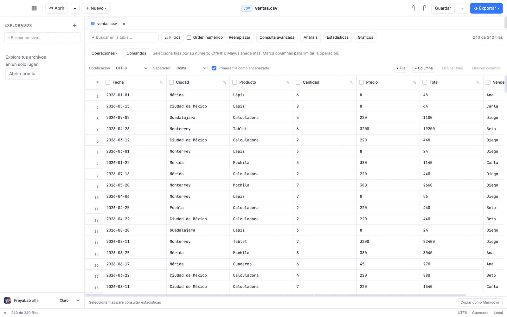
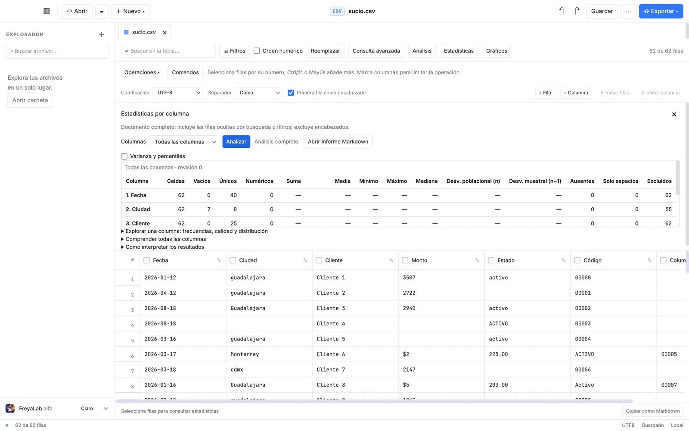
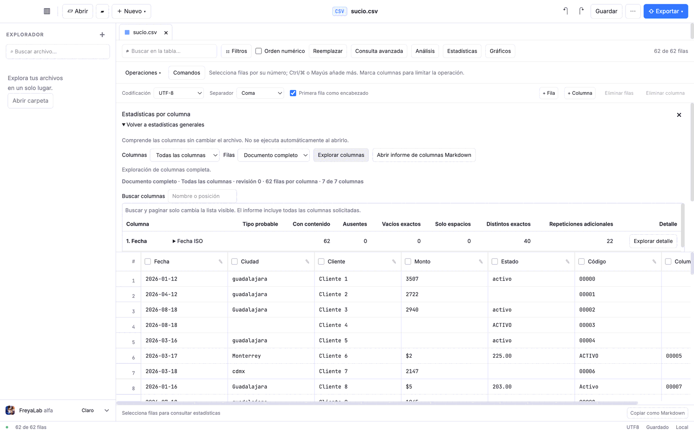
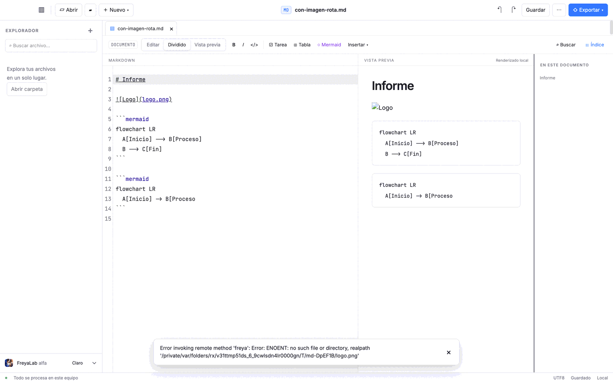
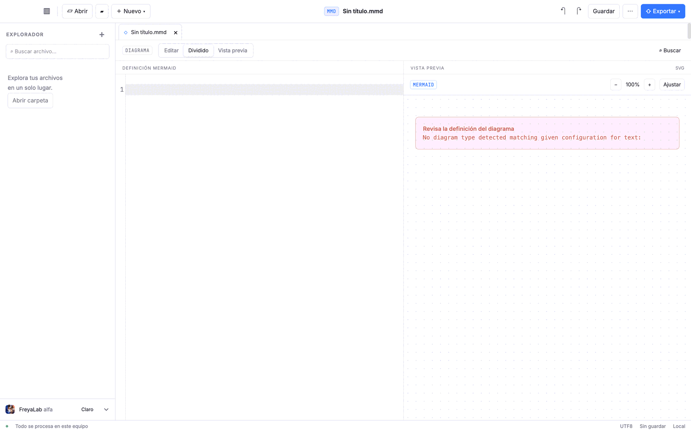
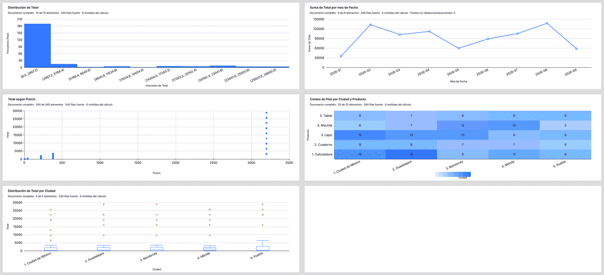
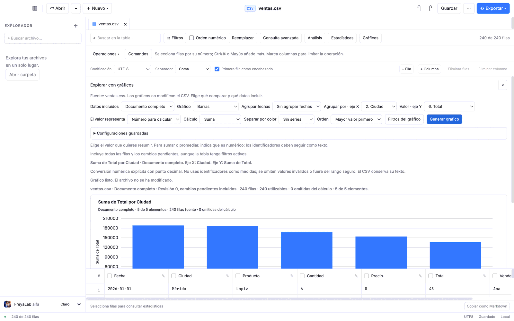
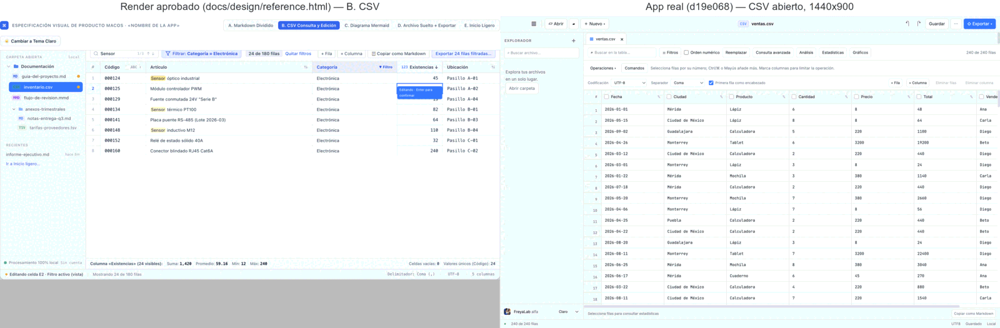

# Auditoría integral de UX/UI y mejora continua de FreyaLab

Fecha local: 23 de octubre de 2026. Rama: `codex/ux-ui-continuous-improvement`, sobre `main` `e62a535`. Aplicación auditada: `d19e068` (punta de `codex/descriptive-percentiles`, 15 commits por delante de `main`; ver §1.2 para saber por qué). Estado: **informe documental**. No cambia código de producto, dependencias, arquitectura, instalador ni la aplicación instalada.

Objetivo: saber qué tan buena es hoy la experiencia de FreyaLab para una persona que no conoce Markdown, SQL, CSV ni programación, sin sacrificar al usuario avanzado. Se usó la aplicación real (Electron + Playwright), no solo el código Svelte.

## Cómo leer las etiquetas de evidencia

| Etiqueta | Significa | Dónde está la prueba |
|---|---|---|
| **[R]** Reproducido | Se ejecutó en la interfaz real y el resultado se registró | Script de [`exploration/`](exploration/README.md) citado |
| **[V]** Visual | Se observó en una captura de la aplicación real | [Galería E01–E28](#10-evidencia-visual) |
| **[C]** Código | Inferido de leer el código, sin ejecución dedicada | Archivo citado |
| **[H]** Hipótesis | Juicio de usabilidad que necesita personas reales para confirmarse | Plan de §14.3 |
| **[P]** Pendiente | No se pudo comprobar desde la interfaz | Anexo B |

Quien audita es un experto, no un principiante. Toda frase sobre cómo "entendería" una persona sin formación es **[H]**. Ninguna parte de este informe afirma que la interfaz sea intuitiva: no hay un estudio con personas que lo respalde.

## Resumen

FreyaLab tiene un cimiento técnico y de integridad sólido y una experiencia que ha crecido más rápido que su navegación.

- **Lo que está bien [R]:** guardar cambia solo la línea editada (3 de 3 variantes: filas irregulares, BOM+CRLF+punto y coma, campos multilínea); las limpiezas muestran una vista previa con recuento antes de aplicar y se deshacen en un paso; los límites se dicen en pantalla («Muestra limitada: hasta 200 registros…»); los gráficos declaran alcance, filas y «El archivo no se ha modificado». `check` sin errores, 192 pruebas unitarias y 108 E2E pasan en esta máquina.
- **Lo que más pesa [R/V]:** (1) nueve PR figuran como fusionados pero ninguno está en `main`; (2) la tabla CSV tiene de cuatro a cinco franjas de controles (214 px antes de la primera fila, 24 % de una ventana de 900 px, frente a **una** fila en el render aprobado); (3) el gráfico más básico, «Total por ciudad», exige 7 interacciones (≈10 clics) y, tras generarlo, queda recortado en 1280×800 y 1440×900; (4) un diagrama Mermaid nuevo se abre vacío con un error técnico en inglés y sin plantillas; (5) una sola imagen local ausente impide dibujar **todos** los diagramas del documento y bloquea exportar a HTML/PDF.
- **Qué hacer primero:** integrar la pila en `main` (§13, UX-01) y una primera iteración de cinco arreglos pequeños, cada uno con su prueba E2E (§15 y §17). Después, un panel de análisis acoplado a un lado y gráficos sugeridos (§16), validados con estudiantes y profesionales antes de ampliar funciones.

| Dimensión | Juicio actual | Base |
|---|---|---|
| Integridad y honestidad de los datos | Fuerte | [R] ida y vuelta 3/3, vista previa y deshacer, límites visibles |
| Primera impresión e identidad visual | Buena; coherente en claro y oscuro | [V] E01, E13, E14 |
| Edición de celdas y estructura | Correcta; fricciones de teclado | [R] UX-09 |
| Limpieza de datos | Potente pero difícil de encontrar | [R] UX-11, §3.5 flujo B |
| Estadísticas y comprensión de columnas | Completas; vocabulario técnico; lista recortada | [R/V] UX-13 |
| Gráficos | Seis tipos correctos y exportables; muchos pasos; resultado parcialmente oculto | [R/V] UX-03, UX-06 |
| Markdown | Base sólida; inserción asistida corta; un fallo en cascada | [R] UX-02, UX-15 |
| Mermaid | Render y exportación correctos; creación sin ayuda | [R] UX-10 |
| Accesibilidad | Buena estructura; contraste, tamaños y foco por mejorar; lector de pantalla sin verificar | [R/P] UX-20 |
| Densidad y adaptación a la ventana | Sobrecargada; pierde filas por debajo de 1366×768 | [R] §3.4 |
| Proceso de entrega | **P0**: trabajo entregado fuera de `main` | git/gh, §1.2 |

---

## 1. Estado real de FreyaLab

### 1.1 Repositorio, ramas y aplicación instalada

| Elemento | Estado |
|---|---|
| `origin/main` | `e62a535`, fusión del PR #29 (2026-10-23 04:55 UTC). CI del commit: éxito |
| PR abiertos | Ninguno |
| Cerrados sin fusionar | #3 (transferencia temporal) y #6 (auditoría histórica; su corrección entró por #7 y #11) |
| Checkout de trabajo | `codex/descriptive-percentiles` en `d19e068`, limpio. Su rama local `main` apunta a `1ef4665` (PR #5), 63 commits detrás de origen: es solo un puntero viejo |
| Prerelease publicada | `v0.1.0-alpha.1`, código `7851ee2`. No incluye nada posterior a #2 |
| App instalada en el Mac | `/Applications/FreyaLab.app` versión `0.1.0-dev.20261022.6208e6b`: compilación de desarrollo de la pila (`6208e6b` está en la historia de `d19e068`). **No** es la prerelease ni `main`. No se ejecutó ni se actualizó |
| Worktrees ajenos | `/private/tmp/freyalab-*` (otras sesiones). No se tocaron |

### 1.2 Hallazgo estructural: nueve PR «fusionados» que no están en `main`

Cada PR de la cadena DW-02b → DW-04c se abrió contra la rama del anterior. Tras fusionar #29 en `main`, las ramas base no se eliminaron ni se redirigieron, así que #30 a #38 se fusionaron en ramas intermedias (causa probable **[C]**, por bases y marcas de tiempo).

| PR | Contenido | Base real | ¿En `main`? | ¿En `d19e068`? |
|---|---|---|---|---|
| #30 | DW-02b agrupar fechas | `codex/chart-category-series` | No | Sí |
| #31 | DW-02c filtros propios del gráfico | `codex/chart-time-groups` | No | Sí |
| #32 | DW-03a configuraciones guardadas | `codex/chart-local-filters` | No | Sí |
| #33 | DW-03b exportar resultados | `codex/chart-presets` | No | Sí |
| #34 | Sondeo de extractos (`docs/ANALYSIS-DATASETS.md`, experimento) | `codex/chart-result-exports` | No | **No** (solo en `39714c0`) |
| #35 | DW-04a tipo probable de columna | `codex/chart-result-exports` | No | Sí |
| #36 | Corrección de foco al desplazar | `codex/column-profile-types` | No | Sí |
| #37 | DW-04b comprender todas las columnas | `codex/focus-restoration` | No | Sí |
| #38 | DW-04c varianza y percentiles | `codex/column-overview` | No | Sí (es la punta) |

Consecuencias: `main` no entrega DW-02b a DW-04c aunque GitHub muestre «Merged»; hay **dos** cabezas con trabajo huérfano (`d19e068` y `39714c0`, 20 commits en total por delante de `main`); y la app instalada se compiló sobre código no integrado. La documentación de la pila es honesta («CI e integración pendientes»), pero la insignia «Merged» induce a error. El commit `d19e068` tiene CI en verde (ejecución 39888633870) y `996f911`, cabeza de #34, también (ejecución 39906108301).

### 1.3 Qué existe y dónde (no confundir implementado con pendiente de fusionar)

| Bloque | En `main` | Solo en la pila | Pendiente (sin código) |
|---|---|---|---|
| Alfa: archivos, pestañas, guardado seguro, recuperación, Markdown, Mermaid, CSV hasta 50 MiB, exportaciones | Sí (publicada en `v0.1.0-alpha.1`) | | |
| Menús, vista previa de reemplazos, paleta de comandos, menús de filas/columnas, rangos, consulta avanzada, SQL/asistentes, estadísticas por columna | Sí (#5 a #26) | | |
| DW-01 ejes, medidas y alcance; DW-02a series por categoría | Sí (#28, #29) | | |
| DW-02b fechas, DW-02c filtros propios, DW-03 configuraciones y resultados, DW-04 tipos, panorámica y percentiles | | Sí (#30 a #38) | Moda (DW-04) |
| Sondeo de extractos y bases congeladas (#34) | | Solo en `39714c0` | |
| DW-05 sugerencias, DW-06 a DW-10 | | | Sí |

Los componentes de la carcasa y de los editores (`App.svelte`, `Preview.svelte`, `Diagram.svelte`, `Editor.svelte`) son **idénticos** en `main` y en `d19e068`, y `CsvTable.svelte` difiere en 2 líneas. Por eso todo lo dicho de la ventana, la tabla, Markdown y Mermaid vale para `main`. Lo que dependa de la pila se marca «pila».

### 1.4 Comprobaciones ejecutadas en esta auditoría

En un worktree aislado de `d19e068` (el checkout del usuario no se tocó), macOS Apple silicon:

| Comprobación | Resultado |
|---|---|
| `npm run check` | 889 archivos, 0 errores, 0 advertencias |
| `npm test` | 20 archivos, 192 pruebas aprobadas (5,2 s) |
| `npm run test:e2e` (incluye `build`) | 108 aprobadas, sin reintentos (4,2 min) |

Entorno: Node v26.11.1 (el repo declara `engines >= 24` y `.nvmrc` indica 24; la CI usa 24). Estas ejecuciones **no** prueban el paquete instalable ni otras plataformas. La alfa y la pila tampoco tienen aprobación visual manual en Windows/Linux **[P]**.

### 1.5 Contexto recuperado y qué no se repitió

Se leyó `OBJECTIVE.md`, `PLAN.md`, `PROGRESS.md`, `WORKSPACE-EVOLUTION.md`, `ARCHITECTURE.md`, `EDITOR-UX-AUDIT.md` (20 de octubre), `OPEN-SOURCE-ECOSYSTEM.md`, `CSV-REFERENCE-APPS.md`, `CSV-ADVANCED-ROADMAP.md` y `ANALYSIS-DATASETS.md` (rama de #34). No se repitió la investigación de mantenimiento de bibliotecas ni la auditoría de integridad previa.

**Grafo:** FreyaLab no tiene un grafo de Graphify (no hay `graphify-out` en el repo, en sus ramas ni en el equipo). Se usó `docs/ARCHITECTURE.md` y lectura directa de los pocos componentes implicados (16 archivos Svelte: la carcasa y 15 componentes, 1 129 líneas).

Estado de los hallazgos de la auditoría anterior (base `1ef4665`), con lo observado hoy:

| ID previo | Hoy |
|---|---|
| F01 exportar columnas con «Documento completo» | Corregido; la E2E «exportación CSV: completo y filtrado conservan columnas» pasa |
| F02 pegado en vista filtrada | Corregido; la E2E «pegar sigue filtros y orden» pasa |
| F03 historial por pestaña | No re-verificado **[P]** |
| F05 imágenes relativas tras Guardar como o recuperar | No re-verificado **[P]**; relacionado con UX-02 |
| F06 Mermaid conserva el último dibujo válido al fallar | **Sigue abierto [R]**: con un error, la vista previa queda vacía (`Diagram.svelte` pone `svg=''`) |
| F07 limpieza sin vista previa | Resuelto [R]: vista previa con recuento y ejemplos |
| F09 teclado y semántica de la cuadrícula | Mejorado [R] (flechas, rangos, F2); siguen cuatro fallos (UX-09, UX-20) |

---

## 2. Funcionalidades verificadas

«Verificado» significa: ejecutado por la interfaz real con resultado registrado. «Visto» significa que el panel se abrió pero no se ejercitó cada control.

| Capacidad | Versión | Estado | Cómo |
|---|---|---|---|
| Abrir CSV al arrancar, ver, editar celda con doble clic, guardar con ⌘S | `main` | **Verificado** | `04-flowA`: solo cambió la línea editada (10 943 → 10 945 bytes) |
| Ida y vuelta de filas irregulares, BOM, CRLF, `;`, comillas dobles y multilínea | `main` | **Verificado** | `31-roundtrip`: BOM y CRLF conservados; 1 línea distinta de 63, 4 y 5 |
| Deshacer/rehacer, incluso tras guardar | `main` | **Verificado** (con fallo de foco, UX-09) | `04-flowA`, `25-keys` |
| Navegación con flechas, Enter, F2, Tab; rango con Mayús; ⌘K; ⌘F | `main` | **Verificado** | `05-edit`, `25-keys` |
| Menús contextuales de celda, fila y columna | `main` | **Verificado** | `05-edit`, `36-menus` |
| Operaciones de limpieza con vista previa, aplicar y deshacer | `main` | **Verificado** | `11-flowB2`: 37 de 62 celdas cambiaron; deshacer restauró los valores (se comprobaron los 12 primeros) y el indicador de cambios volvió a 0 |
| Buscar, filtros por encabezado, orden por encabezado, «Orden numérico» | `main` | **Verificado** (UX-08, UX-24) | `25-keys`, `26-sort` |
| Consulta avanzada (filtros Y/O, orden múltiple) | `main` | Visto | `32-query`: panel y controles |
| Transformar documento (dividir, combinar, eliminar duplicadas, NFC, encabezados, mover filas y columnas, fijar orden) | `main` | Visto | `10-transform`, `36-menus`: lista de operaciones; no se aplicó ninguna |
| Estadísticas por columna y «Analizar» | `main` | **Verificado** | `07-stats2`: 0,63 s con 62 filas |
| Comprender todas las columnas | pila | **Verificado** | `08-overview`: 0,85 s con 62 filas |
| Varianza y percentiles | pila | Visto (casilla) y E2E | `descriptive-percentiles.spec.ts` pasa |
| Análisis SQL con DuckDB: consulta por defecto y asistentes | `main` | **Verificado** | `35-sql`: 1,56 s para `SELECT * FROM datos` con 240 filas |
| Gráficos: seis tipos con configuración válida | `main` y pila | **Verificado** | `16-six`: los seis dibujan (E15) |
| Series por categoría («Separar por color») | `main` | Visto | Control presente; no se ejercitó |
| Agrupar fechas por mes | pila | **Verificado** | `16-six`: «Suma de Total por mes de Fecha», 9 de 9 periodos |
| Filtros propios del gráfico y configuraciones guardadas | pila | Visto | `17-flowD3`: panel y controles; no se aplicó un filtro |
| Exportar gráfico a PNG y SVG | `main` | **Verificado** | `17-flowD3`: 97 269 y 96 972 bytes; el PNG conserva título, alcance y recuentos (E28) |
| Exportar resultados del análisis (JSON, CSV + contexto, Markdown) | pila | Visto | Menú y texto de alcance |
| Archivo de más de 50 MiB: muestra de solo lectura | `main` | **Verificado** | `29-big`: 57 MiB → 200 filas, «Solo lectura», abre en 1,1 s |
| Markdown: edición, vista dividida, tabla, tareas, fórmula KaTeX, código | `main` | **Verificado** | `20-md-preview`, `19-md-insert` |
| Markdown: Mermaid embebido | `main` | **Verificado** (falla con imagen ausente, UX-02) | `21-md-image` |
| Markdown: imagen local ausente | `main` | **Defecto reproducido** | `21-md-image` |
| Markdown: exportar HTML | `main` | **Verificado** sin imágenes rotas | `21-md-image`: `sin-imagen.html` |
| Mermaid: documento propio, zoom, exportar SVG, PNG y PDF | `main` | **Verificado** | `23-flowF2`: 107 094, 42 018 y 7 121 bytes |
| Carpeta, árbol y búsqueda de archivos | `main` | Visto | `30-analysis`: árbol con 4 archivos |
| Claro y oscuro | `main` | **Verificado** en tabla, gráficos y bienvenida | E01, E13, E14 |
| Abrir, Guardar como y exportar mediante diálogos nativos | `main` | **No verificado [P]** | Playwright no maneja diálogos nativos |
| Arrastrar archivos desde el Finder | `main` | **No verificado [P]** | |
| Recuperación tras caída, conflicto externo | `main` | Solo E2E del repo | No se repitió a mano |
| Lector de pantalla | — | **No verificado [P]** | |

---

## 3. Evaluación UX/UI general

### 3.1 Primera impresión y navegación

La bienvenida cumple (E01): título claro, tres acciones, zona de arrastre, «Se abren y procesan en este equipo». Observaciones **[V]**:

- Hay **cuatro** entradas a «Abrir carpeta» (botón `▰` de la barra, `＋` del explorador, botón del explorador y tarjeta central) y dos a «Abrir archivo». `Exportar` aparece resaltado en azul pero deshabilitado cuando no hay documento.
- Los iconos de la barra son caracteres Unicode (`▥ ▰ ▱ ↶ ↷ ⋯`). `▰` y `▥` no sugieren «carpeta» ni «explorador», y `⋯` es **«Guardar como»** (solo lo dice su `aria-label` **[R]** `03-aria`). El render aprobado usa iconografía vectorial.
- Con un documento abierto la barra superior es corta y legible. El problema aparece debajo (§3.4 y UX-04).

### 3.2 Tres perfiles

Evaluación experta; la columna del principiante es **[H]**.

| Tarea | Principiante | Intermedio | Avanzado |
|---|---|---|---|
| Abrir un CSV y corregir un dato | Probable: doble clic y Enter; no «escribir encima» (UX-09) | Echa de menos teclear sobre la celda y que Enter baje | Sin problema |
| Guardar y confiar | Estado «Editado», «Guardado» y toast claros **[V]** | Igual | Igual |
| Limpiar mayúsculas de una columna | Difícil: marcar la columna no habilita nada (UX-11) | Encuentra «Operaciones», pero debe seleccionar el rango | Usa la paleta ⌘K o `Transformar documento…` |
| Quitar duplicados | No se descubre: está en `Transformar documento… → Operación` (UX-12) | Igual | Lo encuentra por la paleta |
| Entender columnas y faltantes | Vocabulario técnico: «Vacíos exactos», «Ausentes», «Excluidos» (UX-13) | Aceptable con la ayuda | Completo |
| Ventas por ciudad en gráfico | Necesita entender «El valor representa», «Cálculo» y «Valor · eje Y» (UX-06) | Lo logra tras explorar | Lo logra |
| Consulta SQL | Fuera de alcance; los asistentes lo cubren | Asistentes | SQL directo |
| Crear un diagrama | Imposible sin sintaxis (UX-10) | Igual | Escribe Mermaid |

**Divulgación progresiva.** Hay buenos ejemplos: ayuda breve junto a los controles, «Cómo interpretar los resultados» plegable, paleta de comandos, SQL bajo petición. Pero la capa «esencial» no existe: las 17 acciones de la tabla, los paneles y los ajustes de formato (Codificación, Separador, Primera fila) están siempre a la vista, y «Análisis» abre un editor SQL antes que sus asistentes (UX-12).

### 3.3 Heurísticas

| Heurística | Hallazgos |
|---|---|
| Visibilidad del estado | Muy buena en guardado y alcance. Falta confirmación al aplicar limpiezas y al exportar gráficos (UX-21, UX-28); mensajes de «datos actualizados» aparecen al abrir un panel por primera vez (UX-13) |
| Lenguaje del usuario | Mezcla. Bien: «Documento completo», «Vista filtrada». Mal: «revisión 0», «Distintos exactos», «El valor representa», «RE2», «Hyndman–Fan tipo 7», errores de Mermaid en inglés |
| Control y libertad | Muy buena: vista previa, un paso de deshacer, «Quitar filtros y orden». Mejorable: el menú `Operaciones` no se cierra con Escape (UX-17) |
| Consistencia | Cuatro formas de abrir paneles (botones, `details`, menú contextual, paleta); dos «agrupar» (asistente SQL y constructor de gráficos) sin conexión |
| Prevención de errores | Muy buena en integridad. Falta avisar de filas irregulares (UX-14) y de orden de números como texto (UX-08) |
| Reconocer antes que recordar | Débil: atajos solo en `title`; sin guía de atajos; icono `⋯` sin etiqueta |
| Flexibilidad | Buena: paleta, atajos, SQL, exportaciones |
| Diseño estético y minimalista | Identidad sólida; densidad alta (UX-04) |
| Recuperación de errores | Desigual: mensajes técnicos con ruta absoluta (UX-02) |
| Ayuda | Texto contextual abundante pero largo; sin tutorial ni ejemplos de arranque |

### 3.4 Espacio, resoluciones, ventanas y temas

La ventana tiene mínimo de 900×600 **[R]** `24-menu`. Medido con un CSV abierto y ningún panel (`27-responsive`):

| Ventana | Altura antes de la 1.ª fila | % de la altura | Filas visibles |
|---|---|---|---|
| 2560×1440 y 1920×1080 (alto útil 949) | 214 px | 23 % | 19 |
| 1440×900 | 214 px | 24 % | 18 |
| 1366×768 | 214 px | 28 % | 14 |
| 1280×800 | 214 px | 27 % | 15 |
| 1280×720 | 214 px | 30 % | 12 |
| 1024×768 | 281 px | 37 % | 12 |
| 900×600 | 304 px | 51 % | 6 |

No hay desborde horizontal de página en ningún tamaño. Con un panel abierto la situación empeora **[R]** `34-overlap` (E18): en 900×600 con `Estadísticas` abierto la tabla queda en 20 px; con `Análisis` o `Gráficos` queda en **0 px** y los botones `Estadísticas` (49×20 px) y `Gráficos` (19×20 px) se solapan con `Comandos`, y el texto de ayuda con la fila `Codificación` **[V]**. Sin panel, 900×600 se ve limpio y sin solapes (E17). El explorador ocupa 240 px por defecto (27 % a 900 px).

**Claro y oscuro.** Ambos son coherentes y legibles (E13 y E14); el oscuro supera mejor el contraste (§3.6). En el dibujo del gráfico hay un píxel blanco en la esquina de cruce de dos barras de desplazamiento en oscuro **[V]** E14.

### 3.5 Flujos reales A–F

Clics = pulsaciones de ratón aproximadas; un `select` cuenta como 2. Todo con CSV sintéticos (`gen-data.mjs`).

| Flujo | Pasos y clics | Errores y dificultades | Poco evidente | Falta | Resultado | Evidencia |
|---|---|---|---|---|---|---|
| **A. CSV básico** `04-flowA` | Doble clic, teclear, Enter, ⌘S o Guardar: ≈ 2 clics + teclado. Reabrir: «Recientes» visible tras cerrar (no se pulsó); «Abrir» usa diálogo nativo **[P]** | Escribir con la celda seleccionada no hace nada. Tras Enter, la selección se pierde (foco en `body`): ↓ y ⌘Z no actúan hasta volver a hacer clic | Que hay que hacer doble clic o Enter; que «Guardar» sigue activo sin cambios | Teclear para sobrescribir; Enter que baja de fila | **Correcto**: solo cambió 1 línea; deshacer sigue funcionando tras guardar | E02 |
| **B. Limpieza** `10-transform`, `11-flowB2` | Mayúsculas en `Ciudad`: clic en 1.ª celda, desplazar, Mayús+clic en la última, clic derecho, opción, Aplicar = **5 clics + desplazamiento**; deshacer = 1 | Marcar la columna (casilla) **no** habilita `Convertir a mayúsculas`. `Ctrl/⌘+Mayús+↓` extiende solo una fila. `guadalajara ` con espacio final sigue distinto tras pasar a mayúsculas: hacen falta dos operaciones. Sin aviso al aplicar | `Eliminar filas duplicadas` está dentro de `Transformar documento… → Operación` | Limpiar una columna entera en 2 clics; quitar duplicados visible | **Correcto con esfuerzo**: vista previa («37 de 62 celdas cambiarán»), aplicar, deshacer (12 primeros valores comprobados) y rehacer | E07, E08 |
| **C. Análisis** `07-stats2`, `08-overview` | Estadísticas (1) + Analizar (1); Comprender todas las columnas (2: abrir, Explorar columnas). 0,6 y 0,9 s | Al abrir el panel dice «El alcance cambió. Pulsa Analizar para actualizar.» sin haber analizado nada. La vista conjunta muestra **una** fila a la vez en 1440×900 (UX-13). Las filas irregulares desplazan columnas y las estadísticas salen sobre datos movidos, sin aviso (UX-14) | Que la panorámica vive dentro de Estadísticas, dentro de un `details` | Resultados en tarjetas; resaltar vacíos en la tabla | **Parcial**: cifras correctas (vacíos, únicos, tipo probable), difícil de leer | E09, E10 |
| **D. Visualización** `13` a `17` | «Total por ciudad»: Gráficos, X, tipo de medida, cálculo, Y, Generar = **7 interacciones ≈ 10 clics**. Cambiar a Promedio y regenerar = 3. Filtro propio: ≥ 5 (no ejecutado). Exportar PNG/SVG = 2 por formato | X arranca en `Fecha` (240 valores distintos); lienzo vacío hasta Generar; el gráfico queda recortado (61 % visible en 1440×900, 33 % en 1280×800); los controles y el resultado no caben juntos; «Generar» sigue obligado tras cada cambio; sin aviso al exportar | Que `El valor representa` debe ir **antes** de `Cálculo`, y `Valor · eje Y` solo aparece tras elegir `Suma`; «Generar» aparece atenuado hasta elegir Y, con solo una pista general | Sugerencias; vista en vivo | **Correcto, con fricción**: gráfico y PNG exportado con título, alcance y recuentos | E11 a E16, E28 |
| **E. Markdown** `18`→`19`, `20`, `21` | Nuevo (2) + Encabezado (2) + Tabla (1) + Bloque de código (2) + Mermaid (1) = **8 clics** | Insertar un bloque con el cursor dentro de un bloque de código lo anida (UX-16). Una imagen ausente rompe diagramas y exportación (UX-02) | Que «Insertar ▾» guarda Encabezado, Lista, Cita, Enlace y Código | **Imagen**, aviso/callout, lista numerada, separador, plantillas | **Parcial**: sin escribir sintaxis solo se logra título, tabla, código, tarea y un diagrama de ejemplo | E21 a E23 |
| **F. Mermaid** `22`, `23` | Nuevo (2) → vacío con error. Teclear 6 líneas. Exportar = 2 por formato | Lienzo vacío con «No diagram type detected matching given configuration for text:». Sin plantillas ni menú; el único atajo está en Markdown. Un error de sintaxis vacía la vista previa | Que `◇ Mermaid` en un documento Markdown inserta un ejemplo de 3 nodos | Galería, asistente, mensajes en español | **Correcto para quien sabe la sintaxis**: SVG, PNG y PDF generados | E24, E25 |

### 3.6 Accesibilidad (medición automática aproximada **[R]** `28-a11y`; confirmar con una herramienta dedicada)

| Aspecto | Hallazgo |
|---|---|
| Estructura | Rol `grid`, `row`, `columnheader`, `gridcell` con `aria-label` («Fila 1, Cantidad»); sin controles visibles sin nombre; diálogos con `aria-modal`; paleta con instrucciones de teclado |
| Contraste (WCAG AA 4,5:1) | Tema claro: 51 nodos de texto por debajo. Botones primarios (blanco sobre azul) 4,02:1; «EXPLORADOR», «Explora tus archivos», «alfa» 3,96:1; etiqueta «CSV» 3,3:1. Oscuro: 8 nodos (primario 4,02:1, `✎` 3,29:1) |
| Tamaño de texto | 175 nodos a 11 px y 39 a 10 px en la vista CSV; solo 10 a 12 px |
| Tamaño de objetivos (WCAG 2.2, 24 px) | 21 controles menores: casillas de columna 13×13, `✎` 14,7×20,5, `＋` 28×22, el botón «FreyaLab alfa» 72×18,5, el separador del explorador 1 px de ancho |
| Teclado | Navegación de celdas, rangos, F2, Escape, paleta: correctos. Pero cada celda tiene `tabindex="0"` (Tab recorre celdas una a una en lugar de saltar la cuadrícula), el foco se pierde tras confirmar una edición (UX-09) y `Operaciones` no se cierra con Escape (UX-17) |
| Lector de pantalla | **No verificado [P]** |

### 3.7 Mensajes, carga y errores

- Bien **[V]**: «Gráfico listo. El archivo no se ha modificado.», «Exportado: ruta», «Muestra limitada…», «No hay filas que coincidan.», «Actualizando vista previa…».
- Mal **[R]**: `Error invoking remote method 'freya': Error: ENOENT: no such file or directory, realpath '/private/var/…/logo.png'` (UX-02); `No hay valores numéricos utilizables en las columnas elegidas` cuando el problema es usar una fecha sin agrupar (UX-07); errores de análisis de Mermaid en inglés (UX-10).
- Los avisos duran 3,5 s (información) y 7 s (error) **[C]**, se centran abajo y tapan la última fila de la tabla (E21).

### 3.8 Atajos

Existentes (según `App.svelte` **[C]**; ⌘S, ⌘K, ⌘F y ⌘Z se ejercitaron **[R]**): ⌘O abrir, ⇧⌘O carpeta, ⌘S guardar, ⇧⌘S guardar como, ⌘N nuevo Markdown, ⇧⌘N Mermaid, ⌥⌘N CSV, ⌘B explorador, ⌘W cerrar pestaña, ⌘K paleta, ⌘F buscar en tabla, ⇧⌘F reemplazar, ⇧⌘T transformar. No hay hoja de atajos ni menú de ayuda; los atajos se descubren solo por `title` o por la paleta. El menú nativo es el predeterminado de Electron: `Archivo` solo contiene «Cerrar ventana» y `Ver` incluye «Recargar» y «Herramientas de desarrollo» **[R]** `24-menu` (etiquetas en inglés en la ejecución de desarrollo, aquí traducidas; el paquete instalado **[P]**).

### 3.9 Diseño visual frente al render aprobado

Se renderizó `docs/design/reference.html` en ambos temas (`ref-shot.cjs`) y se comparó (E26, E27).

| Aspecto | Render aprobado | Aplicación real | Juicio |
|---|---|---|---|
| Tipografía, color, acento azul, malva de Mermaid, barra superior | Definidos | Conservados | **Fiel**; no tocar |
| Markdown dividido | Barra de formato, índice, vista previa, estado con línea/columna y palabras | Barra, índice y vista previa idénticos; el estado no muestra línea/columna ni palabras; busca con botón, no con campo | Fiel, con dos omisiones menores |
| Tabla CSV | **Una** fila de herramientas: búsqueda con contador «1/3 ↑↓», chip «Filtrar: Categoría = Electrónica», «24 de 180 filas · Quitar filtros», `+ Fila`, `+ Columna`, exportar filtradas; cabeceras con insignia de tipo (`ABC`, `123`), números alineados a la derecha, estadística de selección en pie | **Cuatro a cinco** franjas; sin contador de búsqueda ni chip de filtro; sin insignias; números a la izquierda; columnas fijas de 180 px | **Deriva por acumulación de funciones**: lo aprobado es más simple. Implementar lo ya aprobado no cambia la identidad |
| Explorador | Insignias `MD`, `CSV`, `MMD`, puntos de cambios, «Recientes», «Procesamiento 100 % local · Sin cuenta» | Iconos genéricos, sin puntos de cambios; pie con «FreyaLab alfa» y selector de tema | Parcial |
| Iconografía | Vectorial | Caracteres Unicode | Deriva |

Conclusión: la identidad visual es buena y debe conservarse. La mejora más segura es **acercar la tabla CSV al render aprobado**, no inventar un estilo nuevo.

---

## 4. Auditoría del editor CSV

Recorrido: Abrir → Editar → Limpiar → Filtrar → Analizar → Visualizar → Exportar.



### 4.1 Edición

| Capacidad | Estado | Observación |
|---|---|---|
| Selección de celdas y rangos | Funciona [R] | Clic, Mayús+clic, arrastre, Mayús+flechas; resumen «Rango: filas 1–62, columnas 2–2 · 62 celdas». `Ctrl/⌘+Mayús+↓` avanza **una** fila; `Mayús+AvPág` 20; `Mayús+Fin` hasta la última columna. No hay «hasta el final» ni «seleccionar columna» desde la cabecera |
| Edición individual | Funciona [R] | Doble clic, Enter o F2. **Teclear sobre una celda seleccionada no edita.** Tras confirmar con Enter se pierde la selección y el foco queda en `body` (UX-09) |
| Edición masiva | Funciona [R] | Rellenar, vaciar, reemplazar, mayúsculas, minúsculas y quitar espacios del rango, todos con `…` (vista previa) |
| Insertar y eliminar filas | Funciona [R] | Menú de la **cabecera de fila**: Insertar arriba/abajo, Duplicar, Eliminar. El menú de celda no ofrece insertar ni eliminar |
| Insertar y eliminar columnas | Funciona [R] | Menú de la cabecera de columna: izquierda, derecha, duplicar, eliminar; además `+ Columna`, `Eliminar columna` |
| Mover filas y columnas | Existe [V] | Solo dentro de `Transformar documento… → Operación`; sin arrastrar |
| Copiar y pegar | Funciona [R] | ⌘C/⌘V de una celda pega directo (sin vista previa). En rangos, `Pegar en rango…` con vista previa |
| Deshacer y rehacer | Funciona [R] | Botones y ⌘Z con una celda enfocada; ⌘⇧Z. **Con el foco en `body` (tras Enter), ⌘Z no hace nada**; el botón sí. Sobrevive a guardar |
| Buscar | Funciona [R] | `Mérida` → «48 de 240 filas», 27 coincidencias resaltadas. **`Mérida␣` (espacio final) → 0 resultados** (UX-24). Sin contador `1/3` ni siguiente/anterior |
| Reemplazar | Existe [V] | Documento completo, con vista previa (según paleta) |
| Filtros combinados | Existe [V] | Fila de filtros por columna («Contiene…») y `Consulta avanzada` (Y/O, orden múltiple). Texto honesto: «Solo cambia la vista. Guardar conserva el orden del documento.» |
| Orden | Funciona con fallo [R] | Clic en `Total` ordena como **texto** (asc.: 1100, 1100…; desc.: 9600, 9600… 90). Se corrige con la casilla global «Orden numérico» (UX-08) |
| Transformaciones | Existe [R/V] | Limpieza con vista previa (§3.5 B); `Transformar documento…` con ocho operaciones |

Las operaciones son **fáciles de encontrar solo para quien ya sabe dónde buscar**. Cinco rutas distintas llevan a la misma limpieza: `Operaciones ▾`, menú de fila, menú de rango, paleta ⌘K, `Transformar documento…`. La paleta (36 comandos, con descripción y atajo) es el mejor recurso de descubrimiento (E05), pero se llama «Comandos» y su casilla dice «Buscar herramienta».

### 4.2 Estadísticas y exploración



| Capacidad | Estado | ¿Comprensible sin formación estadística? **[H]** |
|---|---|---|
| Estadísticas descriptivas | Correctas [R] | Parcial. La tabla mezcla «Celdas, Vacíos, Únicos, Numéricos, Suma, Media, Mínimo, Máximo, Mediana, Desv. poblacional (n), Desv. muestral (n−1), Ausentes, Solo espacios, Excluidos». Una columna de fechas muestra «Excluidos 62»: parece un error y significa «no numéricas». La media sale con 8 decimales («2,478.63414634») |
| Valores únicos, faltantes | Correctos [R] | «Vacíos» frente a «Ausentes» frente a «Solo espacios» necesita una frase de ayuda en la propia tabla |
| Frecuencias y distribución | Existen [V] (`Explorar una columna`) | No ejercitado; enterrado en dos niveles de `details` |
| Tipo probable | Correcto [R] | «Fecha ISO», «Categórico», «Texto», «Mixto o con valores incompatibles», «Posible identificador». Es la mejor pista para un principiante y hoy solo se ve tras pulsar dos botones |
| Correlaciones, duplicados | Existen [V] | No ejercitados |



**Presentación (pila).** Con el panel abierto en 1440×900, la lista de «Comprender todas las columnas» cabe en un recuadro interno que muestra **una** columna; hay que desplazar dentro de otro desplazamiento (E10). El panel de Estadísticas también empuja la tabla a 12 filas. Los mensajes «Datos o alcance actualizados. Pulsa Explorar columnas.» y «El alcance cambió. Pulsa Analizar para actualizar.» aparecen **antes** del primer análisis.

**Datos irregulares.** `sucio.csv` contiene un importe con coma sin comillas (`$2,225.00`), error muy común en datos reales. FreyaLab lo conserva intacto (correcto), crea la «Columna 7» y desplaza los valores de 13 filas **sin avisar** [R]: las estadísticas de `Monto` y `Estado` se calculan sobre celdas movidas (UX-14).

### 4.3 Exportar

Exportar documento, filas filtradas y selección existen y están cubiertos por E2E; las exportaciones del gráfico se tratan en §7. Falta confirmar con un toast las exportaciones del gráfico (UX-21).

### 4.4 Sobre «Guardar» y la fuente original

Guardar **reemplaza** el archivo (de forma atómica y verificada). Después de guardar, la «fuente original» solo sobrevive en el historial de deshacer de la sesión y en la recuperación local; no hay «Guardar una copia antes de limpiar» ni «Volver a la versión original». Relevante para §8 (UX-23).

---

## 5. Auditoría del editor Markdown



Referencias funcionales: Joplin y Obsidian (no se ejecutaron en esta auditoría; ver §11).

| Capacidad | Estado | Observación |
|---|---|---|
| Edición visual | **No existe** | El editor es CodeMirror con sintaxis visible (`**negrita**`, `\|---\|`). Es una decisión de diseño (`EDITOR-UX-AUDIT.md` §6) |
| Barra de formato | Parcial [R] | `B`, `I`, `</>`, `☑ Tarea`, `⊞ Tabla`, `◇ Mermaid`, `Insertar ▾` (Encabezado, Lista con viñetas, Cita, Enlace, Bloque de código), `Buscar`, `Índice` |
| Tablas | Funciona [R] | Inserta `\| Columna 1 \| Columna 2 \|` con una fila; no pregunta tamaño. Con el cursor dentro de una tabla, inserta **después** del bloque (correcto) |
| Bloques de código | Funciona [R] con fallo | Inserta «```text»; con el cursor dentro de otro bloque de código lo anida (UX-16) |
| Enlaces | Funciona | Sin diálogo |
| Imágenes | **No hay inserción asistida** [R] | Solo escribiendo ``. Con la imagen ausente: «Imagen no disponible» en la vista previa **y** el fallo en cascada (UX-02) |
| Listas y tareas | Parcial | Viñetas y tareas; sin lista numerada ni separador; las tareas se dibujan como casillas deshabilitadas, el render aprobado las tacha |
| Callouts | **No** [R] | `> [!NOTE]` se dibuja como cita con el texto literal «[!NOTE]» |
| Fórmulas | Funciona [R] | KaTeX |
| Mermaid integrado | Funciona [R] (sin imagen ausente) | Diagrama dibujado; el error de uno aparece como bloque rojo con el texto del analizador |
| Vista previa y dividida | Funciona [R] | `Editar / Dividido / Vista previa`, índice, «Renderizado local» |
| Búsqueda | Existe | Botón `Buscar`; el render aprobado muestra un campo «Buscar y reemplazar…» |
| Exportación | Funciona [R] | HTML autónomo y PDF; rota con imagen ausente |

**Conservación del contenido.** Deshacer restauró el texto exacto en los tres casos de inserción probados. No se encontró pérdida de contenido. **[P]** guardar una vez que contiene imágenes relativas tras «Guardar como» (F05).

**¿Puede alguien crear un documento sin conocer Markdown? [H]** Solo parcialmente: título, tabla, tarea, código y un diagrama de ejemplo salen con clics (8 en el flujo E). Lo demás (imagen, aviso, lista numerada) exige escribir sintaxis. Tampoco hay modo que oculte la sintaxis. El estudio de §14.3 debe medir si basta una barra completa más un menú `/` o si hace falta una vista enriquecida.

**No se propone sustituir CodeMirror.** La ventaja demostrable de TipTap, Milkdown u otro editor enriquecido no existe hoy: `EDITOR-UX-AUDIT.md` ya documentó el riesgo de normalizar el Markdown al serializar (F04). Una «vista en vivo» al estilo Obsidian puede probarse **con decoraciones de CodeMirror** sin dependencia nueva (§16, HI-3).

---

## 6. Auditoría de Mermaid



| Capacidad | Estado | Observación |
|---|---|---|
| Creación | Sin asistencia [R] | `Nuevo → Diagrama Mermaid` abre un editor **vacío** y, a la derecha, «Revisa la definición del diagrama · No diagram type detected matching given configuration for text:» |
| Plantillas | **No existen** | Solo `◇ Mermaid` en Markdown, que inserta `flowchart LR` de tres nodos |
| Inserción asistida | No | La barra del documento Mermaid solo tiene modos y `Buscar` |
| Vista previa | Buena [R] | Diagrama nítido; fondo punteado; zoom `−`, `+`, `Ajustar` (100 % → 120 % con dos `+`) |
| Errores de sintaxis | Crudos [R] | Texto del analizador en inglés, con `Expecting 'SEMI', 'NEWLINE', 'EOF', 'AMP', 'START_LINK'…`. La vista previa **desaparece** mientras hay error (F06 sigue abierto) |
| Exportación | Funciona [R] | SVG, PNG y PDF; el estado inválido se bloquea con «Corrige el diagrama antes de exportar.» |
| Integración con Markdown | Funciona | Bloques ```` ```mermaid ```` en la vista previa; sin plantilla |
| Edición | [V] | Las ligaduras de la fuente muestran `-->` de forma inconsistente: en 4 de 5 líneas aparece `   >` y en una un `⟶` largo (E25). El texto es correcto; la presentación oculta la sintaxis justo donde se aprende |

**¿Puede alguien sin Mermaid crear un diagrama sencillo? [H]** Con lo observado, no sin ayuda externa: la pantalla no ofrece un ejemplo ni explica la sintaxis; un error técnico es lo primero que se ve.

**Propuesta (sin motor propio, sin dependencias):** galería de 5 o 6 plantillas (flujo, secuencia, organigrama, cronograma, clases, en blanco) con miniatura y «para qué sirve»; el editor abre con la plantilla elegida; errores traducidos y con número de línea; la última vista válida se mantiene atenuada. Ver §12.4.

---

## 7. Constructor de gráficos



### 7.1 Los seis tipos

Evidencia con `ventas.csv` (`15-types`, `16-six`). «Generar» está habilitado por defecto solo en Barras.

| Tipo | Controles | Configuración mínima probada | Resultado | Dificultad **[H]** |
|---|---|---|---|---|
| Histograma | Columna Y | `Total` | Intervalos `[8.0, 2887.2)…`; un dato domina (Tablet) | Baja; etiquetas con decimales |
| Barras | X, tipo de medida, cálculo, Y, series, orden | `Ciudad`, Número, Suma, `Total` | «Suma de Total por Ciudad» | **Alta**: 7 interacciones |
| Líneas | X, Y (sin agrupar) o X + fechas + medida | `Fecha` + `Total` **falla**; con `Agrupar fechas → Mes` + medida + Suma funciona | «Suma de Total por mes de Fecha» | **Alta**: el camino natural falla (UX-07) |
| Dispersión | X, Y, series | `Precio`, `Total` | 240 puntos; apiladas en 5 precios | Media |
| Mapa de calor | X, Y | `Ciudad`, `Producto` | Matriz de conteos; la leyenda de color se solapa con el título del eje X [V] | Media; texto claro «Elige dos categorías» |
| Diagrama de caja | X, Y | `Ciudad`, `Total` | Cajas diminutas porque los atípicos fijan la escala; ayuda con «Hyndman–Fan tipo 7» y «RIC» | Alta: no se entiende qué muestra |

Por defecto, **X vale siempre `1. Fecha`** (la primera columna) sea cual sea el tipo: una fecha no sirve de eje en dispersión, mapa de calor ni caja [R] `15-types`. Las etiquetas de categoría llevan un prefijo de posición («1. Guadalajara», «4. Ciudad de México»), el eje Y no usa separador de miles (210000) y todo se dibuja en un solo color [V].

### 7.2 Flujo, alcance y legibilidad



Medido con el panel real (`14-flowD2`):

| Ventana | Panel (alto útil / contenido) | Gráfico visible tras «Generar» |
|---|---|---|
| 1920×1080 (alto útil 949) | 568 / 818 px | 236 de 340 px (69 %) |
| 1440×900 | 539 / 818 px | 207 de 340 px (61 %) |
| 1280×800 | 479 / 853 px | **112 de 340 px (33 %)** |

- El panel es un área con desplazamiento propia dentro de una ventana que no se desplaza; «Generar» no desplaza hasta el gráfico. Las etiquetas del eje X (los nombres de las ciudades) quedan fuera de vista. Al desplazar, los controles se van: **no se ven a la vez el cambio y su efecto** (E13).
- Antes del gráfico hay cinco líneas de texto gris (alcance, definición, conversión numérica, estado, resumen de fuente) que ocupan ≈120 px.
- Cada cambio exige pulsar «Generar»; mientras tanto la línea descriptiva ya muestra el nuevo cálculo y la nota «Opciones o datos actualizados. Pulsa Generar gráfico.» avisa de que el dibujo sigue siendo el anterior.
- Los filtros propios desplazan el gráfico otros ≈185 px (E16) y dejan el gráfico completamente fuera de la pantalla.

**¿El usuario entiende qué representa cada gráfico?** El título («Suma de Total por Ciudad»), el subtítulo («Documento completo · 5 de 5 elementos · 240 filas fuente · 0 omitidas del cálculo»), los ejes y el PNG exportado (E28) lo dicen con claridad: es uno de los mejores aspectos del producto. Lo difícil es **llegar** a ese gráfico: los términos «El valor representa», «Texto / identificador», «Número para calcular» y «Valor · eje Y» presuponen conceptos de modelado de datos.

**¿Debería sugerir gráficos? Sí.** El perfil de columnas ya infiere tipo probable; `WORKSPACE-EVOLUTION.md` (DW-05) define las reglas (categoría + número → barras, fecha + número → evolución, una numérica → histograma, dos numéricas → dispersión). Implementarlas elimina 4 de las 7 interacciones del caso básico. **No se recomienda añadir más tipos de gráfico** hasta que estos seis sean fáciles de configurar, tal como pidió la misión.

### 7.3 Exportación y reutilización

PNG y SVG se generan correctamente (E28: título, alcance y recuentos incluidos; las líneas de cuadrícula salen negras mientras en pantalla son grises [V]). No hubo aviso al exportar (UX-21) y el archivo se llama `ventas.png`, igual para cualquier gráfico del mismo CSV. «Exportar resultados del análisis» (JSON, CSV + contexto, Markdown) y «Configuraciones guardadas» existen en la pila.

---

## 8. Propuesta: fuentes originales y datasets derivados

**Alcance:** propuesta técnica con riesgos y beneficios. **No se implementa nada.** Se apoya en `ANALYSIS-DATASETS.md` (rama de #34, sin integrar) y no repite sus mediciones.

### 8.1 Cómo trabaja FreyaLab hoy

| Principio deseado | Estado hoy | Evidencia |
|---|---|---|
| Los análisis nunca modifican el CSV original | **Cumple** | Los gráficos dicen «El archivo no se ha modificado»; `Análisis SQL` es de solo lectura; `ANALYSIS-DATASETS.md` confirma que el análisis lee una representación privada |
| Los filtros no eliminan registros | **Cumple** | La consulta cambia la vista; «Guardar conserva el orden del documento» |
| Transformaciones analíticas sobre datasets derivados | **No**: las limpiezas, `Transformar documento…` y los rangos **modifican el documento** (con vista previa y deshacer). No hay noción de «versión preparada» | `11-flowB2` |
| Resultados reutilizables | **Parcial** | Exportar resultados (JSON/CSV/Markdown) y configuraciones guardadas. Un preset guarda instrucciones y filtros, no datos; en otra versión del archivo puede dar otro resultado |
| Gráficos usan datasets preparados | **No** | Cada consulta repite preparación y carga en un proceso aislado (`sql-service.ts`): 1,5 s para 240 filas **[R]** |
| Operaciones reproducibles | **Parcial** | Recetas guardadas sin fijar versión de la fuente |
| El usuario puede volver a la fuente original | **Parcial** | Deshacer en sesión y recuperación local; tras guardar, el disco se reemplaza (§4.4) |

### 8.2 Modelo propuesto

```
Fuente (archivo en disco)
   │  identidad = ruta real + tamaño + huella
   ▼
Documento de trabajo (texto canónico + historial; hoy)  ◄── ediciones explícitas, con vista previa y deshacer
   │  «Analizar» captura una versión
   ▼
Base analítica por revisión (DuckDB-Wasm, solo lectura; una por versión)
   ├─► Preparación A «Ventas pagadas de Oaxaca» = receta (filtros + conversiones)   ┐
   └─► Preparación B ...                                                             ├─► Resultados: estadísticas · gráficos · exportaciones
                                                                                      ┘      (receta + versión + alcance + definición de cálculo)
```

- **Una vista lógica no es una copia**: `CREATE VIEW` guarda una consulta y DuckDB la vuelve a ejecutar. Aporta reproducibilidad solo si la base subyacente es estable, por eso la unidad es «base por revisión + receta».
- **Las preparaciones no crean CSV físicos.** Son recetas con nombre humano. Un gráfico y una estadística pueden compartir la misma.
- **Editar y analizar siguen siendo acciones del mismo editor**; «Analizar» abre el espacio temporal sin pedir un proyecto.

### 8.3 Decisiones técnicas

| Tema | Propuesta | Riesgo / nota |
|---|---|---|
| Identidad de la fuente | `sourceId` = ruta real + tamaño + huella de contenido (ya existe una «huella compartida» por streaming) | Renombrar o mover el archivo cambia la ruta; la huella permite reconocerlo |
| Versionado | `revisión` (ya presente: «Revisión 0») + huella de disco. Una base por `(sourceId, revisión)` | La revisión sube con cada edición; la huella solo cambia al guardar |
| Cambios externos | Reutilizar la detección existente (evento `external`, hash antes de reemplazar). «Hay datos nuevos; actualizar crea una versión nueva» | Nada de mezclar versiones ni de presentar un resultado viejo como actual |
| Caché e invalidación | Clave `(sourceId, huella, revisión, huella de la receta)`. Invalidar por cambio de datos, de receta o de alcance | El probe midió que con 3 consultas **no** compensa capturar por páginas en 100 000 filas (4,88 s frente a 3,51 s) |
| Persistencia | Guardar solo **recetas y configuraciones** (sidecar JSON versionado, junto al documento o en el perfil), nunca bases ni copias de datos | Una copia conserva datos sensibles tras borrar la fuente; no almacenar sin control visible |
| Recuperación | Una base es efímera y se reconstruye desde la fuente; una receta apunta a columnas por identidad | Columnas renombradas, duplicadas o eliminadas deben detectarse y avisar (ya contemplado en presets) |
| Memoria | Sin ahorro demostrado: ≈ 437–443 MiB de working set con 100 000 filas, igual con o sin base compartida | No presentarlo como mejora de memoria. Liberación explícita al cerrar el documento |
| Motor | Reutilizar DuckDB-Wasm/Arrow. Python y otros motores no eliminan el coste de extracción, versionado ni de diseño de interacción | `@duckdb/duckdb-wasm` está fijado en una **prerrelease** (1.33.1-dev57.0): vigilar |
| Cancelación | Destruir una consulta no puede dejar otras esperando ni una base «perdida» disponible | Cola o reconstrucción definidas antes de compartir motor |
| Muestras | Una muestra nunca se convierte en base «completa»; mantener «200 de un total desconocido» frente a «18 420 de 100 000» | |

### 8.4 Beneficios y riesgos

| Beneficio | Riesgo |
|---|---|
| Trazabilidad: cada resultado dice de qué versión sale | Más conceptos para el principiante si se exponen mal («base», «receta») |
| Reutilizar una preparación entre estadística, gráfico y exportación | Complejidad de invalidación y de cancelación con un motor compartido |
| «Volver a la fuente» como acción explícita | Persistencia de copias: privacidad y tamaño |
| Una misma regla de limpieza para varios resultados | La amortización depende del trabajo: con 3 consultas la captura **pierde** en 100 000 filas |

### 8.5 Camino mínimo (no migración)

1. **Spike interno** que *retenga la carga productiva existente* para 2–3 análisis seguidos, con captura consistente y liberación explícita (sin la ruta por páginas del probe). Medir tiempo total, memoria y cancelación con los mismos fixtures.
2. Si supera esas condiciones, una función pequeña: **«Preparación guardada»** (nombre, filtros, versión elegida) usada por gráfico y estadística.
3. Después: refresco y versionado visibles, y «Guardar copia antes de limpiar».
4. Proyectos opcionales solo si el estudio con personas (§14.3) muestra que los necesitan.

**Criterios de aceptación del spike:** el CSV nunca cambia (comparación byte a byte); un cambio de datos invalida resultados; cancelar no deja la base inutilizable; el tiempo total para 3 análisis no empeora frente a hoy; la interfaz nunca muestra un resultado sin versión y alcance.

---

## 9. Problemas detectados

Índice de hallazgos. «Versión»: `main` = también presente en `main`; pila = solo en `d19e068`. Detalle, soluciones y criterios en §13.

| ID | Prio. | Hallazgo | Tipo | Versión |
|---|---|---|---|---|
| UX-01 | P0 | Nueve PR «fusionados» no están en `main`; el #34 vive aparte | git/gh | repo |
| UX-02 | P1 | Una imagen ausente impide dibujar **todos** los diagramas y bloquea exportar a HTML/PDF, con error técnico y ruta | [R] `21` + [C] | `main` |
| UX-03 | P1 | El gráfico queda parcialmente oculto y los controles no se ven con el resultado | [R] `14` | `main`, medido en pila |
| UX-04 | P1 | La tabla CSV acumula 4–5 franjas de controles; 214 px antes de la primera fila | [R] `27` | `main` |
| UX-06 | P1 | Crear un gráfico sencillo requiere 7 interacciones y conceptos de modelado; X por defecto = primera columna; lienzo vacío | [R] `13`–`16` | `main` |
| UX-07 | P1 | Línea con fecha sin agrupar falla con un mensaje engañoso | [R] `16` | pila (agrupar) |
| UX-08 | P1 | Ordenar números por cabecera ordena como texto | [R] `26` | `main` |
| UX-09 | P1 | Tras confirmar una edición se pierde el foco; teclear no edita; ⌘Z no actúa | [R] `04`, `05`, `25` | `main` |
| UX-10 | P1 | Mermaid nuevo se abre vacío con error en inglés; sin plantillas ni asistente | [R] `22` | `main` |
| UX-11 | P1 | Limpiar una columna entera exige seleccionar un rango (5 clics + desplazamiento) | [R] `10`, `11` | `main` |
| UX-12 | P1 | Nombres y rutas que compiten («Consulta avanzada» frente a «Análisis»; duplicados escondidos) | [V] + [R] | `main` |
| UX-05 | P2 | En 900×600 con `Análisis` o `Gráficos` los controles se solapan y la tabla desaparece | [R] `34` | `main` |
| UX-13 | P2 | Estadísticas y panorámica: lista recortada, vocabulario técnico, mensajes de «actualizado» prematuros | [R]/[V] `07`, `08` | pila (panorámica) |
| UX-14 | P2 | Filas con campos de más desplazan columnas sin aviso | [R] `07`, `31` | `main` |
| UX-15 | P2 | Markdown sin imagen, aviso, lista numerada ni separador; callouts sin dibujar | [R] `20` | `main` |
| UX-16 | P2 | Insertar un bloque con el cursor dentro de un bloque de código lo anida | [R] `19` | `main` |
| UX-17 | P2 | El menú `Operaciones` no se cierra con Escape ni al hacer clic fuera | [R] `10` | `main` |
| UX-18 | P2 | Menú nativo predeterminado: sin acciones del producto; «Recargar» y «Herramientas de desarrollo» | [R] `24` (desarrollo) | `main` |
| UX-19 | P2 | Iconos Unicode sin etiqueta; `⋯` = Guardar como | [R] `03` + [C] | `main` |
| UX-20 | P2 | Contraste, texto de 10–11 px, objetivos menores de 24 px, cada celda es una parada de Tab | [R] `28` | `main` |
| UX-21 | P2 | Exportar un gráfico no confirma y siempre se llama `<archivo>.png/svg` | [R] `17` | `main` |
| UX-23 | P2 | Guardar reemplaza el original y no hay «copia antes de limpiar» | [C] + [R] | `main` |
| UX-22 | P3 | Pulido de gráficos: leyenda del mapa de calor solapada, cajas diminutas, prefijos «1.», sin miles, un color, ligaduras Mermaid | [V] | `main` |
| UX-24 | P3 | Búsqueda: espacio final = 0 resultados; sin contador ni siguiente | [R] `25` | `main` |
| UX-25 | P3 | Aviso de archivo grande: frase repetida sin espacio («muestra.Los filtros…») y sin siguiente paso | [V] `29` | `main` |
| UX-26 | P3 | Bienvenida: entradas duplicadas; `Exportar` azul y deshabilitado | [V] | `main` |
| UX-27 | P3 | Tabla: columnas fijas, números a la izquierda, sin insignias de tipo | [V] frente a referencia | `main` |
| UX-28 | P3 | Sin confirmación al aplicar limpiezas («37 celdas cambiaron») | [R] `11` | `main` |
| UX-29 | P3 | Al seguir el foco, la fila queda bajo la cabecera fija | [V] E04 | `main` |

No se reprodujo **pérdida de datos** ni problema de seguridad nuevo. El aviso de UX-02 expone una ruta local en un mensaje de error; no sale del equipo.

---

## 10. Evidencia visual

Capturas de la aplicación real (Electron, 1440×900 salvo indicación, claro salvo indicación) en [`evidence/ux-ui-2026-10-23/`](evidence/ux-ui-2026-10-23/), reducidas a 1600 px de ancho y 128 colores. Los scripts que las generan están en [`exploration/`](exploration/README.md).

| ID | Qué muestra | Script |
|---|---|---|
| E01 | Bienvenida | `01-first` |
| E02 | CSV abierto: cinco franjas antes de la primera fila | `02-csv-open` |
| E03 | Fila de filtros por columna y estadística de selección | `05-edit` |
| E04 | Menú contextual de rango | `05-edit` |
| E05 | Paleta de comandos (36 comandos) | `05-edit` |
| E06 | Menú `Operaciones` que sigue abierto tras Escape y clic fuera | `10-transform` |
| E07 | Vista previa de «Mayúsculas en el rango» | `11-flowB2` |
| E08 | `Transformar documento CSV` | `10-transform` |
| E09 | Estadísticas por columna | `07-stats2` |
| E10 | Comprender todas las columnas: lista recortada | `08-overview` |
| E11 | Gráficos: estado inicial (barras, X = Fecha, lienzo vacío) | `12-charts` |
| E12 | «Suma de Total por Ciudad» recortado en 1440×900 | `14-flowD2` |
| E13 | Mismo gráfico desplazado (claro) | `14-flowD2` |
| E14 | Mismo gráfico desplazado (oscuro) | `14-flowD2` |
| E15 | Los seis tipos; el último recuadro es el error de la línea con fecha sin agrupar | `16-six` |
| E16 | Filtros propios del gráfico: el gráfico sale de la pantalla | `17-flowD3` |
| E17 | CSV en 900×600 sin panel | `27-responsive` |
| E18 | Gráficos en 900×600: solapes y tabla a 0 px | `27-responsive`, `34-overlap` |
| E19 | Archivo de 57 MiB: aviso de muestra y solo lectura | `29-big` |
| E20 | `Análisis`: editor SQL por defecto | `30-analysis` |
| E21 | Markdown con imagen ausente: aviso técnico con ruta | `20-md-preview` |
| E22 | Mismo documento: diagramas mostrados como código | `21-md-image` |
| E23 | Sin imagen: diagrama dibujado y error de Mermaid legible solo para expertos | `21-md-image` |
| E24 | Mermaid nuevo: vacío con error en inglés | `22-flowF` |
| E25 | Diagrama de flujo dibujado; ligaduras `-->` en el editor | `23-flowF2` |
| E26 | Render aprobado frente a app real: CSV | `ref-shot.cjs` |
| E27 | Render aprobado frente a app real: Markdown | `ref-shot.cjs` |
| E28 | PNG exportado del gráfico | `17-flowD3` |



---

## 11. Comparativa con referencias

Reutiliza `OPEN-SOURCE-ECOSYSTEM.md` y `CSV-REFERENCE-APPS.md`; **no** repite su investigación de mantenimiento. Clases: **E** referencia de experiencia, **L** librería reutilizable, **C** componente integrable, **A** aplicación independiente. Modern CSV, Joplin y Obsidian **no se ejecutaron** en esta auditoría: lo dicho de ellos es conocimiento general y debe contrastarse antes de decidir.

| Referencia | Clase | Qué conviene tomar | Qué no | Estado en FreyaLab |
|---|---|---|---|---|
| Modern CSV | A / E | Edición rápida con teclado, selección de columna, buscar y reemplazar, orden e inserción en contexto | Aplicación de pago; no integrable | Rangos, menús, paleta existen; falta teclado «a la hoja» (UX-09, UX-11) |
| OpenRefine | A / E | Facetas, agrupar valores parecidos (`CDMX`, `cdmx`), historial de operaciones reproducible | Aplicación Java; no embebible | Base: vista previa y deshacer. Falta «normalizar valores parecidos» y una lista de pasos |
| JASP | A / E | Resultados anotados con explicación en lenguaje llano; divulgación progresiva | AGPL; no copiar código | Panel básico + «Cómo interpretar»; falta lenguaje llano en los resultados (UX-13) |
| jamovi | A / E | Hoja de datos separada de resultados que se actualizan; marca de obsolescencia | AGPL | Obsolescencia implementada («Datos actualizados…»); mensajes prematuros (UX-13) |
| Orange | A / E | Estadística de columna con tipo y distribución; salida tabular | | Tipo probable existe; perfil visible de un vistazo, no |
| KNIME | A / E | Flujo lineal con entrada, vista previa y resultado por paso | Lienzo de nodos: prematuro | Posible «lista de pasos» sobre las preparaciones (§8) |
| Joplin | A / E | Editor dual Markdown/enriquecido, plantillas, adjuntos | | Sin modo enriquecido ni plantillas (UX-15) |
| Obsidian | A / E | Vista en vivo, callouts, menú `/`, plantillas, paleta | Aplicación cerrada | Paleta solo en CSV; callouts, menú `/` y plantillas no |
| Apache ECharts | L | Dibujo de los seis gráficos | | **En uso**; conservar |
| DuckDB-Wasm | L | Consultas y agregaciones aisladas | Prerrelease fijada | **En uso**; reutilizar para §8 |
| TanStack Table/Virtual | L | Cuadrícula virtualizada | | **En uso**; Tabulator solo si hay un POC con ahorro neto |
| Perspective | C | Explorador con campos arrastrables | Segundo dibujador; requiere puente seguro | Evaluado; **no** adoptar antes de arreglar el flujo actual |
| Graphic Walker | C | Constructor visual completo | Avisos transitivos; Vega en lugar de ECharts | Evaluado; **no** |
| CodeMirror 6 | L | Editor de texto | Sustituirlo no se justifica | **En uso**; probar «vista en vivo» con decoraciones |
| Mermaid | L | Motor de diagramas | No escribir un motor propio | **En uso**; añadir plantillas y mensajes |

Conclusión: la mayoría de las mejoras de §13 **reutilizan componentes existentes** (paleta, vista previa, perfil de columnas, `details`, menús contextuales). **Ninguna requiere una dependencia nueva.**

---

## 12. Propuestas de rediseño

Todas conservan tipografía, color y estructura del render aprobado. Los esquemas son ASCII para poder revisarse en un PR.

### 12.1 Espacio de trabajo CSV: una fila de herramientas y un panel acoplado (UX-04, UX-03, UX-12, UX-13)

Hoy los paneles se apilan **encima** de la tabla. Propuesta: la tabla conserva todo el ancho que necesita y el análisis vive en un panel lateral de 360 px (desacoplable), de modo que cambio y efecto se ven a la vez.

```
┌ Barra global ──────────────────────────────────────────────────────────────────────────┐
│ ▥ [Abrir] [Nuevo ▾]            ventas.csv  ● Editado            ↶ ↷  [Guardar] [Exportar ▾] [⋯] │
├ Fila de herramientas (una sola) ────────────────────────────────────────────────────────┤
│ [⌕ Buscar en la tabla…  1/3 ↑ ↓] [Filtrar ▾] ‹Ciudad = Mérida ×›  48 de 240 filas · Quitar   │
│                                      [+ Fila] [+ Columna] [Datos ▾]   [Analizar ▾]          │
├──────────────────────────────────────────────────┬──────────────────────────────────────┤
│ #  Fecha ABC ↑   Ciudad ABC   Cantidad 123  Total 123 │ Resumir │ Gráficos │ SQL            │
│ 1  2026-01-01    Mérida              6          48    │ ─────────────────────────────────  │
│ 2  …                                                  │  Suma de Total por Ciudad            │
│                                                       │  [gráfico completo, 360×300]         │
│                                                       │  Comparar [Ciudad ▾]  Medir [Total ▾]│
│                                                       │  ▸ Más opciones                      │
├───────────────────────────────────────────────────┴──────────────────────────────────────┤
│ Columna «Total» (24 visibles): Suma 1 420 · Promedio 59,16 · Mín 12 · Máx 240 │ UTF-8 · coma · 7 columnas │
└──────────────────────────────────────────────────────────────────────────────────────────┘
```

- `Codificación`, `Separador` y `Primera fila como encabezado` pasan al menú **Datos ▾** («Formato del archivo»); el pie muestra «UTF-8 · coma · 7 columnas» como en el render aprobado.
- `Filtros` (fila bajo las cabeceras), `Consulta avanzada` y `Reemplazar` se agrupan en **Filtrar ▾** y dejan un chip visible del filtro activo.
- `Estadísticas`, `Gráficos` y `Análisis` pasan a **Analizar ▾** y al panel lateral con pestañas **Resumir · Gráficos · SQL**. «Consulta avanzada» se renombra «Filtrar y ordenar»; «Análisis» pasa a «SQL», con los asistentes como pestaña inicial.
- `Operaciones ▾` se funde con el menú de columna/fila y la paleta (12.3); `Comandos` se renombra «Buscar acción ⌘K».
- Recupera del render aprobado: contador de búsqueda `1/3 ↑↓`, insignias de tipo en las cabeceras, números a la derecha y estadística de selección.

Objetivo medible (estimado): 214 px → ≈ 104 px antes de la primera fila (barra global + una fila), es decir, 3 o 4 filas más a cualquier tamaño.

### 12.2 Constructor de gráficos guiado (UX-06, UX-07, UX-03)

```
┌ Gráficos ────────────────────────────────────────────────────────────────── [×] ┐
│ Sugeridos: [▮ Suma de Total por Ciudad] [∿ Total por mes] [▭ Distribución de Cantidad]│
│ ┌ ¿Qué quieres ver? ───────────────┐ ┌ Vista previa (se actualiza sola) ─────────┐ │
│ │ Comparar   [Ciudad          ▾] ⓘ │ │ Suma de Total por Ciudad                  │ │
│ │ Medir      [Total (número)  ▾]   │ │ ▮▮▮▮▮                                     │ │
│ │ Cómo       (•) Suma ( ) Promedio │ │ Datos: documento completo · 240 filas     │ │
│ │ Tipo       [▮ Barras] [∿ Líneas] ▸│ │                                           │ │
│ │ ▸ Más opciones                    │ │ [Exportar ▾] [Guardar configuración]      │ │
│ └───────────────────────────────────┘ └───────────────────────────────────────────┘ │
└──────────────────────────────────────────────────────────────────────────────────────┘
```

- **Sugeridos** al abrir, calculados del perfil (DW-05): cada tarjeta es un gráfico ya configurado con su frase («Puedes comparar la suma de Total por Ciudad»). Un clic = el caso básico.
- **Vista previa en vivo** (con indicador de carga) para los tamaños dentro de presupuesto; «Generar» queda solo para los costosos.
- `El valor representa: Texto / identificador | Número para calcular` desaparece del camino básico: `Medir` lista las columnas con su tipo probable (número, texto, fecha, posible identificador). Elegir una columna marcada como identificador pide confirmar «usar como número».
- `Más opciones` contiene: alcance (documento o vista), agrupar fechas, series, orden, filtros propios, configuraciones guardadas.
- Fecha en X ⇒ «Agrupar fechas» se propone en **Mes** automáticamente; el error «No hay valores numéricos utilizables…» se sustituye por «Esta columna parece una fecha: agrúpala por día, mes o año».
- Defecto de orden «Mayor valor primero» en barras; separador de miles y etiqueta sin prefijo «1.» **[H]**.

### 12.3 Limpieza en el menú de columna (UX-11, UX-17, UX-12)

```
Ciudad ▾  (menú de columna: clic en la flecha de la cabecera o clic derecho)
 ├ Ordenar A→Z   ·   Z→A                       (numérico si la columna es numérica)
 ├ Filtrar…
 ├ Limpiar ▸   Quitar espacios · MAYÚSCULAS · minúsculas
 │             Quitar filas duplicadas… · Rellenar vacíos…
 │             Unificar valores parecidos…        (referencia: OpenRefine)
 ├ Dividir · Combinar · Mover…
 ├ Estadísticas de esta columna
 └ Gráfico con esta columna…
```

«Limpiar» abre la **vista previa que ya existe** («37 de 62 celdas cambiarán», ejemplos antes/después) sobre toda la columna; el resultado dice «37 celdas cambiaron · Deshacer» en un aviso. Clics para el flujo B: 5 + desplazamiento → **3** (menú, opción, Aplicar). Se mantiene `Operaciones` como atajo en la paleta.

### 12.4 Mermaid: nuevo diagrama con plantillas (UX-10)

```
Nuevo diagrama
 ┌────────┐ ┌────────┐ ┌────────┐ ┌────────┐ ┌────────┐ ┌────────┐
 │ ▭→◇→▭  │ │ ▭ ⇄ ▭  │ │  ▭     │ │ ▬▬     │ │ ▭ ▭ ▭  │ │  en    │
 │ Flujo  │ │Secuenc.│ │Organig.│ │Cronogr.│ │ Clases │ │ blanco │
 │ pasos y│ │ quién  │ │ jerar- │ │ tareas │ │ ...    │ │        │
 │ decis. │ │ habla  │ │ quía   │ │ y fechas│ │        │ │        │
 └────────┘ └────────┘ └────────┘ └────────┘ └────────┘ └────────┘
```

Al elegir, el editor dividido abre con la plantilla y su vista previa. Errores: «Línea 3: falta cerrar el corchete `[`» en lugar del texto del analizador, y la última vista válida atenuada (cierra F06). El mismo selector alimenta `◇ Mermaid` de Markdown.

### 12.5 Markdown: Insertar completo y menú `/` (UX-15, UX-16, UX-02)

```
Insertar ▾                                          Escribir «/» en el editor abre lo mismo, filtrable
 Texto     Título ▸ (1 · 2 · 3)   Lista ▸ (viñetas · numerada · tareas)   Cita   Separador
 Aviso ▸   Nota · Consejo · Importante · Advertencia · Precaución   (se dibujan como en GitHub/Obsidian)
 Objetos   Tabla… (filas × columnas)   Imagen…   Enlace…   Código ▸   Fórmula
 Diagrama ▸ las seis plantillas de 12.4
 Datos     Tabla desde el CSV abierto…   Gráfico del CSV…        (DW-08)
```

- **Imagen…** copia el archivo junto al documento y escribe la ruta relativa (política F05 de `EDITOR-UX-AUDIT.md`).
- Insertar un bloque con el cursor dentro de uno de código lo coloca **después** del cierre.
- Una imagen no disponible muestra «Imagen no disponible: logo.png» y **nada más cambia**: los diagramas se dibujan y exportar avisa «1 imagen no se encontró» sin ruta absoluta.

### 12.6 «Comprender mis datos» en tarjetas (UX-13)

```
 ┌ Fecha ────────────┐ ┌ Ciudad ───────────┐ ┌ Monto ─────────────┐
 │ 📅 Fecha (ISO)     │ │ ABC Categoría      │ │ 123 Mixto ⚠        │
 │ 62 valores · 0 vacíos│ │ 55 con valor · 7 vacíos│ │ 8 vacíos · 13 con símbolo $│
 │ [barra de calidad] │ │ [barra]  8 distintos│ │ [barra]            │
 │ Ver detalle        │ │ Más frecuentes: …  │ │ Corregir…          │
 └────────────────────┘ └────────────────────┘ └────────────────────┘
 Sugerencia: «Ciudad» tiene 8 variantes de 4 ciudades. [Unificar valores parecidos…]
```

Mismo cálculo y mismos informes; presentación por columna, ejecución automática al abrir si cabe en el presupuesto y glosario en cada término («Ausentes: celdas que faltan; Vacíos: celdas presentes sin texto»).

### 12.7 Barra de ventana y menú nativo (UX-18, UX-19)

Menú: **Archivo** (Nuevo ▸, Abrir…, Abrir carpeta…, Guardar, Guardar como…, Exportar ▸, Cerrar pestaña), **Edición**, **Ver** (Explorador ⌘B, Tema ▸, Zoom), **Ayuda** (Atajos de teclado, Acerca de). Sin «Recargar» ni «Herramientas de desarrollo» en producción. Iconos SVG propios en línea (sin dependencia) con la misma paleta, `Guardar como` visible como texto y atajos en los `title`.

---

## 13. Backlog priorizado

Esfuerzo: **S** < 1 día · **M** 2–4 días · **L** 1–2 semanas. Impacto: alto, medio o bajo para el usuario objetivo.

### 13.1 Matriz

| Área | Problema | Evidencia | Mejora | Impacto | Esfuerzo | Prioridad |
|---|---|---|---|---|---|---|
| Proceso | Nueve PR fusionados fuera de `main` | §1.2, git/gh | PR único de integración y política de bases | Alto | S | **P0** |
| Markdown | Una imagen ausente rompe diagramas y exportación | `21-md-image`, E22 | Aislar el error por imagen | Alto | S | **P1** |
| Gráficos | Gráfico recortado; controles y resultado no se ven juntos | `14`, E12–E13 | Desplazar al gráfico; texto breve | Alto | S | **P1** |
| CSV | 4–5 franjas de controles | `27`, E02, E26 | Fila única + panel acoplado | Alto | L | **P1** |
| Gráficos | 7 interacciones; X = primera columna; lienzo vacío | `13`–`16`, E11 | Sugeridos y vista en vivo | Alto | M–L | **P1** |
| Gráficos | Línea con fecha falla con mensaje engañoso | `16-six`, E15 | Agrupar por defecto o mensaje claro | Medio | S | **P1** |
| CSV | Números ordenados como texto | `26-sort` | Orden numérico inferido del perfil | Alto | S–M | **P1** |
| CSV | Foco perdido tras Enter; no se edita al teclear | `04`, `05`, `25` | Restaurar foco, Enter baja, teclear edita | Alto | S–M | **P1** |
| Mermaid | Diagrama nuevo vacío con error en inglés | `22`, E24 | Plantillas y mensajes en español | Alto | M | **P1** |
| CSV | Limpiar una columna exige rango | `11-flowB2` | Menú «Limpiar» de columna | Alto | M | **P1** |
| CSV | Nombres y rutas que compiten | `30`, `32`, E20 | Renombrar y agrupar | Medio | S–M | **P1** |
| Ventana | Solapes con panel en 900×600 | `34`, E18 | Fila de herramientas flexible | Medio | S–M | P2 |
| Estadísticas | Lista recortada; vocabulario técnico | `07`, `08`, E10 | Tarjetas y glosario | Medio | M | P2 |
| CSV | Filas irregulares sin aviso | `07`, `31` | Banner y filtro «ver irregulares» | Medio | S–M | P2 |
| Markdown | Sin imagen, aviso ni lista numerada | `20-md-preview` | Menú Insertar completo y `/` | Medio | M–L | P2 |
| Markdown | Bloque anidado dentro de código | `19-md-insert` | Insertar tras el cierre | Bajo | S | P2 |
| CSV | `Operaciones` no se cierra | `10-transform`, E06 | Cerrar con Escape y fuera | Medio | S | P2 |
| Ventana | Menú nativo predeterminado | `24-menu` | Menú propio | Medio | S | P2 |
| Visual | Iconos Unicode sin etiqueta | `03-aria` | Iconos SVG y texto | Medio | S–M | P2 |
| Accesibilidad | Contraste, tamaño, objetivos, Tab por celda | `28-a11y` | Tokens, 12 px mínimo, 24 px | Medio | M | P2 |
| Gráficos | Exportar sin aviso, nombre fijo | `17-flowD3` | Toast y nombre con título | Bajo | S | P2 |
| Datos | Guardar reemplaza; sin copia | §4.4 | «Guardar copia antes de limpiar» | Medio | M | P2 |
| Gráficos | Pulido visual | E15 | Leyenda, miles, orden, color | Bajo | S–M | P3 |
| CSV | Búsqueda con espacio final | `25-keys` | Recortar o sugerir | Bajo | S | P3 |
| CSV | Aviso de archivo grande | `29-big`, E19 | Corregir frase y añadir siguiente paso | Bajo | S | P3 |
| Bienvenida | Entradas duplicadas | E01 | Una entrada por acción | Bajo | S | P3 |
| CSV | Columnas fijas, sin insignias de tipo | E02, E26 | Ancho por contenido, insignias | Medio | M | P3 |
| CSV | Sin confirmación al aplicar | `11-flowB2` | Aviso «N celdas cambiaron» | Bajo | S | P3 |
| CSV | Fila bajo la cabecera fija | E04 | `scroll-padding` | Bajo | S | P3 |

### 13.2 Fichas

Cada ficha: **Problema · Evidencia · Usuario afectado · Solución · Beneficio · Complejidad · Riesgo · Dependencias · Criterios de aceptación**.

**UX-01 (P0) Integrar la pila en `main`**
- *Problema:* #30 a #38 «fusionados» en ramas intermedias; #34 en otra cabeza; la app instalada procede de código no integrado.
- *Evidencia:* §1.2 (`git merge-base --is-ancestor`, `gh pr list`).
- *Usuario:* quien mantiene el proyecto y cualquiera que descargue `main`.
- *Solución:* un PR desde `codex/descriptive-percentiles` hacia `main` (más `39714c0` si se decide conservar #34), con CI; después, borrar ramas intermedias y fijar la regla «todo PR apunta a `main`; si se apila, se redirige al fusionar la base».
- *Beneficio:* `main` pasa a ser lo que se entrega; se acaba la ambigüedad «Merged».
- *Complejidad:* S. *Riesgo:* conflictos de documentación; revisar que los archivos de #34 no choquen con `WORKSPACE-EVOLUTION.md`.
- *Dependencias:* decisión del propietario.
- *Aceptación:* `git merge-base --is-ancestor d19e068 origin/main` es cierto; CI verde en el commit resultante; `PROGRESS.md` y `WORKSPACE-EVOLUTION.md` describen lo mismo que `main`.

**UX-02 (P1) Una imagen ausente no debe romper el documento**
- *Problema:* `Preview.svelte` espera `null` de `window.freya.image(...)` para marcar «Imagen no disponible», pero la llamada lanza `ENOENT`; el bucle de imágenes aborta antes de dibujar los bloques `mermaid` y fija `renderError`, que también bloquea `exportHTML`.
- *Evidencia:* `21-md-image`: con ``, 0 diagramas y 2 bloques como código, aviso `Error invoking remote method 'freya': Error: ENOENT…realpath '/private/var/…/logo.png'` y HTML sin generar; sin la imagen, 1 diagrama dibujado y exportación correcta. `Preview.svelte`, `render.ts` y `documents.ts` son idénticos en `main` y en la pila.
- *Usuario:* quien enlaza imágenes (estudiantes con informes).
- *Solución:* `try/catch` por imagen: marcar «Imagen no disponible: logo.png» y continuar; dibujar los diagramas; que la exportación avise «1 imagen no se encontró» y continúe con el marcador; mensajes sin prefijo de IPC ni ruta absoluta.
- *Beneficio:* un fallo parcial no destruye el resto.
- *Complejidad:* S. *Riesgo:* bajo; mantener el bloqueo de recursos remotos.
- *Dependencias:* ninguna.
- *Aceptación:* nueva E2E (falla primero): documento con imagen ausente y dos diagramas ⇒ 2 SVG en la vista previa, texto «Imagen no disponible: logo.png», exportación HTML produce archivo y menciona la imagen; ningún mensaje contiene `Error invoking remote method` ni una ruta absoluta.

**UX-03 (P1) El gráfico debe verse completo y junto a sus controles**
- *Problema:* el panel desplazable deja ver el 33–61 % del gráfico tras «Generar» y las cinco líneas de texto lo empujan.
- *Evidencia:* `14-flowD2`: 112/340 px a 1280×800; 207/340 a 1440×900; E12, E13.
- *Usuario:* todos.
- *Solución a corto plazo:* tras generar, desplazar el gráfico a la vista; condensar el texto a una línea con «¿Qué significa?» desplegable. A medio plazo, panel acoplado (12.1).
- *Beneficio:* se ven las etiquetas del eje X sin buscarlas.
- *Complejidad:* S (corto plazo), L (acoplado). *Riesgo:* bajo.
- *Dependencias:* panel acoplado depende de UX-04.
- *Aceptación:* en 1280×800 el gráfico se ve entero (≥ 340 px) tras «Generar» sin desplazar a mano; medido con la misma geometría de `14-flowD2`.

**UX-04 (P1) Reducir las franjas de la tabla CSV**
- *Problema:* 214 px de controles antes de la primera fila (24–51 % de la altura).
- *Evidencia:* `27-responsive`, E02, E26 (render aprobado con una fila).
- *Usuario:* todos; más en portátiles.
- *Solución:* §12.1.
- *Beneficio:* 3 o 4 filas más a la vista; menos controles por pantalla.
- *Complejidad:* L. *Riesgo:* medio; mover controles puede romper E2E que los buscan por nombre: mantener nombres accesibles.
- *Dependencias:* ninguna; habilita UX-03 acoplado y UX-13.
- *Aceptación:* altura antes de la primera fila ≤ 120 px a ≥ 1280 px de ancho; filas visibles en 1440×900 ≥ 21; 108 E2E existentes verdes tras ajustar selectores; ningún control pierde su `aria-label`.

**UX-05 (P2) Panel de gráficos en la ventana mínima**
- *Problema:* en 900×600 con `Análisis` o `Gráficos` abiertos, la tabla queda a 0 px y hay solapes (con `Estadísticas`, 20 px).
- *Evidencia:* `34-overlap`, E18.
- *Solución:* las filas de herramientas se pliegan con `flex-wrap` sin alto fijo; en ventana pequeña el panel se oculta tras un botón.
- *Complejidad:* S–M. *Aceptación:* en 900×600, ningún par de controles visibles se solapa (prueba de cajas) y la tabla conserva ≥ 120 px.

**UX-06 (P1) Gráficos sugeridos y creación en menos pasos**
- *Problema:* X por defecto es la primera columna; 7 interacciones para el caso básico; lienzo vacío.
- *Evidencia:* `12-charts`, `13`–`16`, E11.
- *Usuario:* principiantes y profesionales no técnicos **[H]**.
- *Solución:* §12.2 (DW-05).
- *Beneficio:* «ventas por ciudad» en 1–2 clics.
- *Complejidad:* M–L. *Riesgo:* inferencias erróneas: las sugerencias son propuestas explicables, nunca cambian el tipo del CSV (política de `WORKSPACE-EVOLUTION.md`).
- *Dependencias:* DW-04 (perfil), integración de la pila (UX-01).
- *Aceptación:* con `ventas.csv`, abrir Gráficos muestra ≥ 3 sugerencias; una tarjeta produce «Suma de Total por Ciudad» con un clic; ids con ceros iniciales no se proponen como medida; cada sugerencia explica por qué; E2E con fixtures de ids largos, fechas inválidas y columnas mixtas.

**UX-07 (P1) Línea con fechas**
- *Problema:* `Líneas` con X = `Fecha` y sin agrupar da «No hay valores numéricos utilizables…».
- *Evidencia:* `16-six`, tercer recuadro de E15.
- *Solución:* si el perfil dice «Fecha ISO», proponer `Agrupar fechas = Mes` y decir «Esta columna parece una fecha…».
- *Complejidad:* S. *Aceptación:* Líneas con X fecha produce un gráfico o un mensaje que nombra «Agrupar fechas»; E2E.

**UX-08 (P1) Orden numérico inferido**
- *Problema:* clic en `Total` ordena como texto; hay que marcar «Orden numérico» (global).
- *Evidencia:* `26-sort`: asc. `1100,1100…`; desc. `9600,9600…90`; con la casilla `8,8,8…`.
- *Solución:* si ≥ 95 % de los valores de la columna son numéricos y no es un posible identificador, ordenar numérico y mostrarlo en la cabecera (`123 ↑`); la casilla pasa a «Tratar como texto» por columna.
- *Riesgo:* ids con ceros iniciales deben seguir como texto. *Complejidad:* S–M.
- *Aceptación:* ordenar `Total` da 8, 8, 8…; `Código` con `00012` sigue ordenándose como texto; E2E.

**UX-09 (P1) Teclado «de hoja de cálculo»**
- *Problema:* tras Enter el foco pasa a `body` (↓ y ⌘Z no actúan); teclear sobre una celda no edita.
- *Evidencia:* `04-flowA`, `05-edit`, `25-keys`.
- *Solución:* devolver el foco a la celda al confirmar; Enter baja, Mayús+Enter sube, Tab avanza; teclear un carácter imprimible inicia la edición; el menú nativo «Deshacer» enruta al historial CSV si la cuadrícula tiene el foco.
- *Complejidad:* S–M. *Riesgo:* tocar el foco virtualizado ya corregido en #36: conservar su regresión.
- *Aceptación:* E2E: editar con Enter deja el foco en la celda siguiente; ↓ mueve; ⌘Z deshace; teclear `7` sobre una celda abre la edición con `7`.

**UX-10 (P1) Mermaid con plantillas**
- *Problema/Evidencia:* §6, E24.
- *Solución:* §12.4, sin motor propio ni dependencias.
- *Complejidad:* M. *Riesgo:* bajo.
- *Aceptación:* Nuevo diagrama ofrece ≥ 4 plantillas; cada una dibuja sin error; un error de sintaxis muestra el número de línea en español y conserva la última vista válida; E2E.

**UX-11 (P1) Limpiar una columna entera**
- *Problema/Evidencia:* `11-flowB2`: 5 clics + desplazamiento; la casilla de columna no habilita `Convertir a mayúsculas`.
- *Solución:* §12.3; las operaciones de `Operaciones` actúan sobre las columnas marcadas cuando no hay filas marcadas.
- *Complejidad:* M. *Riesgo:* el alcance debe ser explícito en la vista previa (ya lo es).
- *Aceptación:* marcar `Ciudad` y elegir «MAYÚSCULAS» abre la vista previa sobre las 62 filas; Aplicar + Deshacer restauran los valores exactos (como en `11-flowB2`); ≤ 3 clics.

**UX-12 (P1) Nombres y rutas**
- *Problema:* «Consulta avanzada» (filtrar y ordenar) suena a SQL y «Análisis» abre SQL; `Eliminar filas duplicadas` está dentro de un `select`.
- *Evidencia:* `30-analysis`, `32-query`, `36-menus`, E20.
- *Solución:* renombrar («Filtrar y ordenar», «SQL»), asistentes primero, «Quitar duplicadas» visible en «Limpiar».
- *Complejidad:* S–M. *Aceptación:* prueba de tarea con 5 personas (§14.3): ≥ 4 encuentran «quitar duplicados» sin ayuda.

**UX-13 (P2) Estadísticas y panorámica legibles**
- *Solución:* §12.6; ejecución automática dentro de presupuesto; no mostrar «El alcance cambió» antes del primer análisis; redondear a 2–4 cifras; glosario.
- *Evidencia:* `07-stats2`, `08-overview`, E09, E10. *Complejidad:* M. *Dependencias:* UX-04 (espacio), UX-01 (pila).
- *Aceptación:* en 1440×900 se ven ≥ 5 columnas sin desplazar un recuadro interno; ningún mensaje de «actualizado» antes de analizar.

**UX-14 (P2) Filas irregulares**
- *Solución:* al abrir, si alguna fila tiene más campos que el encabezado: «13 filas tienen más campos que el encabezado (¿una coma sin comillas?)» con «Ver esas filas». No cambiar el archivo.
- *Evidencia:* `07-stats2`, `31-roundtrip`. *Complejidad:* S–M.
- *Aceptación:* `sucio.csv` muestra el aviso con el recuento correcto; los datos se guardan sin cambios (E2E de ida y vuelta existente).

**UX-15 (P2) Markdown: Insertar completo**
- *Solución:* §12.5; callouts GitHub dibujados; «Imagen…» con copia junto al documento.
- *Evidencia:* `20-md-preview`, E21. *Complejidad:* M–L. *Riesgo:* política de recursos (F05) y de callouts desconocidos (conservar como texto).
- *Aceptación:* con clics se crea un documento con título, lista numerada, aviso, imagen, tabla, código y diagrama; `> [!NOTE]` se dibuja como aviso; deshacer restaura el texto exacto.

**UX-16 (P2) Bloque dentro de bloque**
- *Evidencia:* `19-md-insert` caso 1 (Mermaid con el cursor en un bloque `python`).
- *Solución:* si el cursor está dentro de una valla, insertar tras el cierre. *Complejidad:* S.
- *Aceptación:* E2E: el texto resultante conserva las dos vallas bien cerradas.

**UX-17 (P2) Menús que se cierran**
- *Solución:* cerrar con Escape, clic fuera y pérdida de foco; flechas arriba/abajo; mismo primitivo que el menú contextual. *Evidencia:* `10-transform`, E06. *Complejidad:* S.
- *Aceptación:* E2E: abrir `Operaciones`, Escape ⇒ cerrado y el foco vuelve al botón.

**UX-18 (P2) Menú nativo**
- *Solución:* §12.7. *Evidencia:* `24-menu` (desarrollo; confirmar en el paquete **[P]**). *Complejidad:* S.
- *Aceptación:* `Archivo` contiene Abrir, Guardar y Exportar con sus atajos; producción no ofrece «Herramientas de desarrollo».

**UX-19 (P2) Iconos y etiquetas**
- *Solución:* iconos SVG en línea y texto en `Guardar como`. *Evidencia:* `03-aria`. *Complejidad:* S–M. *Aceptación:* ningún botón visible es solo un carácter Unicode; cada icono tiene `aria-label` y `title` con atajo.

**UX-20 (P2) Accesibilidad medible**
- *Solución:* subir el contraste de los tokens (primario ≥ 4,5:1, etiquetas ≥ 4,5:1), texto mínimo 12 px, objetivos ≥ 24 px, `tabindex` itinerante en la cuadrícula, prueba con VoiceOver y lector de NVDA.
- *Evidencia:* `28-a11y`. *Complejidad:* M. *Riesgo:* cambios de color deben seguir el render aprobado.
- *Aceptación:* 0 nodos de texto por debajo de 4,5:1 en ambos temas (script `28-a11y` sin fallos); Tab cruza la cuadrícula en 1 pulsación; sesión con lector de pantalla documentada.

**UX-21 (P2) Exportar gráfico**
- *Solución:* toast «Exportado: ruta» y nombre propuesto con el título («Suma de Total por Ciudad.png»). *Evidencia:* `17-flowD3`, E28. *Complejidad:* S.
- *Aceptación:* tras exportar aparece el aviso con la ruta; el nombre sugerido contiene el título.

**UX-22 (P3) Pulido de gráficos**
- *Solución:* leyenda del mapa de calor sin solape; separador de miles; sin prefijo de posición; caja con escala robusta o aviso; ligaduras desactivadas en el editor de Mermaid. *Evidencia:* E15, E25. *Complejidad:* S–M. *Aceptación:* capturas de los seis tipos sin solapes y `-->` visible.

**UX-23 (P2) Copia antes de limpiar**
- *Solución:* ofrecer «Guardar una copia del original» la primera vez que una limpieza modifica un archivo guardado (junto al archivo, sin sobrescribir). *Evidencia:* §4.4. *Complejidad:* M. *Riesgo:* ocupar disco y duplicar datos sensibles: opcional y visible.
- *Aceptación:* tras aceptar, el original existe intacto y el documento editado se guarda aparte; rechazar no crea nada.

**UX-24 a UX-29 (P3):** búsqueda que recorta espacios finales o sugiere quitarlos y muestra `1/3 ↑↓` (`25-keys`); aviso de archivo grande sin frase repetida y con siguiente paso («Divide el archivo o ábrelo en una herramienta de datos grandes») (`29-big`, E19); una entrada por acción en la bienvenida y `Exportar` neutro sin documento (E01); columnas por contenido, números a la derecha e insignias de tipo (E02, E26); aviso «N celdas cambiaron» tras aplicar (`11-flowB2`); `scroll-padding-top` igual a la cabecera fija (E04). Cada uno con su prueba E2E mínima.

---

## 14. Roadmap de mejora continua

### 14.1 Secuencia

| Iteración | Objetivo | Contenido | Salida verificable |
|---|---|---|---|
| **0. Integrar** | `main` = lo entregado | UX-01 | `main` contiene #30–#38; CI verde |
| **1. Arreglos de confianza** | Quitar fricciones concretas | Los cinco de §15 | 5 PR pequeños, cada uno con E2E que falla primero |
| **2. Espacio** | Cambio y efecto a la vez | UX-04, UX-03 acoplado, UX-05, UX-12, UX-13 | Medición `27`/`14` mejorada; tabla con fila única |
| **3. Gráficos guiados** | Creación en 1–2 clics | UX-06, UX-07, UX-22, DW-05 | Sugeridos + vista en vivo; estudio de tareas T1–T3 |
| **4. Escribir sin sintaxis** | Markdown y Mermaid asistidos | UX-10, UX-15, UX-16, UX-02 completo | Galería, `/`, callouts, imágenes; tareas T5–T6 |
| **5. Preparar datos** | Limpieza y derivados | UX-11, UX-14, UX-23, spike §8 | Menú «Limpiar»; spike con criterios de §8.5; tarea T4 |
| **6. Accesibilidad y plataforma** | Cumplir y medir | UX-18, UX-19, UX-20, DW-10 | `28-a11y` sin fallos; sesión con lector de pantalla; paquetes en 4 sistemas |

Cada iteración termina con: volver a ejecutar los scripts de `exploration/` (mismas métricas), las comprobaciones del repo (`check`, `test`, `test:e2e`, `build`) y una sesión corta con personas antes de la siguiente.

### 14.2 Métricas

Las del propio script, repetibles: altura antes de la primera fila, filas visibles a 1440×900/1280×720, fracción visible del gráfico tras «Generar», interacciones para «Total por ciudad», clics del flujo B, nodos de contraste bajo 4,5:1, objetivos < 24 px. Con personas: finalización sin ayuda, tiempo, errores de elección de datos, necesidad de ayuda, SEQ por tarea y SUS al final. **No se fijan metas numéricas de éxito aquí:** se acuerdan antes del estudio.

### 14.3 Validación con personas (hipótesis a comprobar)

| Hipótesis **[H]** | Tarea |
|---|---|
| H1: la mayoría encuentra cómo corregir un dato y guardar sin ayuda | T1 |
| H2: quitar mayúsculas inconsistentes y duplicados no se descubre hoy | T2 |
| H3: «Vacíos / Ausentes / Excluidos» se confunden | T3 |
| H4: crear «ventas por ciudad» exige ayuda hoy y no con sugerencias | T4 |
| H5: sin imagen ni aviso insertables, los documentos se quedan sin ellos | T5 |
| H6: nadie crea un diagrama sin plantilla | T6 |
| H7: los iconos Unicode y `⋯` frenan el descubrimiento | observación en T1–T6 |

Diseño: 5 estudiantes universitarios y 5 profesionales que usan Excel/Word, ninguno con experiencia en SQL ni Markdown, con pensamiento en voz alta y archivos sintéticos. **Tareas:**
- **T1:** «Abre `ventas.csv`, cambia la cantidad de la primera venta a 10 y guarda.»
- **T2:** «En `sucio.csv`, haz que todas las ciudades se escriban igual y elimina los registros repetidos; si te equivocas, vuelve atrás.»
- **T3:** «¿Qué columnas tienen datos faltantes y cuántos?»
- **T4:** «Muestra las ventas totales por ciudad en un gráfico, cámbialo a promedio y guarda la imagen.»
- **T5:** «Escribe un informe corto con un título, una tabla, una imagen y un aviso importante.»
- **T6:** «Dibuja un diagrama de flujo de tres pasos y expórtalo.»

Se anotan: finalización sin ayuda, tiempo, clics, errores, frases literales y qué buscaron primero. Repetir al terminar las iteraciones 3, 4 y 5; incluir una sesión con VoiceOver/NVDA. Los resultados se documentan en `docs/audit/`.

---

## 15. Cinco quick wins

Cada uno es un PR independiente, con prueba que **falla primero**, sin dependencias nuevas.

1. **UX-02 — Imagen ausente sin romper el documento** (S). Los diagramas se dibujan, la exportación avisa y el error deja de ser técnico.
2. **UX-03 (parte corta) + UX-07 — El gráfico se muestra entero y los errores se explican** (S). Desplazar al gráfico tras «Generar», condensar el texto y nombrar «Agrupar fechas» en el error de las líneas.
3. **UX-08 — Orden numérico por inferencia** (S–M). Quita el fallo más visible de la tabla.
4. **UX-09 — Foco y teclado tras editar** (S–M). Enter baja, ⌘Z funciona, teclear edita.
5. **UX-10 (parte mínima) + UX-17 — Mermaid nuevo con ejemplo y mensajes en español; menús que se cierran con Escape** (S–M). El documento Mermaid nuevo abre con la plantilla de flujo; `Operaciones` se cierra con Escape y clic fuera.

## 16. Tres mejoras de alto impacto

1. **Panel de análisis acoplado y una sola fila de herramientas** (UX-04, UX-03, UX-12, UX-13; §12.1). Es el cambio que más reduce la sensación de «muchas funciones apiladas»: libera hasta 110 px de altura, mantiene la tabla visible junto al gráfico y agrupa nombres que compiten.
2. **Gráficos sugeridos con vista en vivo** (UX-06, UX-07; §12.2, DW-05). Convierte el caso central («ventas por ciudad») de 7 interacciones a 1 o 2 y ayuda a quien no sabe qué es una medida.
3. **Escribir sin sintaxis: plantillas de diagrama, menú Insertar completo y `/`** (UX-10, UX-15, UX-16, UX-02; §12.4–12.5). Es lo que falta para que alguien cree un documento con imagen, aviso y diagrama sin conocer Markdown ni Mermaid.

Los datasets derivados (§8) son una decisión **estratégica** posterior: aportan trazabilidad, no velocidad, y su spike debe esperar a que 1 y 2 estén integrados.

## 17. Recomendación para la primera iteración

1. **Antes de escribir código:** decidir UX-01. Sin `main` actualizado, cualquier arreglo parte de una base ambigua.
2. **Iteración 1** = los cinco quick wins de §15, en este orden: UX-02, UX-09, UX-08, UX-03/UX-07, UX-10/UX-17. Una rama `codex/…` y un PR por arreglo, cada uno con su E2E, y volver a ejecutar `exploration/` para dejar el «antes y después» en `docs/evidence/`.
3. **En paralelo, sin código:** preparar el estudio de §14.3 (archivos sintéticos, guion, consentimiento) para ejecutarlo con la versión de `main` tras la iteración 1 y decidir con datos si empezar por el panel acoplado o por los gráficos sugeridos.
4. **No hacer todavía:** ningún tipo de gráfico nuevo, ni sustituir CodeMirror, ni adoptar Perspective o Graphic Walker, ni migrar a una base analítica compartida.

---

## Anexo A. Cómo reproducir

```sh
git worktree add --detach /tmp/freyalab-audit d19e068 && cd /tmp/freyalab-audit
npm ci && npm run check && npm test && npm run test:e2e && npm run build
node docs/audit/exploration/gen-data.mjs --big     # copiar antes la carpeta exploration/ desde esta rama
node docs/audit/exploration/04-flowA.mjs           # y los demás scripts; ver exploration/README.md
```

Las capturas por defecto van a `exploration/out` (ignorada). Los scripts usan perfil, exportaciones y archivos **temporales**; no tocan datos del usuario ni la aplicación instalada.

## Anexo B. No verificado

- Diálogos nativos de abrir, guardar y exportar; arrastrar desde el Finder.
- Lector de pantalla (VoiceOver, NVDA, Orca) y contraste con una herramienta dedicada.
- Paquete instalado: menú nativo, atajos y comportamiento con la app de `/Applications`.
- Windows y Linux (render de los iconos Unicode, fuentes, tamaño de ventana).
- Recuperación tras caída y conflicto externo hechos a mano (cubiertos por la E2E del repo).
- Series por categoría, filtros propios aplicados, configuraciones guardadas, perfil de una columna, correlaciones y exportación de resultados (se vieron los controles, no se ejercitaron).
- Rendimiento con millones de filas (hay evidencia previa en `docs/evidence/`; no se repitió).
- Joplin, Obsidian y Modern CSV (no se ejecutaron).
- F03, F05, F08 y F10 de la auditoría anterior.
- Cualquier afirmación de facilidad de uso para estudiantes y profesionales: pendiente del estudio de §14.3.
