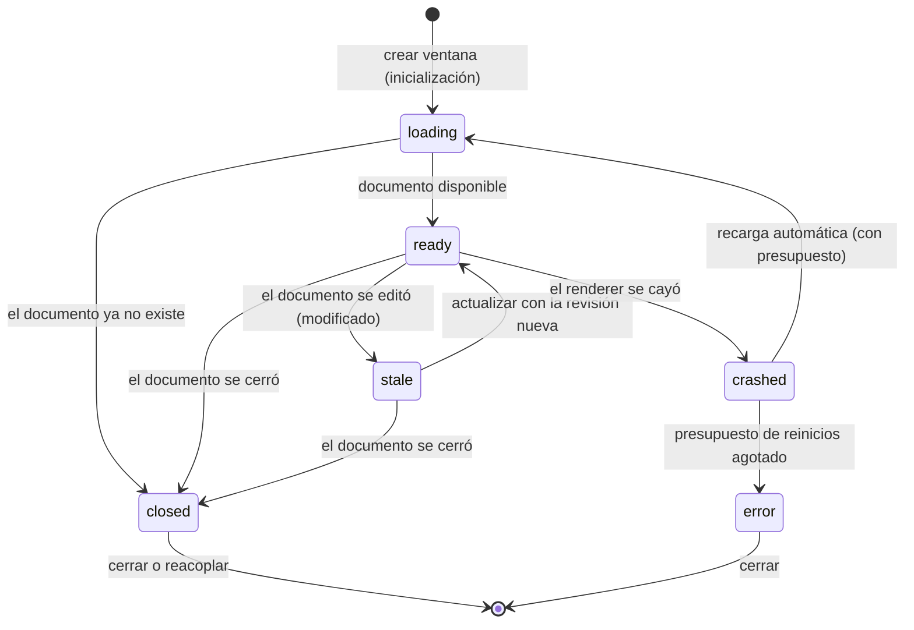

# Espacio de trabajo flexible — cierre arquitectónico

**Estado:** propuesta validada con un spike aislado; no hay código de producto en este cambio.
**Fecha y base:** 23 de octubre de 2026, sobre `main` en `bd09caa` (incluye #39, #40 y #41).
**Rama:** `codex/flexible-workspace-design`. Solo añade `docs/` y `experiments/flexible-workspace/`.
**Entradas que se reutilizan sin repetir:** [auditoría UX/UI](../audit/UX-UI-CONTINUOUS-IMPROVEMENT.md) (UX-03, UX-04, §12.1), [arquitectura](../ARCHITECTURE.md) y [evolución del espacio de trabajo](../WORKSPACE-EVOLUTION.md). Mediciones y comandos: [nota de evidencia](../evidence/flexible-workspace-2026-10-23.md).

## 0. Conclusión

1. **Es viable sin duplicar motores ni abrir un canal general.** Una ventana secundaria solo necesita 6 operaciones probadas en el spike (más 7 previsibles de lectura/análisis), frente a las 40 del preload principal.
2. **El bloqueo real no es la interfaz sino `SqlService`.** Tiene un único hueco de trabajo y `run()` cancela el anterior. Reproducido en la aplicación real: «Generar gráfico» y «Exportar resultados» se cancelan entre sí, y el resultado paginable de una consulta se pierde al empezar otra. No es conexión compartida ni reutilización de identificadores (§2).
3. **La solución que respeta el motor es una cola en `main` con concurrencia 1**, cancelación por solicitud y liberación que no dependa de que el motor responda. El pico de memoria sigue siendo el de hoy (un motor), no se añade ningún motor ni dependencia (§3).
4. **El spike encontró un fallo de diseño que no se habría visto en papel:** si el motor se crea de forma asíncrona y se cancela o se sale de la aplicación mientras carga, el motor queda huérfano y la aplicación no termina. Se corrige registrando el motor de forma síncrona (§3.4, §8).
5. **La primera implementación recomendada es la cola (F1), no la ventana.** Corrige el defecto actual para la interfaz que ya existe, no toca los componentes que cambia #42 y es el requisito de todo lo demás (§10, §11).

## 1. Decisiones de producto provisionales

Siguen siendo provisionales hasta que una persona las pruebe; cada una indica qué la invalidaría.

| # | Decisión | Motivo | La invalidaría |
|---|---|---|---|
| D1 | **Panel acoplado a la derecha** como modo por defecto, con tres pestañas de análisis y la tabla siempre con la altura completa. | Hoy los paneles se apilan sobre la tabla: con Gráficos abierto quedan 2 filas a 1440×900 y 0 a 1366×768 y 1280×720 (auditoría UX-03). Un dock lateral conserva todas las filas. | Que con 520 px de dock la tabla quede con menos de 3 columnas: ocurre a 1280 px (§7.2), donde se ofrece D2 en lugar de D1. |
| D2 | **Vista ampliada dentro de FreyaLab:** el panel ocupa el área de contenido y la tabla se reduce a una franja con «Volver a la tabla». Es el mismo componente y el mismo renderer. | Es la respuesta para ventanas estrechas y para leer un gráfico grande sin otra ventana ni más memoria. | Que la franja de tabla no sea útil: se reemplazaría por ocultarla del todo. |
| D3 | **Ventana secundaria independiente, una por documento.** «Separar» mueve el panel (pestaña y ajustes) a una ventana nueva; volver a separar el mismo documento enfoca la existente; «Reacoplar» la cierra y reabre el dock en la misma pestaña. | Permite usar un segundo monitor sin duplicar el estado del documento. | Que se necesiten dos paneles del mismo documento a la vez. |
| D4 | **El documento queda fijado al separar.** Cambiar de documento en la principal no cambia la secundaria. Si la fuente se edita, la ventana pasa a «desactualizada» y los resultados mostrados se rotulan con su revisión. Si la fuente se cierra, se muestra «“ventas.csv” se cerró», se conservan los resultados ya visibles como solo lectura y se desactivan ejecutar y exportar. La secundaria solo ve **su** documento: el SQL con varias fuentes queda en la principal. | Es lo que probó el spike (E_STALE, E_DOC_CLOSED) y evita referencias a documentos inexistentes. | Que se pida SQL multi-fuente en la secundaria: exigiría una lista explícita de fuentes en el contrato. |
| D5 | **Pestañas Resumen / Gráficos / SQL.** Resumen agrupa estadísticas, vista general de columnas y análisis de una columna; las configuraciones guardadas viven en Gráficos. | Mantiene las tres tareas que hoy son paneles separados sin añadir otra. | Que Resumen resulte demasiado denso (se mediría tras F2). |
| D6 | **Alcance limitado a CSV.** Markdown y Mermaid no cambian. | Solo los CSV tienen paneles de análisis. | — |
| D7 | **La secundaria no edita.** Ninguna operación de edición, guardado, deshacer ni apertura de rutas. «Abrir informe» pide a la principal que cree el documento. | Mantiene a `Documents` como única fuente de verdad (hoy los paneles ya solo leen/analizan). | — |
| D8 | **Una ventana secundaria no mantiene viva la aplicación ni puede impedir un cierre seguro.** Cerrar la principal sigue el flujo actual (`src/main/index.ts:94`): pide guardar los documentos modificados y, tras confirmarlo, cierra todo. En macOS el cierre de la última ventana ya termina la aplicación (`:99`). | La secundaria no guarda datos, así que no hay nada que perder en ella. | — |

## 2. Hallazgo: por qué se cancelan las consultas

### 2.1 Reproducción (aplicación real, sin tocar `src/`)

[`concurrency.spec.ts`](../../experiments/flexible-workspace/concurrency.spec.ts) abre el `out/main/index.js` construido y llama a las mismas operaciones que usa la interfaz. Resultados en [el JSON](../evidence/flexible-workspace-concurrency-2026-10-23.json):

| Caso | Resultado observado |
|---|---|
| S1. Consulta A en curso y llega B | A falla con «Análisis cancelado.»; B se completa. |
| S2. Resultado paginable de A, luego se ejecuta otra consulta | `sqlPage` de A pasa de «disponible» a «El resultado ya no está disponible. Ejecuta de nuevo la consulta.». |
| S3. «Generar gráfico» y luego «Exportar resultados» | El gráfico falla con «Análisis cancelado.»; la exportación se completa (un archivo). En orden inverso, falla la exportación. |
| S4. Cancelar con un identificador viejo | No afecta a la consulta nueva. |

### 2.2 Causa

| Hipótesis | Veredicto | Evidencia |
|---|---|---|
| Conexión compartida | **Descartada** | Cada trabajo crea su propia ventana oculta con DuckDB-Wasm (`sql-service.ts:36`) y la destruye al terminar (`:33`). Los datos viajan por un ticket aleatorio por fuente (`:46`–`:53`). |
| Controlador de cancelación compartido | **Descartada** | Hay un `abort` por trabajo (`:29`); no se comparte. |
| **Estado global** | **Causa raíz** | `private job?:Job` (`:15`) es el único hueco. `run()` llama a `this.stop()` antes de empezar (`:28`) y `cancel()` solo reconoce el identificador vigente (`:23`). |
| Cola de ejecución | **No existe** | No hay cola: solo desalojo «gana el último». |
| Reutilización de identificadores | **Descartada** | S4; las comparaciones son por identificador exacto (`:23`, `:61`). |
| Resultado ligado al hueco | **Causa agravante** | `page()` lee `this.job` (`:61`): un resultado solo existe mientras su trabajo sea el vigente (S2). |

Hay dos consumidores que comparten el hueco: los paneles (`sqlRun`/`sqlPage`/`sqlCancel`) y `chart-result-export.ts:15`–`:19`, que hace `run`, recorre `page` y cancela su propio identificador en `finally`. Cada componente ya cancela su solicitud anterior de forma explícita (`CsvCharts.svelte:34`, `CsvSql.svelte:19`), así que el desalojo implícito del servicio solo actúa entre consumidores distintos, que es justo el caso que el espacio flexible multiplica.

## 3. Diseño de concurrencia

### 3.1 Restricciones del motor (medidas, no supuestas)

| Medida | Valor | Fuente |
|---|---|---|
| Tiempo de una consulta, 240 filas | 555–559 ms (domina el arranque del motor) | M1 |
| Tiempo de una consulta, 100 000 filas | 875–879 ms | M1 |
| Memoria con una consulta de 100 000 filas | 886 MiB → pico 1282 MiB (**+396 MiB**) → 891 MiB al terminar | M1 |
| Ventanas durante una consulta | 1 → 2 → 1 (el motor se destruye) | M1 |
| Tope de celdas por análisis | 8 000 000 (`sql-service.ts:52`) | código |
| Tiempo límite | 120 s (`:30`) | código |
| Memoria de una ventana secundaria | De +15 a +168 MiB en tres mediciones con el renderer real (el conjunto de trabajo en macOS es ruidoso) y +108 MiB con la página mínima del spike; se toma ~100 MiB solo como orden de magnitud | M4 / spike |

Consecuencia: un motor por consulta es caro y su coste crece con las filas. Permitir N consultas a la vez multiplica el pico (4 consultas de 100 000 filas serían del orden de +1,5 GiB; extrapolación aritmética, no medida). Por eso el límite de concurrencia debe ser un parámetro explícito, con valor 1 por defecto.

### 3.2 Alternativas evaluadas

| Opción | Memoria | Cancelación | Riesgo | Veredicto |
|---|---|---|---|---|
| A. Hueco único y «gana el último» (actual) | Un motor | Solo la vigente | Falla el requisito (S1–S3) | Descartada |
| **B. Cola con concurrencia 1, prioridades y cancelación por solicitud** | **Igual que hoy** | Por solicitud: en cola se retira; en ejecución se destruye el motor | Espera si hay una consulta larga (se mitiga con prioridad, progreso «En cola» y compartir trabajos idénticos) | **Recomendada** |
| C. Conexiones independientes dentro de un motor persistente | Coste continuo con los datos en memoria | Más fina | Cambia el aislamiento (hoy el motor es efímero) y exige invalidar por revisión | Descartada ahora; reconsiderar solo si la medición muestra que el arranque (~0,55 s) es el cuello |
| D. N motores simultáneos con presupuesto | Multiplica el pico | Por solicitud | Memoria; el valor de N no está medido | Posible más adelante cambiando `concurrency`; no por defecto |

### 3.3 Diseño recomendado (B)

- **Cola en `main`**, detrás de la API actual (`sqlRun`, `sqlPage`, `sqlCancel` no cambian de firma). Prioridad `interactive` antes que `export` (la exportación espera a la consulta de quien está mirando); `background` queda reservada hasta que exista un consumidor.
- **Cancelación por solicitud.** En cola: se retira y no arranca. En ejecución: se destruye el motor y se libera el hueco **sin esperar** a que el motor responda.
- **Resultados ligados a la solicitud, no al hueco.** `page(requestId, offset)` sirve el resultado de esa solicitud hasta que su dueño la libere (`sqlCancel`), cambie la revisión del documento o se cierre su ventana. Con tope de entradas; el tope se fija midiendo con el peor resultado que admite el esquema (10 000 filas × 200 columnas), no con un valor supuesto.
- **Dueño de cada solicitud** (`windowId`): solo la ventana que la pidió puede cancelarla (E_OWNER).
- **Reutilización** (fase de ventana secundaria): solicitudes idénticas (documento, revisión, vista y consulta) comparten un único trabajo; cancelar a un suscriptor no aborta el trabajo mientras quede otro; un resultado reciente se sirve de caché y se invalida al cambiar la revisión.
- **Tiempo límite** de 120 s se conserva.
- **Presupuesto de memoria.** Con `concurrency = 1`: pico ≈ el de hoy. Estimación aditiva con un dock, una secundaria y un motor de 100 000 filas: 886 + ~100 + ~396 ≈ 1,4 GiB (no medida en conjunto).

### 3.4 Lo que demostró el spike (sin DuckDB real; el motor se simula con una ventana oculta y un temporizador)

| Propiedad | Resultado |
|---|---|
| Nunca hay más motores vivos que `concurrency` (1 y 2) | Cumplido |
| Prioridad: `interactive` pasa por delante de `export` y `background` aunque lleguen después | Orden observado: interactive, interactive, export, background |
| A en curso y llega B desde otra ventana | A y B se completan; 0 cancelaciones; 1 motor como máximo (frente a S1) |
| Cancelar en cola | No arranca nunca |
| Cancelar en ejecución | Motor destruido; el siguiente trabajo arranca 25 ms después; 0 motores residuales |
| Cancelar una solicitud ajena | E_OWNER |
| Tres solicitudes idénticas | 1 ejecución del motor; cancelar a un suscriptor no aborta el trabajo |
| Motor que no responde | Tiempo límite → E_TIMEOUT y el siguiente trabajo avanza |
| **Cancelar o salir mientras el motor aún carga** | **Hallazgo:** con `create()` asíncrono el motor queda huérfano y la aplicación no termina (30 s sin cerrar). Con el motor registrado de forma síncrona y la carga dentro de `run()`, el cierre tarda 55 ms. |

## 4. Contrato IPC de la ventana secundaria

Canal propio (`panel:op`), preload propio y comprobación de origen propia; **no** reutiliza `freya`. Implementación de referencia: [`contract.mjs`](../../experiments/flexible-workspace/spike/contract.mjs).

```text
Sobre (v1)        { v, windowId, docId, requestId?, revision?, op, payload }   — todo .strict()
Respuesta         { v, ok:true, requestId?, data } | { v, ok:false, requestId?, error:{ code, message } }
Evento (a la ventana, con seq creciente por ventana)
                  state{ state, docName, revision?, reason? } | view{ viewSeq, view } | progress{ requestId, phase: queued|running, position? }
Códigos           E_SENDER E_SCHEMA E_WINDOW E_DOC E_DOC_CLOSED E_STALE E_CANCELLED E_OWNER E_RENDERER_GONE E_TIMEOUT E_INTERNAL
```

| Requisito | Dónde está |
|---|---|
| Identidad de ventana | `windowId` = `webContents.id`, asignado por `main`; el preload lo obtiene del registro (`panel:whoami`), nunca lo elige el renderer. Se verifica que coincida con el remitente. |
| Identidad de documento | `docId`, fijado al crear la ventana. Cualquier otro se rechaza (E_DOC). |
| Identidad de solicitud | `requestId` (UUID) único; reutilizarlo se rechaza. |
| Revisión de datos | `revision` opcional en la petición (E_STALE si no coincide); las respuestas llevan `revision` y `viewSeq`. |
| Tipo de operación | `op` de una lista cerrada; `payload.kind` para `run`. |
| Estado de ejecución | Eventos `progress` (en cola con posición, en ejecución). |
| Cancelación | `cancel{ requestId }`, solo del dueño; también al cerrar la ventana o el documento. |
| Errores | Códigos cerrados con mensaje corto en español. |
| Cierre | Evento `state: closed` (documento) y aviso `panel-closed` a la principal (ventana). |

**Orden de comprobaciones en `main`:** remitente registrado y marco principal → sobre válido (Zod `.strict()`) → `windowId` → `docId` → `payload` de la operación → `revision` → dueño. Cualquier fallo devuelve un código y no toca datos.

**Lista permitida.** Probadas en el spike: `hello`, `getView`, `run`, `cancel`, `reattach`, `close` (+ `onEvent`). Previsibles al construir la ventana real (cada una con su esquema Zod estricto y sin rutas del renderer): `run` con `kind` de estadísticas, de análisis de columna, de SQL y de gráfico; `page`; `exportGraphic` y `exportChartResult` (el diálogo de guardado lo abre `main`, asociado a la ventana); `chartPresets`, `saveChartPreset`, `deleteChartPreset`; `openReport`. Son 13 operaciones frente a 40, y todas ya existen como lectura/análisis en los paneles actuales.

**Verificado en el spike:** en la secundaria no existen `window.freya`, `require` ni `process`; un sobre con otra ventana, otro documento, una operación desconocida, un campo extra, una versión distinta, una columna fuera de rango, un coste absurdo, un tipo de consulta libre o un mensaje basura se rechaza con el código esperado; la ventana principal no puede usar el canal del panel (E_SENDER); `window.open` devuelve `null` y la navegación se bloquea. No hay acceso general al sistema de archivos.

## 5. Modelo de estados



| Estado pedido | Estado / mecanismo | Qué ve la persona | Qué hace `main` |
|---|---|---|---|
| Inicialización | `loading` | «Preparando…» | Registra la ventana y envía un estado completo al cargar. |
| Cargando datos | `progress` de la solicitud (`queued` con posición, `running`) | «En cola (n)», «Calculando…» | La cola decide el orden. |
| Documento disponible | `ready` | Resultados y controles | — |
| Modificado | `stale` | Aviso con la revisión; resultados rotulados; «Actualizar» | Cancela trabajos en curso de la revisión vieja (E_STALE) e invalida la caché. |
| Cerrado (documento) | `closed` | «“ventas.csv” se cerró.» Resultados visibles de solo lectura | Cancela trabajos (E_DOC_CLOSED); `getView` y `run` devuelven E_DOC_CLOSED; la ventana sigue respondiendo y se puede cerrar. |
| Error | `error` | Mensaje y «Cerrar» | Tras agotar el presupuesto de reinicios no recarga más y avisa a la principal. |
| Cancelado | Respuesta E_CANCELLED a **esa solicitud** (no es un estado de ventana) | Mensaje de cancelación | Libera el motor. |
| Renderer reiniciado | `crashed` → `loading` → `ready` | Breve recarga y la vista restaurada | Cancela trabajos de la ventana (E_RENDERER_GONE) y recarga; la vista sale de `main`. |
| Ventana cerrada | La ventana sale del registro | — | Cancela sus solicitudes y libera motores; los datos no cambian. |

### 5.1 Cierre de la ventana principal

Se reutiliza el flujo actual: se cierran los documentos uno a uno (con la confirmación de los modificados) y, solo si todos se cierran, se marca `quitting`, se destruyen las secundarias y los motores y se sale. La secundaria no participa en la decisión ni la bloquea. Comprobado en el spike con una secundaria abierta y una consulta de 8 s en ejecución: salida en **55 ms**; con un documento modificado se muestra la confirmación una sola vez, «cancelar» conserva todo y «descartar» sale en 50 ms.

### 5.2 Reinicios

El spike recarga una ventana cuyo renderer se cayó en 240 ms (medido) y le restituye la vista desde `main`. Para que un renderer que falla al cargar no se recargue sin fin, hay un presupuesto de reinicios (3 por minuto en la prueba; **valor de prueba, no medido**): al superarse, el estado pasa a `error`, `main` avisa a la principal y no recarga. Playwright no puede reconectarse a un destino caído, por lo que la comprobación posterior se hizo ejecutando código en la ventana desde `main`.

## 6. Persistencia

Se reutiliza el patrón de `ChartPresets`: archivo `workspace-layout.json` en el directorio de datos del usuario, esquema `version: z.literal(1)` con `.strict()`, escritura atómica (archivo temporal y `rename`) y recuperación segura. Solo lo necesario:

```text
dock   { visible, width, tab }
panel  { width, height, x?, y?, tab }        // ventana secundaria
```

Sin datos del CSV, sin rutas de documentos ni identificadores de documento. Comprobado ([`layout-store.mjs`](../../experiments/flexible-workspace/spike/layout-store.mjs)): lectura de un archivo ausente devuelve los valores por defecto; un guardado inválido (ancho 10, versión 2, clave `rows`) se rechaza **sin tocar el archivo**; un archivo ilegible o con claves ajenas se copia a `workspace-layout.json.invalid` y se usan los valores por defecto; no quedan temporales; una ventana guardada fuera de pantalla (monitor desconectado, coordenadas extremas, tamaño mayor que la pantalla) se recoloca y se recorta. La regla «al menos 120×60 px visibles» es un valor de prueba, no medido. Las preferencias de la barra lateral que hoy están en `localStorage` no se mueven; la posición de una ventana solo la conoce `main`, por eso este archivo vive allí.

## 7. UX/UI

### 7.1 Criterios medibles

Cada criterio indica lo **medido hoy**; los umbrales marcados como *propuesta* son derivados y deben confirmarse, no son datos.

| Criterio | Medido hoy | Umbral (propuesta) | Cómo se comprueba |
|---|---|---|---|
| Filas visibles con un panel abierto | Sin panel / Gráficos / Estadísticas: 21/3/15 (1920×1080), 19/2/13 (1440×900), 15/0/9 (1366×768), 16/1/10 (1280×800), 13/0/8 (1280×720), 7/0/0 (900×600) | Con el dock, **las mismas que sin panel** (la tabla conserva la altura completa) | E2E por tamaño de ventana |
| Columnas visibles con dock de 520 px | Con 14 columnas de ancho por defecto, en 1920×1080 / 1440×900 / 1366×768 / 1280×720: sin dock 9/6/5/5; con dock de 520 px 6/3/3/2 (§7.2) | Ofrecer el dock solo si quedan **≥ 3 columnas**; si no, proponer «Ampliar» o «Separar» | E2E con medición de cabeceras |
| Tamaño mínimo del panel | Ancho: el gráfico no se desplaza horizontalmente desde **520 px** (con 480 sí); ningún panel desborda entre 320 y 560 px | **520 px** de ancho mínimo; altura mínima útil a decidir con F2 | M2 |
| Tamaño mínimo del gráfico | Alto fijo de **340 px**; los controles actuales ocupan ~502 px de un panel de 540 | Tras «Generar», el gráfico a la vista sin desplazar y los controles plegados | E2E |
| Tiempo de respuesta | Generar un gráfico de 240 filas: 852–866 ms; consulta de 100 000 filas ~0,9 s | No peor que la base actual + 20 % (margen provisional) | Mediana de ≥ 5 corridas |
| Apertura de la secundaria | 181 ms hasta «ready» con una página mínima (spike) | A repetir con el renderer real | Medición en F4 |
| Memoria adicional | Secundaria: ~100 MiB de orden de magnitud (+15 a +168 en M4) · motor: +396 MiB por consulta de 100 000 filas | Con `concurrency = 1`, un solo motor a la vez; medir la secundaria con una métrica menos ruidosa (memoria privada por proceso) en F4 | `getAppMetrics` en E2E |

### 7.2 Columnas visibles (M3, 14 columnas)

| Ventana | Ancho de tabla | Sin dock | Dock 360 | Dock 480 | Dock 520 | Dock 560 |
|---|---|---|---|---|---|---|
| 1920×1080 | 1679 | 9 | 7 | 6 | 6 | 5 |
| 1440×900 | 1199 | 6 | 4 | 3 | 3 | 3 |
| 1366×768 | 1125 | 5 | 3 | 3 | 3 | 2 |
| 1280×720 | 1039 | 5 | 3 | 2 | 2 | 2 |

Con la barra lateral por defecto (240 px). Es la base de la regla «dock solo con ≥ 3 columnas»: con 520 px eso ocurre desde 1366 px de ancho de ventana; por debajo se ofrece D2.

### 7.3 Comportamiento (a implementar en F2–F5; no probado en el spike)

- **Pestañas accesibles** con el patrón ARIA de pestañas: `tablist`/`tab`/`tabpanel`, un solo `tab` en la secuencia de tabulación, flechas izquierda/derecha, Inicio/Fin, activación manual (Intro o Espacio), porque cambiar de pestaña puede lanzar una consulta.
- **Divisor** `separator` enfocable con `aria-valuenow/min/max`; flechas redimensionan por pasos y Mayús por pasos grandes (los pasos concretos se fijarán con la prueba); mínimo 520 px.
- **Foco.** Abrir el dock lleva el foco a la pestaña activa; Esc o «Cerrar» lo devuelve al botón que lo abrió (misma técnica que la restauración de foco del #36). Al separar, el foco pasa al `tablist` de la ventana nueva; al reacoplar vuelve al botón de la barra.
- **Atajos.** Se definirán contra el registro actual de atajos para no colisionar (`CsvTable.svelte` ya usa Cmd/Ctrl+F y +K); no se proponen combinaciones concretas aquí.
- **Estados vacíos:** sin documento («Abre un CSV para analizarlo»), sin resultados («Ejecuta una consulta o genera un gráfico»), sin columnas numéricas.
- **Mensajes de error** (uno por código, en español y accionables): E_STALE «El documento cambió. Actualiza para usar la revisión nueva.»; E_DOC_CLOSED «“nombre” se cerró. Los resultados que ves son de solo lectura.»; E_RENDERER_GONE «La ventana de análisis se reinició. Los datos no se modificaron.»; E_TIMEOUT «El análisis superó el tiempo límite. Reduce la consulta.»; E_CANCELLED «Análisis cancelado.».
- **Vista ampliada:** Esc o «Volver a la tabla»; conserva pestaña y resultados.
- **Recuperar ventana fuera de pantalla:** colocación automática al abrir (§6) y orden «Recuperar ventana de análisis» en el menú de ventanas.

## 8. Spike aislado

Todo en [`experiments/flexible-workspace/`](../../experiments/flexible-workspace/README.md), fuera de `src/`, de `npm test` y de `npm run test:e2e`, sin dependencias nuevas. **No se incorpora al producto.**

| Objetivo pedido | Resultado |
|---|---|
| Crear una ventana secundaria | 181 ms hasta «ready» |
| Asociarla a un documento | Identidad fijada; cambiar el documento activo en la principal no la altera |
| Consultar datos por IPC | Agrupación de 600 filas por ciudad correcta (5 grupos, suma 600) |
| Sincronizar filtros | La vista llega con `viewSeq`; solo a las ventanas del mismo documento; `seq` estrictamente creciente por ventana |
| Cancelar una solicitud | En cola, en ejecución, ajena (E_OWNER) y con identificador reutilizado (E_SCHEMA) |
| Cerrar solo la secundaria | Motor liberado (0 residuales); la otra ventana y los datos intactos (suma de verificación igual) |
| Recuperarse de un fallo del renderer | Recarga en 240 ms, vista restituida, la otra ventana no se entera; presupuesto de reinicios |

11 pruebas, 33/33 en tres repeticiones seguidas, con Node 24 sobre macOS. Resultados: [`flexible-workspace-spike-2026-10-23.json`](../evidence/flexible-workspace-spike-2026-10-23.json).

Las cifras de tiempo son las de la corrida guardada; en las corridas observadas variaron unos milisegundos (apertura 160–181 ms, recuperación tras caída 190–240 ms, cierre 48–55 ms), así que sirven de orden de magnitud y no de umbral.

**Límites del spike** (lo que no demuestra): el motor se simula (el coste real de DuckDB se midió aparte sobre la aplicación real, M1); la interfaz es mínima, sin los componentes Svelte reales; una sola pantalla (la lógica de recolocación se comprobó con datos, no con un segundo monitor físico); solo macOS; la página de la secundaria no pasa por electron-vite.

## 9. Riesgos

| # | Riesgo | Impacto | Mitigación / detector |
|---|---|---|---|
| R1 | Espera percibida con concurrencia 1 cuando hay una consulta larga | Medio | Prioridad, mensaje «En cola (n)», cancelación visible, reutilización de trabajos idénticos |
| R2 | Pico de memoria si se sube `concurrency` | Alto | Valor 1 por defecto; cualquier aumento exige medición y presupuesto |
| R3 | Estado divergente entre ventanas | Alto | `main` es la fuente de verdad; `viewSeq`, `revision` y `seq`; la ventana nueva recibe un estado completo |
| R4 | Carreras de ciclo de vida (motor/cierre, cancelar durante carga, documento cerrado en ejecución) | Alto | Ya hubo una real (§3.4); el motor se registra de forma síncrona; pruebas de cierre y cancelación inmediata |
| R5 | Más superficie IPC | Alto | Canal y preload propios, lista cerrada, Zod `.strict()`, comprobaciones en orden, pruebas de rechazo |
| R6 | Bucle de recargas por un renderer defectuoso | Medio | Presupuesto de reinicios (valor a calibrar) |
| R7 | Los paneles dependen del estado interno de `CsvTable.svelte` (rango, consulta, columnas, firma de vista) | **Alto** | Es el mayor trabajo real: hay que sacar ese estado a un modelo de vista en `main` antes de F4. El spike solo prueba filtro, búsqueda y orden |
| R8 | La página de la secundaria necesita un punto de entrada nuevo en electron-vite y reutilizar los mismos componentes | Medio | Resolver en F4 con una prueba de empaquetado |
| R9 | Solape con #42 (mismos componentes y `style.css`) | Medio | F1 no los toca; F2+ tras integrar #42 (§12) |
| R10 | Accesibilidad de pestañas y divisor | Medio | Pruebas con roles y teclado en F2; revisión manual con lector de pantalla |
| R11 | Solo se probó en macOS | Medio | CI de cuatro sistemas ya existe; sumar las pruebas de F4 |
| R12 | Retención de resultados por solicitud aumenta la memoria | Medio | Tope de entradas fijado midiendo el peor caso |

## 10. Criterios de aceptación

**F1 — cola de trabajos (sin interfaz nueva)**
1. S1–S3 invertidos: con dos consumidores, ambos terminan; ninguno recibe «Análisis cancelado.» sin haberlo pedido.
2. `sqlPage` de una solicitud sigue disponible mientras otra consulta se ejecuta y hasta que su dueño la libera.
3. Cancelar en cola no arranca; cancelar en ejecución destruye el motor y libera el hueco; ningún motor residual al terminar ni al salir (incluida la cancelación inmediata).
4. Nunca más de `concurrency` (1) motores vivos.
5. Los mensajes y tipos de la API actual no cambian; las pruebas E2E existentes de gráficos, SQL y exportación pasan sin modificarse.
6. Memoria de resultados retenidos medida con el peor caso del esquema y registrada antes de fijar el tope.

**F2 — dock derecho** · mismas filas que sin panel (§7.1); pestañas y divisor operables solo con teclado; el foco vuelve al botón; estado de dock persistido y recuperable; ningún cambio de comportamiento de los análisis.

**F3 — vista ampliada** · se entra y se sale con teclado; conserva pestaña y resultados; sin segundo renderer.

**F4 — ventana secundaria** · contrato y rechazos del spike repetidos sobre el código real; los 8 estados de §5 con prueba; cierre de la principal sin pérdida de datos y en menos de un segundo (referencia: 55 ms); tras un fallo del renderer la vista se restituye; memoria adicional medida con el renderer real.

**F5 — recuperación y pulido** · ventana fuera de pantalla; presupuesto de reinicios con mensaje; atajos sin colisión; revisión de accesibilidad.

## 11. Hoja de ruta incremental

| Fase | Contenido | Depende de | Toca |
|---|---|---|---|
| F0 | Este cambio: diseño, spike y evidencia | — | `docs/`, `experiments/` |
| **F1** | **Cola de trabajos en `SqlService` + resultados por solicitud** | Nada | `src/main/sql-service.ts`, `chart-result-export.ts`, pruebas |
| F2 | Dock derecho con pestañas, divisor y layout persistente | #42 integrado | Renderer (`CsvTable`, `App`, estilos) |
| F3 | Vista ampliada | F2 | Renderer |
| F4 | Modelo de vista en `main`, registro de paneles, contrato, preload y página de la secundaria | F1, F2 | `main`, `preload`, `shared`, renderer, build |
| F5 | Recuperación, atajos, accesibilidad, pulido | F4 | Transversal |

Cada fase es un PR en borrador con su propia evidencia; nada de F2 en adelante empieza hasta que la anterior esté integrada o la persona decida lo contrario.

## 12. Primera implementación recomendada: F1

Por qué primero: corrige un defecto que ya existe hoy sin esperar al diseño visual; es independiente de #42 (los archivos que toca no están en ese PR); no añade dependencias ni superficie IPC; y todo lo demás lo necesita. El cambio es interno: la cola, la cancelación por solicitud y la retención de resultados por solicitud detrás de las mismas tres operaciones. La prueba falla primero (los casos S1–S3 invertidos, ya escritos como reproducción en este cambio) y pasa después. Reversión: un solo módulo.

No incluye: ventana secundaria, caché ni reutilización de trabajos (sin segundo consumidor visible no hacen falta), prioridad `background`, cambios de interfaz.

## 13. Dependencias con otros cambios y grafo

- **#41** ya está en `main` (`bd09caa`); sin conflicto.
- **#42** (sistema de iconos, borrador, limpio) modifica `App.svelte`, `CsvTable.svelte`, `CsvCharts.svelte`, `CsvSql.svelte`, `CsvStatistics.svelte`, `CsvQueryTools.svelte`, `CsvCommands.svelte`, `Tree.svelte`, `Diagram.svelte`, `style.css` y varias pruebas E2E. **F1 no toca ninguno**; F2 y posteriores sí, por lo que deben esperar a su integración. Este cambio no modifica esos archivos.
- **Grafo (Graphify):** no se regenera aquí; este cambio no altera código de producto y el grafo local sigue reflejando `src/`. Conviene regenerarlo **después de integrar #42 y antes de F2**, porque cambia la relación entre componentes del renderer.
- No se tocan ramas ni árboles de trabajo de otras sesiones. No se fusiona ningún PR, no se publica ninguna versión y no se actualiza la aplicación instalada.

## 14. Qué queda sin validar

- La experiencia real de las tres modalidades con personas; las decisiones D1–D8 son provisionales.
- El comportamiento con DuckDB real dentro de la cola (el spike usa un motor simulado; la medición real es independiente).
- Un segundo monitor físico, Windows y Linux.
- Coste y empaquetado de la página de la secundaria con los componentes reales (R8) y el traslado del estado de `CsvTable` a `main` (R7).
- Todos los umbrales marcados como *propuesta* o *valor de prueba*.
