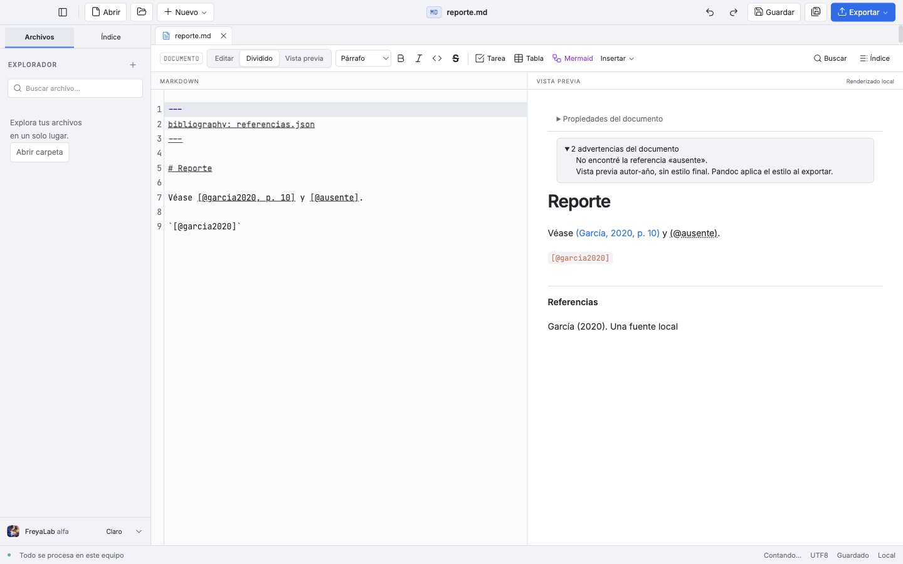
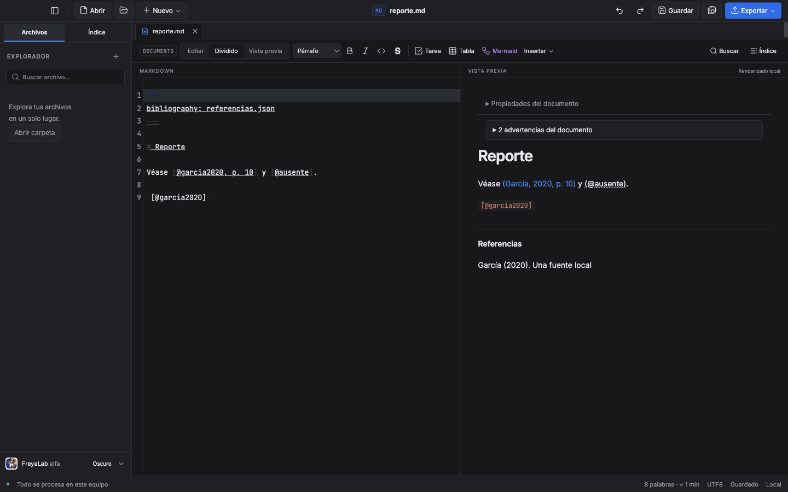

# AC-03 · Citas y bibliografía — evidencia en curso

> Estado al congelar este borrador actualizado: producto `cbffd79` sobre main `a44eb89`; check 0/0 y 1.476 unitarias verdes. E2E completo actual en curso en otro worktree de la misma fuente; CI anterior cancelada por una corrección de integridad reproducida, no para obtener verde. El cierre se registrará en el PR sin commits de estado. D6 conserva su SHA c642771 porque la ruta de exportación no cambió.

Rama: `codex/ac-03-04-citas-exportar`. Esta evidencia corresponde al desarrollo de la pareja AC-03/AC-04; **no es todavía un cierre integral ni una calificación de CI**. Se parte de `main` 33a5dfd con las ramas locales A0, AC-01/02, AC-00 e I18N-01 como antecedentes.

## Pruebas rojas y verificaciones del renderizador

| Comportamiento | Rojo conservado | Resultado posterior real |
| --- | --- | --- |
| Citas autor-año, narrativa, claves ausentes, bibliografía y seguridad | `a3-citations-red.log`: 6 fallos y 2 casos ya cubiertos | Primer focal del render/puente: 20/20 |
| Puntuación después de una cita narrativa | `a3-citation-punctuation-red.log`: 1 fallo/17 | Corregido; regresión posterior de 6 archivos: 203/203 |
| Citas escapadas, incluidas una literal y otra real en el mismo párrafo | `a3-citation-escaping-red.log`: 3 fallos | 20/20 del archivo de citas tras corregir |
| Citas en pies de figura y tabla conservando posiciones del texto | `a3-citation-caption-red.log`: 2 fallos/23 | 209/209 en 6 archivos, incluido el caso de pie escapado |
| Interfaz real, advertencias y biblioteca actualizada sin modificar la fuente | `a3-citations-e2e-red.log`: no existía `#citation-1` en el build congelado de AC-01/02 | 1/1 en 1,8 s; luego incluido en el focal de 4 casos |
| Citas, generaciones de Mermaid y texto progresivo mientras esperan imágenes | No se cambian ni debilitan las pruebas de regresión existentes | 4/4, sin reintentos, 13,1 s |

Los directorios temporales anteriores desaparecieron al retomar la sesión. Las órdenes, salidas recuperables y cambios de fuente se rescataron de los registros originales en el directorio persistente local `visualizations/2026/10/20/01a15b98-21cd-73c1-9d21-54a67035a7fa/recovery/`; los resultados de la tabla anterior son históricos. La fuente se recompuso con 79 lotes de cambios y se comprobó de nuevo. No se recuperaron las antiguas trazas/capturas salvo lo que ya estaba comprometido. Comandos realmente ejecutados durante el desarrollo, con Node 24.22.1:

```sh
node node_modules/vitest/vitest.mjs run tests/citations.test.ts tests/document-bibliography.test.ts tests/academic-numbering.test.ts tests/render.test.ts tests/front-matter.test.ts tests/report-metadata.test.ts
node node_modules/svelte-check/bin/svelte-check --tsconfig ./tsconfig.json
node node_modules/typescript/bin/tsc -p tsconfig.node.json --noEmit
node node_modules/electron-vite/bin/electron-vite.js build
node node_modules/@playwright/test/cli.js test tests/e2e/academic-citations.spec.ts tests/e2e/mermaid-errors.spec.ts tests/e2e/preview-progressive.spec.ts --project=md --grep 'AC-03|obsoletos|generaciones|párrafo nuevo' --retries=0 --reporter=line
```

El último Svelte check dio **0 errores/0 avisos** y el build terminó con código **0**. El TypeScript de main dio 0 antes del ajuste de posiciones del pie; se comprobará nuevamente al cerrar la rama. Estos comandos enfocados **no sustituyen** los cuatro comandos completos exigidos para el cierre.

La primera ejecución contra una copia externa del build no arrancó porque esa copia no tenía resolución de `node_modules`: agotó 90 s antes de poder probar el producto. Se conserva como `a3-citations-e2e-boot-failure.log`, junto con su traza. Se corrigió únicamente el directorio temporal de pruebas, añadiendo su manifiesto de paquete y el enlace a las dependencias ya instaladas; no se modificó el producto para obtener el verde.

La fuente de los dos builds empleados está identificada en los manifiestos externos `a3-preview-frozen/manifest.sha256` y `a3-preview-caption-frozen/manifest.sha256`. No debe atribuirse el resultado de esos builds a cambios posteriores del exportador.

## Seguridad e integridad comprobadas hasta ahora

- La biblioteca se selecciona desde el front matter de la fuente actual que conserva main. El renderer envía identificador y snapshot de texto; no puede entregar una ruta de documento arbitraria. Main comprueba identidad, revisión, ruta y texto antes y después de leer.
- El protocolo público devuelve entradas, tamaño y hash; no devuelve la ruta canónica ni los bytes privados del snapshot para Pandoc.
- Las etiquetas bibliográficas se construyen como texto. Las pruebas incluyen títulos/autores con HTML hostil, código, correo, referencias de figuras y notas al pie.
- La vista previa publica el texto saneado antes de esperar la biblioteca. Las respuestas de generaciones antiguas se descartan; las dos pruebas críticas de Mermaid y la de imágenes progresivas siguen pasando.
- El E2E modificó el archivo bibliográfico y después el texto del editor: la cita utilizó la nueva biblioteca y el Markdown del disco permaneció idéntico al original, mientras el documento abierto conservó sus cambios pendientes.
- Las citas escapadas siguen siendo texto. Si entidades Markdown impiden emparejar inequívocamente las citas del texto y su fuente, se conserva ese nodo como texto; no se adivina una clave.

## Recursos CSL autorizados

El propietario autorizó expresamente los cinco estilos oficiales y sus avisos, conservando MIT para el código. Los recursos y hashes están en `src/main/csl/manifest.json`; sus autores y CC BY-SA 3.0 se conservan en los archivos y en los avisos generados.

Se verificaron los cinco recursos en `out/main/chunks/` después del build. **Esto todavía no demuestra que estén presentes y sean utilizables dentro de `app.asar`**: esa comprobación pertenece al cierre del paquete de AC-03/AC-04.

## Inspección visual

Capturas a 1440×900, generadas únicamente con `FREYALAB_AC_EVIDENCE=1` e inspeccionadas:





## Pendiente; no verificado

- Cierre completo de la rama: `npm run check`, `npm test`, `npm run test:e2e`, `npm run build`; CI de las cuatro plataformas y paquete del SHA final.
- Ejecución real de la ruta ampliada Pandoc con JSON/BibTeX, cinco estilos y las dos salidas; se mantienen separados los resultados históricos de AC-00.
- DOCX, HTML y PDF finales con estilo bibliográfico, comparación de contenido y apertura independiente; medición del reporte de 50 páginas (AC-04).
- Uso manual de Word/LibreOffice, lector de pantalla y composición física IME; instalación manual en los tres sistemas.
- El autocompletado general de ED-03 continúa fuera del lote. La asistencia específica de claves bibliográficas de AC-03 reutiliza `@codemirror/autocomplete` 6.20.4, que ya estaba instalado y bloqueado como dependencia transitiva de producción; `package.json` y el lockfile siguen intactos.

## Validación actual tras recuperar la fuente

- `npm run check`: primer intento actual detectó un `unknown` pasado al notificador; se corrigió. Segundo intento: **0 errores/0 avisos**, TypeScript main código **0**. No es el cierre del SHA final.
- Diez patrones unitarios enfocados correspondieron a nueve archivos reales: **257/257**; no se cuenta como ejecutado un archivo inexistente.
- Asistencia bibliográfica específica: prueba E2E real **2/2** en 5,3 s junto al diálogo de Pandoc ausente; incluyó completar con Enter, deshacer en un paso y ambos temas.
- Cita todavía abierta `[@gar`: **2 rojos → archivo de citas verde**; no se anuncia una clave ausente mientras falta el cierre.
- Índice de figuras con una cita: el E2E conservó el rojo real `Figura 1. Datos [@garcia2020]`; tras actualizar el índice desde su pie ya formateado, el mismo caso pasó y mostró `Figura 1. Datos (Chen, 2020)`. El documento fuente no se modifica.
- Tras corregir offsets al combinar referencia cruzada y cita en un párrafo: **129/129** de cuatro archivos (preparación del reporte, citas, numeración y render).
- Los cinco CSL se conservan byte a byte incluso con `core.autocrlf=true`: reproducción roja y después **25/25** del contrato Pandoc; `.gitattributes` fija LF sólo en esos recursos. No se cambiaron sus hashes ni autores.

Las capturas de autocompletado `ac-03-completion-{light,dark}-1440x900.png` se inspeccionaron. Corresponden al estado previo al ajuste del índice de citas; se renovarán con el artefacto final.

La exportación real de un reporte mixto a DOCX/HTML/PDF pasó el focal E2E en 5,6 s (sin reintentos), pero la revisión independiente posterior encontró paginación incorrecta en LibreOffice. El verde de contenido no se presenta como aprobación visual de DOCX ni cierre de AC-04. Véase la evidencia AC-04 en curso.

## Actualización: exportación con biblioteca reciente

La fuente de la biblioteca puede cambiar sin cambiar el Markdown ni refrescar su vista previa. La nueva prueba de exportación reprodujo HTML obsoleto con García/2020. Se corrigió reutilizando `reportCitationGroups` y `presentCitations`, sin otro parser ni motor CSL: HTML y PDF sin Pandoc usan ahora Chen/2024 y el título revisado. Resultado: 160/160 unitarias en ocho archivos, build código 0 y E2E 1/1 en 2,6 s. El original y la biblioteca permanecen idénticos; no se atribuye ese verde a cambios posteriores.

La paginación de LibreOffice ya se corrigió y revisó (5 páginas); PDF de FreyaLab tiene 3, con portada sin número. Véase AC-04 para separar revisión visual, validación estructural y límites. Las notas anteriores de paginación pendiente son históricas.

El test de seis recursos se trasladó sin cambiar aserciones a `commands.spec.ts`, seleccionado por la CI actual de paquete; `app.spec.ts` no lo estaba. Pasó en desarrollo después del traslado. ASAR, P4 completa y cierre del head final continúan pendientes.

## B4 · autoridad estable y actualización de main

La revisión focal encontró un caso adicional: después de abrir el documento, sustituir su directorio por un enlace a otra carpeta hacía que `realpath(documentPath)` eligiera esa carpeta nueva como permiso bibliográfico. Una reproducción real con dos carpetas sintéticas confirmó **1 fallo/4 pases** en `document-bibliography.test.ts`: devolvía `ok: true` con la fuente externa. No se atribuyó el hallazgo sólo a una hipótesis.

`c56a07a` conserva la carpeta canónica autorizada en el registro y la pasa a las tres lecturas de producción: vista previa y ambas comprobaciones de exportación. El cargador rechaza que el documento resuelto salga de esa autoridad. Al guardar una fuente nueva se conserva una raíz canónica; se probó que su biblioteca local sigue funcionando y sus bytes no cambian. No cambia el IPC, las codificaciones ni los valores de documentos. Resultado enfocado: **70/70 en tres archivos**, 824 ms; el cuarto patrón solicitado no correspondía a otro archivo existente y no se cuenta.

El propietario fusionó otros carriles en `main` a44eb895c7f6518106898af256dd7cff8ae88275 mientras corría el cierre. Se incorporó ese main a esta misma rama con una integración limpia (`ccf73a7`), sin resolver conflictos manualmente ni fusionar PR por Codex. Su CSV grande y las pruebas heredadas forman parte del siguiente cierre; no se transfieren los verdes anteriores.

Sobre el producto actual y antes del ajuste de arnés C3: check **0/0** y TypeScript salida 0; **1.475/1.475 unitarias de 77 archivos en 16,47 s**, incluido CSV y P4 real (la eficacia HTTP no se acredita con el binario local sin soporte HTTP); build salida 0. Después, foco de reporte Word y C3: **2/2 en 5,5 s**, sin retries. La fuente queda en `c6427714a8a93d2230363ceed59143090cbee39b`; falta su cierre E2E íntegro y CI/paquete.

## B4 · Guardar normal no renueva la autoridad

La revisión posterior encontró otra cadena. Aunque la consulta inicial ya rechazaba el directorio sustituido, Guardar normal recalculaba la raíz después de escribir. Una reproducción real mantuvo idénticos los bytes del documento externo y sustituyó el directorio original por un enlace: **1 fallo/6 pases**, con cuatro aserciones fallidas que demostraron escritura externa (cambió inode/fecha), raíz reautorizada y acceso a la bibliografía canario. Log conservado `a3-b4-normal-save-red.log`.

`cbffd7981810e48d52164c4318ab4a45927e2d54` valida la ubicación resuelta antes de guardar en el mismo destino y conserva la raíz autorizada. Sólo un destino nuevo de Guardar como puede renovarla. Dos etiquetas nuevas usan `t()` en español e inglés. No cambia IPC, dependencias, codificaciones, valores ni permisos. Focal **88/88 en seis archivos, 1,59 s**; después check **0 errores/0 avisos y TypeScript 0**, y **1.476/1.476 unitarias de 77 archivos, 15,10 s**, incluidas CSV y las seis P4 reales.

Se desarrolló en otro worktree para conservar intacto fc28890 durante su CI. La CI general 40832694447 se canceló explícitamente al confirmar el defecto y quedó `completed/cancelled`; no se presenta como aprobada ni se relanzó sin cambios. P4 de fc28890 sí terminó con 6/6 en Windows y 6/6 en Linux, Pandoc 3.10.2 y control HTTP positivo: esos resultados siguen identificados por ese head y no califican automáticamente el nuevo.

La suite E2E completa actual se ejecuta en el worktree aislado, con Pandoc externo explícito para incluir DOCX. El producto y el head de esa ejecución no se modifican. El estado posterior estará en el cuerpo del mismo PR #92, no en commits de estado. No es un cierre integral todavía.
