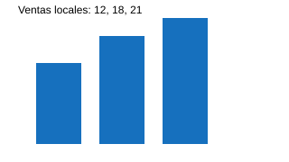

# Capítulo 1: resultados locales

La figura [@fig:ventas-1] y la tabla [@tbl:ventas-1] ilustran este caso. Fuente: [@garcia2020, p. 10] y [@chen2021].

C1-P1. Este texto sintético describe una revisión de datos locales y documenta decisiones reproducibles. El equipo comprueba las fuentes, conserva los identificadores y explica las limitaciones de cada resultado. Una tabla permite contrastar observaciones; una figura resume tendencias y el informe relaciona ambos elementos con sus referencias. Ningún registro pertenece a una persona real ni procede de un expediente privado. La finalidad es medir la exportación de un documento extenso con una estructura académica normal, sin insertar saltos de página ni modificar el formato de impresión de la aplicación.

C1-P2. Este texto sintético describe una revisión de datos locales y documenta decisiones reproducibles. El equipo comprueba las fuentes, conserva los identificadores y explica las limitaciones de cada resultado. Una tabla permite contrastar observaciones; una figura resume tendencias y el informe relaciona ambos elementos con sus referencias. Ningún registro pertenece a una persona real ni procede de un expediente privado. La finalidad es medir la exportación de un documento extenso con una estructura académica normal, sin insertar saltos de página ni modificar el formato de impresión de la aplicación.

C1-P3. Este texto sintético describe una revisión de datos locales y documenta decisiones reproducibles. El equipo comprueba las fuentes, conserva los identificadores y explica las limitaciones de cada resultado. Una tabla permite contrastar observaciones; una figura resume tendencias y el informe relaciona ambos elementos con sus referencias. Ningún registro pertenece a una persona real ni procede de un expediente privado. La finalidad es medir la exportación de un documento extenso con una estructura académica normal, sin insertar saltos de página ni modificar el formato de impresión de la aplicación.

C1-P4. Este texto sintético describe una revisión de datos locales y documenta decisiones reproducibles. El equipo comprueba las fuentes, conserva los identificadores y explica las limitaciones de cada resultado. Una tabla permite contrastar observaciones; una figura resume tendencias y el informe relaciona ambos elementos con sus referencias. Ningún registro pertenece a una persona real ni procede de un expediente privado. La finalidad es medir la exportación de un documento extenso con una estructura académica normal, sin insertar saltos de página ni modificar el formato de impresión de la aplicación.

{#fig:ventas-1}

| Ciudad | Identificador | Ventas |
| --- | --- | --- |
| Oaxaca | 000123 | 12 |
| Puebla | 9007199254740993 | 18 |
| Mérida | 000125 | 21 |

: Ventas verificadas del capítulo 1 {#tbl:ventas-1}

## Método 1

Una medida documentada es $x_i^2$. La nota ofrece contexto[^nota-1].

```python
registro = {"id": "000123", "total": 12}
print(registro["total"])
```

[^nota-1]: Nota sintética del capítulo 1; conserva la referencia [@garcia2020].

# Capítulo 2: resultados locales

La figura [@fig:ventas-2] y la tabla [@tbl:ventas-2] ilustran este caso. Fuente: [@garcia2020, p. 10] y [@chen2021].

C2-P1. Este texto sintético describe una revisión de datos locales y documenta decisiones reproducibles. El equipo comprueba las fuentes, conserva los identificadores y explica las limitaciones de cada resultado. Una tabla permite contrastar observaciones; una figura resume tendencias y el informe relaciona ambos elementos con sus referencias. Ningún registro pertenece a una persona real ni procede de un expediente privado. La finalidad es medir la exportación de un documento extenso con una estructura académica normal, sin insertar saltos de página ni modificar el formato de impresión de la aplicación.

C2-P2. Este texto sintético describe una revisión de datos locales y documenta decisiones reproducibles. El equipo comprueba las fuentes, conserva los identificadores y explica las limitaciones de cada resultado. Una tabla permite contrastar observaciones; una figura resume tendencias y el informe relaciona ambos elementos con sus referencias. Ningún registro pertenece a una persona real ni procede de un expediente privado. La finalidad es medir la exportación de un documento extenso con una estructura académica normal, sin insertar saltos de página ni modificar el formato de impresión de la aplicación.

C2-P3. Este texto sintético describe una revisión de datos locales y documenta decisiones reproducibles. El equipo comprueba las fuentes, conserva los identificadores y explica las limitaciones de cada resultado. Una tabla permite contrastar observaciones; una figura resume tendencias y el informe relaciona ambos elementos con sus referencias. Ningún registro pertenece a una persona real ni procede de un expediente privado. La finalidad es medir la exportación de un documento extenso con una estructura académica normal, sin insertar saltos de página ni modificar el formato de impresión de la aplicación.

C2-P4. Este texto sintético describe una revisión de datos locales y documenta decisiones reproducibles. El equipo comprueba las fuentes, conserva los identificadores y explica las limitaciones de cada resultado. Una tabla permite contrastar observaciones; una figura resume tendencias y el informe relaciona ambos elementos con sus referencias. Ningún registro pertenece a una persona real ni procede de un expediente privado. La finalidad es medir la exportación de un documento extenso con una estructura académica normal, sin insertar saltos de página ni modificar el formato de impresión de la aplicación.

{#fig:ventas-2}

| Ciudad | Identificador | Ventas |
| --- | --- | --- |
| Oaxaca | 000123 | 12 |
| Puebla | 9007199254740993 | 18 |
| Mérida | 000125 | 21 |

: Ventas verificadas del capítulo 2 {#tbl:ventas-2}

## Método 2

Una medida documentada es $x_i^2$. La nota ofrece contexto[^nota-2].

```python
registro = {"id": "000123", "total": 12}
print(registro["total"])
```


[^nota-2]: Nota sintética del capítulo 2; conserva la referencia [@garcia2020].

# Capítulo 3: resultados locales

La figura [@fig:ventas-3] y la tabla [@tbl:ventas-3] ilustran este caso. Fuente: [@garcia2020, p. 10] y [@chen2021].

C3-P1. Este texto sintético describe una revisión de datos locales y documenta decisiones reproducibles. El equipo comprueba las fuentes, conserva los identificadores y explica las limitaciones de cada resultado. Una tabla permite contrastar observaciones; una figura resume tendencias y el informe relaciona ambos elementos con sus referencias. Ningún registro pertenece a una persona real ni procede de un expediente privado. La finalidad es medir la exportación de un documento extenso con una estructura académica normal, sin insertar saltos de página ni modificar el formato de impresión de la aplicación.

C3-P2. Este texto sintético describe una revisión de datos locales y documenta decisiones reproducibles. El equipo comprueba las fuentes, conserva los identificadores y explica las limitaciones de cada resultado. Una tabla permite contrastar observaciones; una figura resume tendencias y el informe relaciona ambos elementos con sus referencias. Ningún registro pertenece a una persona real ni procede de un expediente privado. La finalidad es medir la exportación de un documento extenso con una estructura académica normal, sin insertar saltos de página ni modificar el formato de impresión de la aplicación.

C3-P3. Este texto sintético describe una revisión de datos locales y documenta decisiones reproducibles. El equipo comprueba las fuentes, conserva los identificadores y explica las limitaciones de cada resultado. Una tabla permite contrastar observaciones; una figura resume tendencias y el informe relaciona ambos elementos con sus referencias. Ningún registro pertenece a una persona real ni procede de un expediente privado. La finalidad es medir la exportación de un documento extenso con una estructura académica normal, sin insertar saltos de página ni modificar el formato de impresión de la aplicación.

C3-P4. Este texto sintético describe una revisión de datos locales y documenta decisiones reproducibles. El equipo comprueba las fuentes, conserva los identificadores y explica las limitaciones de cada resultado. Una tabla permite contrastar observaciones; una figura resume tendencias y el informe relaciona ambos elementos con sus referencias. Ningún registro pertenece a una persona real ni procede de un expediente privado. La finalidad es medir la exportación de un documento extenso con una estructura académica normal, sin insertar saltos de página ni modificar el formato de impresión de la aplicación.

{#fig:ventas-3}

| Ciudad | Identificador | Ventas |
| --- | --- | --- |
| Oaxaca | 000123 | 12 |
| Puebla | 9007199254740993 | 18 |
| Mérida | 000125 | 21 |

: Ventas verificadas del capítulo 3 {#tbl:ventas-3}

## Método 3

Una medida documentada es $x_i^2$. La nota ofrece contexto[^nota-3].

```python
registro = {"id": "000123", "total": 12}
print(registro["total"])
```

[^nota-3]: Nota sintética del capítulo 3; conserva la referencia [@garcia2020].

# Capítulo 4: resultados locales

La figura [@fig:ventas-4] y la tabla [@tbl:ventas-4] ilustran este caso. Fuente: [@garcia2020, p. 10] y [@chen2021].

C4-P1. Este texto sintético describe una revisión de datos locales y documenta decisiones reproducibles. El equipo comprueba las fuentes, conserva los identificadores y explica las limitaciones de cada resultado. Una tabla permite contrastar observaciones; una figura resume tendencias y el informe relaciona ambos elementos con sus referencias. Ningún registro pertenece a una persona real ni procede de un expediente privado. La finalidad es medir la exportación de un documento extenso con una estructura académica normal, sin insertar saltos de página ni modificar el formato de impresión de la aplicación.

C4-P2. Este texto sintético describe una revisión de datos locales y documenta decisiones reproducibles. El equipo comprueba las fuentes, conserva los identificadores y explica las limitaciones de cada resultado. Una tabla permite contrastar observaciones; una figura resume tendencias y el informe relaciona ambos elementos con sus referencias. Ningún registro pertenece a una persona real ni procede de un expediente privado. La finalidad es medir la exportación de un documento extenso con una estructura académica normal, sin insertar saltos de página ni modificar el formato de impresión de la aplicación.

C4-P3. Este texto sintético describe una revisión de datos locales y documenta decisiones reproducibles. El equipo comprueba las fuentes, conserva los identificadores y explica las limitaciones de cada resultado. Una tabla permite contrastar observaciones; una figura resume tendencias y el informe relaciona ambos elementos con sus referencias. Ningún registro pertenece a una persona real ni procede de un expediente privado. La finalidad es medir la exportación de un documento extenso con una estructura académica normal, sin insertar saltos de página ni modificar el formato de impresión de la aplicación.

C4-P4. Este texto sintético describe una revisión de datos locales y documenta decisiones reproducibles. El equipo comprueba las fuentes, conserva los identificadores y explica las limitaciones de cada resultado. Una tabla permite contrastar observaciones; una figura resume tendencias y el informe relaciona ambos elementos con sus referencias. Ningún registro pertenece a una persona real ni procede de un expediente privado. La finalidad es medir la exportación de un documento extenso con una estructura académica normal, sin insertar saltos de página ni modificar el formato de impresión de la aplicación.

{#fig:ventas-4}

| Ciudad | Identificador | Ventas |
| --- | --- | --- |
| Oaxaca | 000123 | 12 |
| Puebla | 9007199254740993 | 18 |
| Mérida | 000125 | 21 |

: Ventas verificadas del capítulo 4 {#tbl:ventas-4}

## Método 4

Una medida documentada es $x_i^2$. La nota ofrece contexto[^nota-4].

```python
registro = {"id": "000123", "total": 12}
print(registro["total"])
```


[^nota-4]: Nota sintética del capítulo 4; conserva la referencia [@garcia2020].

# Capítulo 5: resultados locales

La figura [@fig:ventas-5] y la tabla [@tbl:ventas-5] ilustran este caso. Fuente: [@garcia2020, p. 10] y [@chen2021].

C5-P1. Este texto sintético describe una revisión de datos locales y documenta decisiones reproducibles. El equipo comprueba las fuentes, conserva los identificadores y explica las limitaciones de cada resultado. Una tabla permite contrastar observaciones; una figura resume tendencias y el informe relaciona ambos elementos con sus referencias. Ningún registro pertenece a una persona real ni procede de un expediente privado. La finalidad es medir la exportación de un documento extenso con una estructura académica normal, sin insertar saltos de página ni modificar el formato de impresión de la aplicación.

C5-P2. Este texto sintético describe una revisión de datos locales y documenta decisiones reproducibles. El equipo comprueba las fuentes, conserva los identificadores y explica las limitaciones de cada resultado. Una tabla permite contrastar observaciones; una figura resume tendencias y el informe relaciona ambos elementos con sus referencias. Ningún registro pertenece a una persona real ni procede de un expediente privado. La finalidad es medir la exportación de un documento extenso con una estructura académica normal, sin insertar saltos de página ni modificar el formato de impresión de la aplicación.

C5-P3. Este texto sintético describe una revisión de datos locales y documenta decisiones reproducibles. El equipo comprueba las fuentes, conserva los identificadores y explica las limitaciones de cada resultado. Una tabla permite contrastar observaciones; una figura resume tendencias y el informe relaciona ambos elementos con sus referencias. Ningún registro pertenece a una persona real ni procede de un expediente privado. La finalidad es medir la exportación de un documento extenso con una estructura académica normal, sin insertar saltos de página ni modificar el formato de impresión de la aplicación.

C5-P4. Este texto sintético describe una revisión de datos locales y documenta decisiones reproducibles. El equipo comprueba las fuentes, conserva los identificadores y explica las limitaciones de cada resultado. Una tabla permite contrastar observaciones; una figura resume tendencias y el informe relaciona ambos elementos con sus referencias. Ningún registro pertenece a una persona real ni procede de un expediente privado. La finalidad es medir la exportación de un documento extenso con una estructura académica normal, sin insertar saltos de página ni modificar el formato de impresión de la aplicación.

{#fig:ventas-5}

| Ciudad | Identificador | Ventas |
| --- | --- | --- |
| Oaxaca | 000123 | 12 |
| Puebla | 9007199254740993 | 18 |
| Mérida | 000125 | 21 |

: Ventas verificadas del capítulo 5 {#tbl:ventas-5}

## Método 5

Una medida documentada es $x_i^2$. La nota ofrece contexto[^nota-5].

```python
registro = {"id": "000123", "total": 12}
print(registro["total"])
```

[^nota-5]: Nota sintética del capítulo 5; conserva la referencia [@garcia2020].

# Capítulo 6: resultados locales

La figura [@fig:ventas-6] y la tabla [@tbl:ventas-6] ilustran este caso. Fuente: [@garcia2020, p. 10] y [@chen2021].

C6-P1. Este texto sintético describe una revisión de datos locales y documenta decisiones reproducibles. El equipo comprueba las fuentes, conserva los identificadores y explica las limitaciones de cada resultado. Una tabla permite contrastar observaciones; una figura resume tendencias y el informe relaciona ambos elementos con sus referencias. Ningún registro pertenece a una persona real ni procede de un expediente privado. La finalidad es medir la exportación de un documento extenso con una estructura académica normal, sin insertar saltos de página ni modificar el formato de impresión de la aplicación.

C6-P2. Este texto sintético describe una revisión de datos locales y documenta decisiones reproducibles. El equipo comprueba las fuentes, conserva los identificadores y explica las limitaciones de cada resultado. Una tabla permite contrastar observaciones; una figura resume tendencias y el informe relaciona ambos elementos con sus referencias. Ningún registro pertenece a una persona real ni procede de un expediente privado. La finalidad es medir la exportación de un documento extenso con una estructura académica normal, sin insertar saltos de página ni modificar el formato de impresión de la aplicación.

C6-P3. Este texto sintético describe una revisión de datos locales y documenta decisiones reproducibles. El equipo comprueba las fuentes, conserva los identificadores y explica las limitaciones de cada resultado. Una tabla permite contrastar observaciones; una figura resume tendencias y el informe relaciona ambos elementos con sus referencias. Ningún registro pertenece a una persona real ni procede de un expediente privado. La finalidad es medir la exportación de un documento extenso con una estructura académica normal, sin insertar saltos de página ni modificar el formato de impresión de la aplicación.

C6-P4. Este texto sintético describe una revisión de datos locales y documenta decisiones reproducibles. El equipo comprueba las fuentes, conserva los identificadores y explica las limitaciones de cada resultado. Una tabla permite contrastar observaciones; una figura resume tendencias y el informe relaciona ambos elementos con sus referencias. Ningún registro pertenece a una persona real ni procede de un expediente privado. La finalidad es medir la exportación de un documento extenso con una estructura académica normal, sin insertar saltos de página ni modificar el formato de impresión de la aplicación.

{#fig:ventas-6}

| Ciudad | Identificador | Ventas |
| --- | --- | --- |
| Oaxaca | 000123 | 12 |
| Puebla | 9007199254740993 | 18 |
| Mérida | 000125 | 21 |

: Ventas verificadas del capítulo 6 {#tbl:ventas-6}

## Método 6

Una medida documentada es $x_i^2$. La nota ofrece contexto[^nota-6].

```python
registro = {"id": "000123", "total": 12}
print(registro["total"])
```


[^nota-6]: Nota sintética del capítulo 6; conserva la referencia [@garcia2020].

# Desarrollo complementario

APENDICE-0001. Este texto sintético describe una revisión de datos locales y documenta decisiones reproducibles. El equipo comprueba las fuentes, conserva los identificadores y explica las limitaciones de cada resultado. Una tabla permite contrastar observaciones; una figura resume tendencias y el informe relaciona ambos elementos con sus referencias. Ningún registro pertenece a una persona real ni procede de un expediente privado. La finalidad es medir la exportación de un documento extenso con una estructura académica normal, sin insertar saltos de página ni modificar el formato de impresión de la aplicación.

APENDICE-0002. Este texto sintético describe una revisión de datos locales y documenta decisiones reproducibles. El equipo comprueba las fuentes, conserva los identificadores y explica las limitaciones de cada resultado. Una tabla permite contrastar observaciones; una figura resume tendencias y el informe relaciona ambos elementos con sus referencias. Ningún registro pertenece a una persona real ni procede de un expediente privado. La finalidad es medir la exportación de un documento extenso con una estructura académica normal, sin insertar saltos de página ni modificar el formato de impresión de la aplicación.

APENDICE-0003. Este texto sintético describe una revisión de datos locales y documenta decisiones reproducibles. El equipo comprueba las fuentes, conserva los identificadores y explica las limitaciones de cada resultado. Una tabla permite contrastar observaciones; una figura resume tendencias y el informe relaciona ambos elementos con sus referencias. Ningún registro pertenece a una persona real ni procede de un expediente privado. La finalidad es medir la exportación de un documento extenso con una estructura académica normal, sin insertar saltos de página ni modificar el formato de impresión de la aplicación.

APENDICE-0004. Este texto sintético describe una revisión de datos locales y documenta decisiones reproducibles. El equipo comprueba las fuentes, conserva los identificadores y explica las limitaciones de cada resultado. Una tabla permite contrastar observaciones; una figura resume tendencias y el informe relaciona ambos elementos con sus referencias. Ningún registro pertenece a una persona real ni procede de un expediente privado. La finalidad es medir la exportación de un documento extenso con una estructura académica normal, sin insertar saltos de página ni modificar el formato de impresión de la aplicación.

APENDICE-0005. Este texto sintético describe una revisión de datos locales y documenta decisiones reproducibles. El equipo comprueba las fuentes, conserva los identificadores y explica las limitaciones de cada resultado. Una tabla permite contrastar observaciones; una figura resume tendencias y el informe relaciona ambos elementos con sus referencias. Ningún registro pertenece a una persona real ni procede de un expediente privado. La finalidad es medir la exportación de un documento extenso con una estructura académica normal, sin insertar saltos de página ni modificar el formato de impresión de la aplicación.

APENDICE-0006. Este texto sintético describe una revisión de datos locales y documenta decisiones reproducibles. El equipo comprueba las fuentes, conserva los identificadores y explica las limitaciones de cada resultado. Una tabla permite contrastar observaciones; una figura resume tendencias y el informe relaciona ambos elementos con sus referencias. Ningún registro pertenece a una persona real ni procede de un expediente privado. La finalidad es medir la exportación de un documento extenso con una estructura académica normal, sin insertar saltos de página ni modificar el formato de impresión de la aplicación.

APENDICE-0007. Este texto sintético describe una revisión de datos locales y documenta decisiones reproducibles. El equipo comprueba las fuentes, conserva los identificadores y explica las limitaciones de cada resultado. Una tabla permite contrastar observaciones; una figura resume tendencias y el informe relaciona ambos elementos con sus referencias. Ningún registro pertenece a una persona real ni procede de un expediente privado. La finalidad es medir la exportación de un documento extenso con una estructura académica normal, sin insertar saltos de página ni modificar el formato de impresión de la aplicación.

APENDICE-0008. Este texto sintético describe una revisión de datos locales y documenta decisiones reproducibles. El equipo comprueba las fuentes, conserva los identificadores y explica las limitaciones de cada resultado. Una tabla permite contrastar observaciones; una figura resume tendencias y el informe relaciona ambos elementos con sus referencias. Ningún registro pertenece a una persona real ni procede de un expediente privado. La finalidad es medir la exportación de un documento extenso con una estructura académica normal, sin insertar saltos de página ni modificar el formato de impresión de la aplicación.

APENDICE-0009. Este texto sintético describe una revisión de datos locales y documenta decisiones reproducibles. El equipo comprueba las fuentes, conserva los identificadores y explica las limitaciones de cada resultado. Una tabla permite contrastar observaciones; una figura resume tendencias y el informe relaciona ambos elementos con sus referencias. Ningún registro pertenece a una persona real ni procede de un expediente privado. La finalidad es medir la exportación de un documento extenso con una estructura académica normal, sin insertar saltos de página ni modificar el formato de impresión de la aplicación.

APENDICE-0010. Este texto sintético describe una revisión de datos locales y documenta decisiones reproducibles. El equipo comprueba las fuentes, conserva los identificadores y explica las limitaciones de cada resultado. Una tabla permite contrastar observaciones; una figura resume tendencias y el informe relaciona ambos elementos con sus referencias. Ningún registro pertenece a una persona real ni procede de un expediente privado. La finalidad es medir la exportación de un documento extenso con una estructura académica normal, sin insertar saltos de página ni modificar el formato de impresión de la aplicación.

APENDICE-0011. Este texto sintético describe una revisión de datos locales y documenta decisiones reproducibles. El equipo comprueba las fuentes, conserva los identificadores y explica las limitaciones de cada resultado. Una tabla permite contrastar observaciones; una figura resume tendencias y el informe relaciona ambos elementos con sus referencias. Ningún registro pertenece a una persona real ni procede de un expediente privado. La finalidad es medir la exportación de un documento extenso con una estructura académica normal, sin insertar saltos de página ni modificar el formato de impresión de la aplicación.

APENDICE-0012. Este texto sintético describe una revisión de datos locales y documenta decisiones reproducibles. El equipo comprueba las fuentes, conserva los identificadores y explica las limitaciones de cada resultado. Una tabla permite contrastar observaciones; una figura resume tendencias y el informe relaciona ambos elementos con sus referencias. Ningún registro pertenece a una persona real ni procede de un expediente privado. La finalidad es medir la exportación de un documento extenso con una estructura académica normal, sin insertar saltos de página ni modificar el formato de impresión de la aplicación.

APENDICE-0013. Este texto sintético describe una revisión de datos locales y documenta decisiones reproducibles. El equipo comprueba las fuentes, conserva los identificadores y explica las limitaciones de cada resultado. Una tabla permite contrastar observaciones; una figura resume tendencias y el informe relaciona ambos elementos con sus referencias. Ningún registro pertenece a una persona real ni procede de un expediente privado. La finalidad es medir la exportación de un documento extenso con una estructura académica normal, sin insertar saltos de página ni modificar el formato de impresión de la aplicación.

APENDICE-0014. Este texto sintético describe una revisión de datos locales y documenta decisiones reproducibles. El equipo comprueba las fuentes, conserva los identificadores y explica las limitaciones de cada resultado. Una tabla permite contrastar observaciones; una figura resume tendencias y el informe relaciona ambos elementos con sus referencias. Ningún registro pertenece a una persona real ni procede de un expediente privado. La finalidad es medir la exportación de un documento extenso con una estructura académica normal, sin insertar saltos de página ni modificar el formato de impresión de la aplicación.

APENDICE-0015. Este texto sintético describe una revisión de datos locales y documenta decisiones reproducibles. El equipo comprueba las fuentes, conserva los identificadores y explica las limitaciones de cada resultado. Una tabla permite contrastar observaciones; una figura resume tendencias y el informe relaciona ambos elementos con sus referencias. Ningún registro pertenece a una persona real ni procede de un expediente privado. La finalidad es medir la exportación de un documento extenso con una estructura académica normal, sin insertar saltos de página ni modificar el formato de impresión de la aplicación.

APENDICE-0016. Este texto sintético describe una revisión de datos locales y documenta decisiones reproducibles. El equipo comprueba las fuentes, conserva los identificadores y explica las limitaciones de cada resultado. Una tabla permite contrastar observaciones; una figura resume tendencias y el informe relaciona ambos elementos con sus referencias. Ningún registro pertenece a una persona real ni procede de un expediente privado. La finalidad es medir la exportación de un documento extenso con una estructura académica normal, sin insertar saltos de página ni modificar el formato de impresión de la aplicación.

APENDICE-0017. Este texto sintético describe una revisión de datos locales y documenta decisiones reproducibles. El equipo comprueba las fuentes, conserva los identificadores y explica las limitaciones de cada resultado. Una tabla permite contrastar observaciones; una figura resume tendencias y el informe relaciona ambos elementos con sus referencias. Ningún registro pertenece a una persona real ni procede de un expediente privado. La finalidad es medir la exportación de un documento extenso con una estructura académica normal, sin insertar saltos de página ni modificar el formato de impresión de la aplicación.

APENDICE-0018. Este texto sintético describe una revisión de datos locales y documenta decisiones reproducibles. El equipo comprueba las fuentes, conserva los identificadores y explica las limitaciones de cada resultado. Una tabla permite contrastar observaciones; una figura resume tendencias y el informe relaciona ambos elementos con sus referencias. Ningún registro pertenece a una persona real ni procede de un expediente privado. La finalidad es medir la exportación de un documento extenso con una estructura académica normal, sin insertar saltos de página ni modificar el formato de impresión de la aplicación.

APENDICE-0019. Este texto sintético describe una revisión de datos locales y documenta decisiones reproducibles. El equipo comprueba las fuentes, conserva los identificadores y explica las limitaciones de cada resultado. Una tabla permite contrastar observaciones; una figura resume tendencias y el informe relaciona ambos elementos con sus referencias. Ningún registro pertenece a una persona real ni procede de un expediente privado. La finalidad es medir la exportación de un documento extenso con una estructura académica normal, sin insertar saltos de página ni modificar el formato de impresión de la aplicación.

APENDICE-0020. Este texto sintético describe una revisión de datos locales y documenta decisiones reproducibles. El equipo comprueba las fuentes, conserva los identificadores y explica las limitaciones de cada resultado. Una tabla permite contrastar observaciones; una figura resume tendencias y el informe relaciona ambos elementos con sus referencias. Ningún registro pertenece a una persona real ni procede de un expediente privado. La finalidad es medir la exportación de un documento extenso con una estructura académica normal, sin insertar saltos de página ni modificar el formato de impresión de la aplicación.

APENDICE-0021. Este texto sintético describe una revisión de datos locales y documenta decisiones reproducibles. El equipo comprueba las fuentes, conserva los identificadores y explica las limitaciones de cada resultado. Una tabla permite contrastar observaciones; una figura resume tendencias y el informe relaciona ambos elementos con sus referencias. Ningún registro pertenece a una persona real ni procede de un expediente privado. La finalidad es medir la exportación de un documento extenso con una estructura académica normal, sin insertar saltos de página ni modificar el formato de impresión de la aplicación.

APENDICE-0022. Este texto sintético describe una revisión de datos locales y documenta decisiones reproducibles. El equipo comprueba las fuentes, conserva los identificadores y explica las limitaciones de cada resultado. Una tabla permite contrastar observaciones; una figura resume tendencias y el informe relaciona ambos elementos con sus referencias. Ningún registro pertenece a una persona real ni procede de un expediente privado. La finalidad es medir la exportación de un documento extenso con una estructura académica normal, sin insertar saltos de página ni modificar el formato de impresión de la aplicación.

APENDICE-0023. Este texto sintético describe una revisión de datos locales y documenta decisiones reproducibles. El equipo comprueba las fuentes, conserva los identificadores y explica las limitaciones de cada resultado. Una tabla permite contrastar observaciones; una figura resume tendencias y el informe relaciona ambos elementos con sus referencias. Ningún registro pertenece a una persona real ni procede de un expediente privado. La finalidad es medir la exportación de un documento extenso con una estructura académica normal, sin insertar saltos de página ni modificar el formato de impresión de la aplicación.

APENDICE-0024. Este texto sintético describe una revisión de datos locales y documenta decisiones reproducibles. El equipo comprueba las fuentes, conserva los identificadores y explica las limitaciones de cada resultado. Una tabla permite contrastar observaciones; una figura resume tendencias y el informe relaciona ambos elementos con sus referencias. Ningún registro pertenece a una persona real ni procede de un expediente privado. La finalidad es medir la exportación de un documento extenso con una estructura académica normal, sin insertar saltos de página ni modificar el formato de impresión de la aplicación.

APENDICE-0025. Este texto sintético describe una revisión de datos locales y documenta decisiones reproducibles. El equipo comprueba las fuentes, conserva los identificadores y explica las limitaciones de cada resultado. Una tabla permite contrastar observaciones; una figura resume tendencias y el informe relaciona ambos elementos con sus referencias. Ningún registro pertenece a una persona real ni procede de un expediente privado. La finalidad es medir la exportación de un documento extenso con una estructura académica normal, sin insertar saltos de página ni modificar el formato de impresión de la aplicación.

APENDICE-0026. Este texto sintético describe una revisión de datos locales y documenta decisiones reproducibles. El equipo comprueba las fuentes, conserva los identificadores y explica las limitaciones de cada resultado. Una tabla permite contrastar observaciones; una figura resume tendencias y el informe relaciona ambos elementos con sus referencias. Ningún registro pertenece a una persona real ni procede de un expediente privado. La finalidad es medir la exportación de un documento extenso con una estructura académica normal, sin insertar saltos de página ni modificar el formato de impresión de la aplicación.

APENDICE-0027. Este texto sintético describe una revisión de datos locales y documenta decisiones reproducibles. El equipo comprueba las fuentes, conserva los identificadores y explica las limitaciones de cada resultado. Una tabla permite contrastar observaciones; una figura resume tendencias y el informe relaciona ambos elementos con sus referencias. Ningún registro pertenece a una persona real ni procede de un expediente privado. La finalidad es medir la exportación de un documento extenso con una estructura académica normal, sin insertar saltos de página ni modificar el formato de impresión de la aplicación.

APENDICE-0028. Este texto sintético describe una revisión de datos locales y documenta decisiones reproducibles. El equipo comprueba las fuentes, conserva los identificadores y explica las limitaciones de cada resultado. Una tabla permite contrastar observaciones; una figura resume tendencias y el informe relaciona ambos elementos con sus referencias. Ningún registro pertenece a una persona real ni procede de un expediente privado. La finalidad es medir la exportación de un documento extenso con una estructura académica normal, sin insertar saltos de página ni modificar el formato de impresión de la aplicación.

APENDICE-0029. Este texto sintético describe una revisión de datos locales y documenta decisiones reproducibles. El equipo comprueba las fuentes, conserva los identificadores y explica las limitaciones de cada resultado. Una tabla permite contrastar observaciones; una figura resume tendencias y el informe relaciona ambos elementos con sus referencias. Ningún registro pertenece a una persona real ni procede de un expediente privado. La finalidad es medir la exportación de un documento extenso con una estructura académica normal, sin insertar saltos de página ni modificar el formato de impresión de la aplicación.

APENDICE-0030. Este texto sintético describe una revisión de datos locales y documenta decisiones reproducibles. El equipo comprueba las fuentes, conserva los identificadores y explica las limitaciones de cada resultado. Una tabla permite contrastar observaciones; una figura resume tendencias y el informe relaciona ambos elementos con sus referencias. Ningún registro pertenece a una persona real ni procede de un expediente privado. La finalidad es medir la exportación de un documento extenso con una estructura académica normal, sin insertar saltos de página ni modificar el formato de impresión de la aplicación.

APENDICE-0031. Este texto sintético describe una revisión de datos locales y documenta decisiones reproducibles. El equipo comprueba las fuentes, conserva los identificadores y explica las limitaciones de cada resultado. Una tabla permite contrastar observaciones; una figura resume tendencias y el informe relaciona ambos elementos con sus referencias. Ningún registro pertenece a una persona real ni procede de un expediente privado. La finalidad es medir la exportación de un documento extenso con una estructura académica normal, sin insertar saltos de página ni modificar el formato de impresión de la aplicación.

APENDICE-0032. Este texto sintético describe una revisión de datos locales y documenta decisiones reproducibles. El equipo comprueba las fuentes, conserva los identificadores y explica las limitaciones de cada resultado. Una tabla permite contrastar observaciones; una figura resume tendencias y el informe relaciona ambos elementos con sus referencias. Ningún registro pertenece a una persona real ni procede de un expediente privado. La finalidad es medir la exportación de un documento extenso con una estructura académica normal, sin insertar saltos de página ni modificar el formato de impresión de la aplicación.

APENDICE-0033. Este texto sintético describe una revisión de datos locales y documenta decisiones reproducibles. El equipo comprueba las fuentes, conserva los identificadores y explica las limitaciones de cada resultado. Una tabla permite contrastar observaciones; una figura resume tendencias y el informe relaciona ambos elementos con sus referencias. Ningún registro pertenece a una persona real ni procede de un expediente privado. La finalidad es medir la exportación de un documento extenso con una estructura académica normal, sin insertar saltos de página ni modificar el formato de impresión de la aplicación.

APENDICE-0034. Este texto sintético describe una revisión de datos locales y documenta decisiones reproducibles. El equipo comprueba las fuentes, conserva los identificadores y explica las limitaciones de cada resultado. Una tabla permite contrastar observaciones; una figura resume tendencias y el informe relaciona ambos elementos con sus referencias. Ningún registro pertenece a una persona real ni procede de un expediente privado. La finalidad es medir la exportación de un documento extenso con una estructura académica normal, sin insertar saltos de página ni modificar el formato de impresión de la aplicación.

APENDICE-0035. Este texto sintético describe una revisión de datos locales y documenta decisiones reproducibles. El equipo comprueba las fuentes, conserva los identificadores y explica las limitaciones de cada resultado. Una tabla permite contrastar observaciones; una figura resume tendencias y el informe relaciona ambos elementos con sus referencias. Ningún registro pertenece a una persona real ni procede de un expediente privado. La finalidad es medir la exportación de un documento extenso con una estructura académica normal, sin insertar saltos de página ni modificar el formato de impresión de la aplicación.

APENDICE-0036. Este texto sintético describe una revisión de datos locales y documenta decisiones reproducibles. El equipo comprueba las fuentes, conserva los identificadores y explica las limitaciones de cada resultado. Una tabla permite contrastar observaciones; una figura resume tendencias y el informe relaciona ambos elementos con sus referencias. Ningún registro pertenece a una persona real ni procede de un expediente privado. La finalidad es medir la exportación de un documento extenso con una estructura académica normal, sin insertar saltos de página ni modificar el formato de impresión de la aplicación.

APENDICE-0037. Este texto sintético describe una revisión de datos locales y documenta decisiones reproducibles. El equipo comprueba las fuentes, conserva los identificadores y explica las limitaciones de cada resultado. Una tabla permite contrastar observaciones; una figura resume tendencias y el informe relaciona ambos elementos con sus referencias. Ningún registro pertenece a una persona real ni procede de un expediente privado. La finalidad es medir la exportación de un documento extenso con una estructura académica normal, sin insertar saltos de página ni modificar el formato de impresión de la aplicación.

APENDICE-0038. Este texto sintético describe una revisión de datos locales y documenta decisiones reproducibles. El equipo comprueba las fuentes, conserva los identificadores y explica las limitaciones de cada resultado. Una tabla permite contrastar observaciones; una figura resume tendencias y el informe relaciona ambos elementos con sus referencias. Ningún registro pertenece a una persona real ni procede de un expediente privado. La finalidad es medir la exportación de un documento extenso con una estructura académica normal, sin insertar saltos de página ni modificar el formato de impresión de la aplicación.

APENDICE-0039. Este texto sintético describe una revisión de datos locales y documenta decisiones reproducibles. El equipo comprueba las fuentes, conserva los identificadores y explica las limitaciones de cada resultado. Una tabla permite contrastar observaciones; una figura resume tendencias y el informe relaciona ambos elementos con sus referencias. Ningún registro pertenece a una persona real ni procede de un expediente privado. La finalidad es medir la exportación de un documento extenso con una estructura académica normal, sin insertar saltos de página ni modificar el formato de impresión de la aplicación.

APENDICE-0040. Este texto sintético describe una revisión de datos locales y documenta decisiones reproducibles. El equipo comprueba las fuentes, conserva los identificadores y explica las limitaciones de cada resultado. Una tabla permite contrastar observaciones; una figura resume tendencias y el informe relaciona ambos elementos con sus referencias. Ningún registro pertenece a una persona real ni procede de un expediente privado. La finalidad es medir la exportación de un documento extenso con una estructura académica normal, sin insertar saltos de página ni modificar el formato de impresión de la aplicación.

APENDICE-0041. Este texto sintético describe una revisión de datos locales y documenta decisiones reproducibles. El equipo comprueba las fuentes, conserva los identificadores y explica las limitaciones de cada resultado. Una tabla permite contrastar observaciones; una figura resume tendencias y el informe relaciona ambos elementos con sus referencias. Ningún registro pertenece a una persona real ni procede de un expediente privado. La finalidad es medir la exportación de un documento extenso con una estructura académica normal, sin insertar saltos de página ni modificar el formato de impresión de la aplicación.

APENDICE-0042. Este texto sintético describe una revisión de datos locales y documenta decisiones reproducibles. El equipo comprueba las fuentes, conserva los identificadores y explica las limitaciones de cada resultado. Una tabla permite contrastar observaciones; una figura resume tendencias y el informe relaciona ambos elementos con sus referencias. Ningún registro pertenece a una persona real ni procede de un expediente privado. La finalidad es medir la exportación de un documento extenso con una estructura académica normal, sin insertar saltos de página ni modificar el formato de impresión de la aplicación.

APENDICE-0043. Este texto sintético describe una revisión de datos locales y documenta decisiones reproducibles. El equipo comprueba las fuentes, conserva los identificadores y explica las limitaciones de cada resultado. Una tabla permite contrastar observaciones; una figura resume tendencias y el informe relaciona ambos elementos con sus referencias. Ningún registro pertenece a una persona real ni procede de un expediente privado. La finalidad es medir la exportación de un documento extenso con una estructura académica normal, sin insertar saltos de página ni modificar el formato de impresión de la aplicación.

APENDICE-0044. Este texto sintético describe una revisión de datos locales y documenta decisiones reproducibles. El equipo comprueba las fuentes, conserva los identificadores y explica las limitaciones de cada resultado. Una tabla permite contrastar observaciones; una figura resume tendencias y el informe relaciona ambos elementos con sus referencias. Ningún registro pertenece a una persona real ni procede de un expediente privado. La finalidad es medir la exportación de un documento extenso con una estructura académica normal, sin insertar saltos de página ni modificar el formato de impresión de la aplicación.

APENDICE-0045. Este texto sintético describe una revisión de datos locales y documenta decisiones reproducibles. El equipo comprueba las fuentes, conserva los identificadores y explica las limitaciones de cada resultado. Una tabla permite contrastar observaciones; una figura resume tendencias y el informe relaciona ambos elementos con sus referencias. Ningún registro pertenece a una persona real ni procede de un expediente privado. La finalidad es medir la exportación de un documento extenso con una estructura académica normal, sin insertar saltos de página ni modificar el formato de impresión de la aplicación.

APENDICE-0046. Este texto sintético describe una revisión de datos locales y documenta decisiones reproducibles. El equipo comprueba las fuentes, conserva los identificadores y explica las limitaciones de cada resultado. Una tabla permite contrastar observaciones; una figura resume tendencias y el informe relaciona ambos elementos con sus referencias. Ningún registro pertenece a una persona real ni procede de un expediente privado. La finalidad es medir la exportación de un documento extenso con una estructura académica normal, sin insertar saltos de página ni modificar el formato de impresión de la aplicación.

APENDICE-0047. Este texto sintético describe una revisión de datos locales y documenta decisiones reproducibles. El equipo comprueba las fuentes, conserva los identificadores y explica las limitaciones de cada resultado. Una tabla permite contrastar observaciones; una figura resume tendencias y el informe relaciona ambos elementos con sus referencias. Ningún registro pertenece a una persona real ni procede de un expediente privado. La finalidad es medir la exportación de un documento extenso con una estructura académica normal, sin insertar saltos de página ni modificar el formato de impresión de la aplicación.

APENDICE-0048. Este texto sintético describe una revisión de datos locales y documenta decisiones reproducibles. El equipo comprueba las fuentes, conserva los identificadores y explica las limitaciones de cada resultado. Una tabla permite contrastar observaciones; una figura resume tendencias y el informe relaciona ambos elementos con sus referencias. Ningún registro pertenece a una persona real ni procede de un expediente privado. La finalidad es medir la exportación de un documento extenso con una estructura académica normal, sin insertar saltos de página ni modificar el formato de impresión de la aplicación.

APENDICE-0049. Este texto sintético describe una revisión de datos locales y documenta decisiones reproducibles. El equipo comprueba las fuentes, conserva los identificadores y explica las limitaciones de cada resultado. Una tabla permite contrastar observaciones; una figura resume tendencias y el informe relaciona ambos elementos con sus referencias. Ningún registro pertenece a una persona real ni procede de un expediente privado. La finalidad es medir la exportación de un documento extenso con una estructura académica normal, sin insertar saltos de página ni modificar el formato de impresión de la aplicación.

APENDICE-0050. Este texto sintético describe una revisión de datos locales y documenta decisiones reproducibles. El equipo comprueba las fuentes, conserva los identificadores y explica las limitaciones de cada resultado. Una tabla permite contrastar observaciones; una figura resume tendencias y el informe relaciona ambos elementos con sus referencias. Ningún registro pertenece a una persona real ni procede de un expediente privado. La finalidad es medir la exportación de un documento extenso con una estructura académica normal, sin insertar saltos de página ni modificar el formato de impresión de la aplicación.

APENDICE-0051. Este texto sintético describe una revisión de datos locales y documenta decisiones reproducibles. El equipo comprueba las fuentes, conserva los identificadores y explica las limitaciones de cada resultado. Una tabla permite contrastar observaciones; una figura resume tendencias y el informe relaciona ambos elementos con sus referencias. Ningún registro pertenece a una persona real ni procede de un expediente privado. La finalidad es medir la exportación de un documento extenso con una estructura académica normal, sin insertar saltos de página ni modificar el formato de impresión de la aplicación.

APENDICE-0052. Este texto sintético describe una revisión de datos locales y documenta decisiones reproducibles. El equipo comprueba las fuentes, conserva los identificadores y explica las limitaciones de cada resultado. Una tabla permite contrastar observaciones; una figura resume tendencias y el informe relaciona ambos elementos con sus referencias. Ningún registro pertenece a una persona real ni procede de un expediente privado. La finalidad es medir la exportación de un documento extenso con una estructura académica normal, sin insertar saltos de página ni modificar el formato de impresión de la aplicación.

APENDICE-0053. Este texto sintético describe una revisión de datos locales y documenta decisiones reproducibles. El equipo comprueba las fuentes, conserva los identificadores y explica las limitaciones de cada resultado. Una tabla permite contrastar observaciones; una figura resume tendencias y el informe relaciona ambos elementos con sus referencias. Ningún registro pertenece a una persona real ni procede de un expediente privado. La finalidad es medir la exportación de un documento extenso con una estructura académica normal, sin insertar saltos de página ni modificar el formato de impresión de la aplicación.

APENDICE-0054. Este texto sintético describe una revisión de datos locales y documenta decisiones reproducibles. El equipo comprueba las fuentes, conserva los identificadores y explica las limitaciones de cada resultado. Una tabla permite contrastar observaciones; una figura resume tendencias y el informe relaciona ambos elementos con sus referencias. Ningún registro pertenece a una persona real ni procede de un expediente privado. La finalidad es medir la exportación de un documento extenso con una estructura académica normal, sin insertar saltos de página ni modificar el formato de impresión de la aplicación.

APENDICE-0055. Este texto sintético describe una revisión de datos locales y documenta decisiones reproducibles. El equipo comprueba las fuentes, conserva los identificadores y explica las limitaciones de cada resultado. Una tabla permite contrastar observaciones; una figura resume tendencias y el informe relaciona ambos elementos con sus referencias. Ningún registro pertenece a una persona real ni procede de un expediente privado. La finalidad es medir la exportación de un documento extenso con una estructura académica normal, sin insertar saltos de página ni modificar el formato de impresión de la aplicación.

APENDICE-0056. Este texto sintético describe una revisión de datos locales y documenta decisiones reproducibles. El equipo comprueba las fuentes, conserva los identificadores y explica las limitaciones de cada resultado. Una tabla permite contrastar observaciones; una figura resume tendencias y el informe relaciona ambos elementos con sus referencias. Ningún registro pertenece a una persona real ni procede de un expediente privado. La finalidad es medir la exportación de un documento extenso con una estructura académica normal, sin insertar saltos de página ni modificar el formato de impresión de la aplicación.

APENDICE-0057. Este texto sintético describe una revisión de datos locales y documenta decisiones reproducibles. El equipo comprueba las fuentes, conserva los identificadores y explica las limitaciones de cada resultado. Una tabla permite contrastar observaciones; una figura resume tendencias y el informe relaciona ambos elementos con sus referencias. Ningún registro pertenece a una persona real ni procede de un expediente privado. La finalidad es medir la exportación de un documento extenso con una estructura académica normal, sin insertar saltos de página ni modificar el formato de impresión de la aplicación.

APENDICE-0058. Este texto sintético describe una revisión de datos locales y documenta decisiones reproducibles. El equipo comprueba las fuentes, conserva los identificadores y explica las limitaciones de cada resultado. Una tabla permite contrastar observaciones; una figura resume tendencias y el informe relaciona ambos elementos con sus referencias. Ningún registro pertenece a una persona real ni procede de un expediente privado. La finalidad es medir la exportación de un documento extenso con una estructura académica normal, sin insertar saltos de página ni modificar el formato de impresión de la aplicación.

APENDICE-0059. Este texto sintético describe una revisión de datos locales y documenta decisiones reproducibles. El equipo comprueba las fuentes, conserva los identificadores y explica las limitaciones de cada resultado. Una tabla permite contrastar observaciones; una figura resume tendencias y el informe relaciona ambos elementos con sus referencias. Ningún registro pertenece a una persona real ni procede de un expediente privado. La finalidad es medir la exportación de un documento extenso con una estructura académica normal, sin insertar saltos de página ni modificar el formato de impresión de la aplicación.

APENDICE-0060. Este texto sintético describe una revisión de datos locales y documenta decisiones reproducibles. El equipo comprueba las fuentes, conserva los identificadores y explica las limitaciones de cada resultado. Una tabla permite contrastar observaciones; una figura resume tendencias y el informe relaciona ambos elementos con sus referencias. Ningún registro pertenece a una persona real ni procede de un expediente privado. La finalidad es medir la exportación de un documento extenso con una estructura académica normal, sin insertar saltos de página ni modificar el formato de impresión de la aplicación.

APENDICE-0061. Este texto sintético describe una revisión de datos locales y documenta decisiones reproducibles. El equipo comprueba las fuentes, conserva los identificadores y explica las limitaciones de cada resultado. Una tabla permite contrastar observaciones; una figura resume tendencias y el informe relaciona ambos elementos con sus referencias. Ningún registro pertenece a una persona real ni procede de un expediente privado. La finalidad es medir la exportación de un documento extenso con una estructura académica normal, sin insertar saltos de página ni modificar el formato de impresión de la aplicación.

APENDICE-0062. Este texto sintético describe una revisión de datos locales y documenta decisiones reproducibles. El equipo comprueba las fuentes, conserva los identificadores y explica las limitaciones de cada resultado. Una tabla permite contrastar observaciones; una figura resume tendencias y el informe relaciona ambos elementos con sus referencias. Ningún registro pertenece a una persona real ni procede de un expediente privado. La finalidad es medir la exportación de un documento extenso con una estructura académica normal, sin insertar saltos de página ni modificar el formato de impresión de la aplicación.

APENDICE-0063. Este texto sintético describe una revisión de datos locales y documenta decisiones reproducibles. El equipo comprueba las fuentes, conserva los identificadores y explica las limitaciones de cada resultado. Una tabla permite contrastar observaciones; una figura resume tendencias y el informe relaciona ambos elementos con sus referencias. Ningún registro pertenece a una persona real ni procede de un expediente privado. La finalidad es medir la exportación de un documento extenso con una estructura académica normal, sin insertar saltos de página ni modificar el formato de impresión de la aplicación.

APENDICE-0064. Este texto sintético describe una revisión de datos locales y documenta decisiones reproducibles. El equipo comprueba las fuentes, conserva los identificadores y explica las limitaciones de cada resultado. Una tabla permite contrastar observaciones; una figura resume tendencias y el informe relaciona ambos elementos con sus referencias. Ningún registro pertenece a una persona real ni procede de un expediente privado. La finalidad es medir la exportación de un documento extenso con una estructura académica normal, sin insertar saltos de página ni modificar el formato de impresión de la aplicación.

APENDICE-0065. Este texto sintético describe una revisión de datos locales y documenta decisiones reproducibles. El equipo comprueba las fuentes, conserva los identificadores y explica las limitaciones de cada resultado. Una tabla permite contrastar observaciones; una figura resume tendencias y el informe relaciona ambos elementos con sus referencias. Ningún registro pertenece a una persona real ni procede de un expediente privado. La finalidad es medir la exportación de un documento extenso con una estructura académica normal, sin insertar saltos de página ni modificar el formato de impresión de la aplicación.

APENDICE-0066. Este texto sintético describe una revisión de datos locales y documenta decisiones reproducibles. El equipo comprueba las fuentes, conserva los identificadores y explica las limitaciones de cada resultado. Una tabla permite contrastar observaciones; una figura resume tendencias y el informe relaciona ambos elementos con sus referencias. Ningún registro pertenece a una persona real ni procede de un expediente privado. La finalidad es medir la exportación de un documento extenso con una estructura académica normal, sin insertar saltos de página ni modificar el formato de impresión de la aplicación.

APENDICE-0067. Este texto sintético describe una revisión de datos locales y documenta decisiones reproducibles. El equipo comprueba las fuentes, conserva los identificadores y explica las limitaciones de cada resultado. Una tabla permite contrastar observaciones; una figura resume tendencias y el informe relaciona ambos elementos con sus referencias. Ningún registro pertenece a una persona real ni procede de un expediente privado. La finalidad es medir la exportación de un documento extenso con una estructura académica normal, sin insertar saltos de página ni modificar el formato de impresión de la aplicación.

APENDICE-0068. Este texto sintético describe una revisión de datos locales y documenta decisiones reproducibles. El equipo comprueba las fuentes, conserva los identificadores y explica las limitaciones de cada resultado. Una tabla permite contrastar observaciones; una figura resume tendencias y el informe relaciona ambos elementos con sus referencias. Ningún registro pertenece a una persona real ni procede de un expediente privado. La finalidad es medir la exportación de un documento extenso con una estructura académica normal, sin insertar saltos de página ni modificar el formato de impresión de la aplicación.

APENDICE-0069. Este texto sintético describe una revisión de datos locales y documenta decisiones reproducibles. El equipo comprueba las fuentes, conserva los identificadores y explica las limitaciones de cada resultado. Una tabla permite contrastar observaciones; una figura resume tendencias y el informe relaciona ambos elementos con sus referencias. Ningún registro pertenece a una persona real ni procede de un expediente privado. La finalidad es medir la exportación de un documento extenso con una estructura académica normal, sin insertar saltos de página ni modificar el formato de impresión de la aplicación.

APENDICE-0070. Este texto sintético describe una revisión de datos locales y documenta decisiones reproducibles. El equipo comprueba las fuentes, conserva los identificadores y explica las limitaciones de cada resultado. Una tabla permite contrastar observaciones; una figura resume tendencias y el informe relaciona ambos elementos con sus referencias. Ningún registro pertenece a una persona real ni procede de un expediente privado. La finalidad es medir la exportación de un documento extenso con una estructura académica normal, sin insertar saltos de página ni modificar el formato de impresión de la aplicación.

APENDICE-0071. Este texto sintético describe una revisión de datos locales y documenta decisiones reproducibles. El equipo comprueba las fuentes, conserva los identificadores y explica las limitaciones de cada resultado. Una tabla permite contrastar observaciones; una figura resume tendencias y el informe relaciona ambos elementos con sus referencias. Ningún registro pertenece a una persona real ni procede de un expediente privado. La finalidad es medir la exportación de un documento extenso con una estructura académica normal, sin insertar saltos de página ni modificar el formato de impresión de la aplicación.

APENDICE-0072. Este texto sintético describe una revisión de datos locales y documenta decisiones reproducibles. El equipo comprueba las fuentes, conserva los identificadores y explica las limitaciones de cada resultado. Una tabla permite contrastar observaciones; una figura resume tendencias y el informe relaciona ambos elementos con sus referencias. Ningún registro pertenece a una persona real ni procede de un expediente privado. La finalidad es medir la exportación de un documento extenso con una estructura académica normal, sin insertar saltos de página ni modificar el formato de impresión de la aplicación.

APENDICE-0073. Este texto sintético describe una revisión de datos locales y documenta decisiones reproducibles. El equipo comprueba las fuentes, conserva los identificadores y explica las limitaciones de cada resultado. Una tabla permite contrastar observaciones; una figura resume tendencias y el informe relaciona ambos elementos con sus referencias. Ningún registro pertenece a una persona real ni procede de un expediente privado. La finalidad es medir la exportación de un documento extenso con una estructura académica normal, sin insertar saltos de página ni modificar el formato de impresión de la aplicación.

APENDICE-0074. Este texto sintético describe una revisión de datos locales y documenta decisiones reproducibles. El equipo comprueba las fuentes, conserva los identificadores y explica las limitaciones de cada resultado. Una tabla permite contrastar observaciones; una figura resume tendencias y el informe relaciona ambos elementos con sus referencias. Ningún registro pertenece a una persona real ni procede de un expediente privado. La finalidad es medir la exportación de un documento extenso con una estructura académica normal, sin insertar saltos de página ni modificar el formato de impresión de la aplicación.

APENDICE-0075. Este texto sintético describe una revisión de datos locales y documenta decisiones reproducibles. El equipo comprueba las fuentes, conserva los identificadores y explica las limitaciones de cada resultado. Una tabla permite contrastar observaciones; una figura resume tendencias y el informe relaciona ambos elementos con sus referencias. Ningún registro pertenece a una persona real ni procede de un expediente privado. La finalidad es medir la exportación de un documento extenso con una estructura académica normal, sin insertar saltos de página ni modificar el formato de impresión de la aplicación.

APENDICE-0076. Este texto sintético describe una revisión de datos locales y documenta decisiones reproducibles. El equipo comprueba las fuentes, conserva los identificadores y explica las limitaciones de cada resultado. Una tabla permite contrastar observaciones; una figura resume tendencias y el informe relaciona ambos elementos con sus referencias. Ningún registro pertenece a una persona real ni procede de un expediente privado. La finalidad es medir la exportación de un documento extenso con una estructura académica normal, sin insertar saltos de página ni modificar el formato de impresión de la aplicación.

APENDICE-0077. Este texto sintético describe una revisión de datos locales y documenta decisiones reproducibles. El equipo comprueba las fuentes, conserva los identificadores y explica las limitaciones de cada resultado. Una tabla permite contrastar observaciones; una figura resume tendencias y el informe relaciona ambos elementos con sus referencias. Ningún registro pertenece a una persona real ni procede de un expediente privado. La finalidad es medir la exportación de un documento extenso con una estructura académica normal, sin insertar saltos de página ni modificar el formato de impresión de la aplicación.

APENDICE-0078. Este texto sintético describe una revisión de datos locales y documenta decisiones reproducibles. El equipo comprueba las fuentes, conserva los identificadores y explica las limitaciones de cada resultado. Una tabla permite contrastar observaciones; una figura resume tendencias y el informe relaciona ambos elementos con sus referencias. Ningún registro pertenece a una persona real ni procede de un expediente privado. La finalidad es medir la exportación de un documento extenso con una estructura académica normal, sin insertar saltos de página ni modificar el formato de impresión de la aplicación.

APENDICE-0079. Este texto sintético describe una revisión de datos locales y documenta decisiones reproducibles. El equipo comprueba las fuentes, conserva los identificadores y explica las limitaciones de cada resultado. Una tabla permite contrastar observaciones; una figura resume tendencias y el informe relaciona ambos elementos con sus referencias. Ningún registro pertenece a una persona real ni procede de un expediente privado. La finalidad es medir la exportación de un documento extenso con una estructura académica normal, sin insertar saltos de página ni modificar el formato de impresión de la aplicación.

APENDICE-0080. Este texto sintético describe una revisión de datos locales y documenta decisiones reproducibles. El equipo comprueba las fuentes, conserva los identificadores y explica las limitaciones de cada resultado. Una tabla permite contrastar observaciones; una figura resume tendencias y el informe relaciona ambos elementos con sus referencias. Ningún registro pertenece a una persona real ni procede de un expediente privado. La finalidad es medir la exportación de un documento extenso con una estructura académica normal, sin insertar saltos de página ni modificar el formato de impresión de la aplicación.

APENDICE-0081. Este texto sintético describe una revisión de datos locales y documenta decisiones reproducibles. El equipo comprueba las fuentes, conserva los identificadores y explica las limitaciones de cada resultado. Una tabla permite contrastar observaciones; una figura resume tendencias y el informe relaciona ambos elementos con sus referencias. Ningún registro pertenece a una persona real ni procede de un expediente privado. La finalidad es medir la exportación de un documento extenso con una estructura académica normal, sin insertar saltos de página ni modificar el formato de impresión de la aplicación.

APENDICE-0082. Este texto sintético describe una revisión de datos locales y documenta decisiones reproducibles. El equipo comprueba las fuentes, conserva los identificadores y explica las limitaciones de cada resultado. Una tabla permite contrastar observaciones; una figura resume tendencias y el informe relaciona ambos elementos con sus referencias. Ningún registro pertenece a una persona real ni procede de un expediente privado. La finalidad es medir la exportación de un documento extenso con una estructura académica normal, sin insertar saltos de página ni modificar el formato de impresión de la aplicación.

APENDICE-0083. Este texto sintético describe una revisión de datos locales y documenta decisiones reproducibles. El equipo comprueba las fuentes, conserva los identificadores y explica las limitaciones de cada resultado. Una tabla permite contrastar observaciones; una figura resume tendencias y el informe relaciona ambos elementos con sus referencias. Ningún registro pertenece a una persona real ni procede de un expediente privado. La finalidad es medir la exportación de un documento extenso con una estructura académica normal, sin insertar saltos de página ni modificar el formato de impresión de la aplicación.

APENDICE-0084. Este texto sintético describe una revisión de datos locales y documenta decisiones reproducibles. El equipo comprueba las fuentes, conserva los identificadores y explica las limitaciones de cada resultado. Una tabla permite contrastar observaciones; una figura resume tendencias y el informe relaciona ambos elementos con sus referencias. Ningún registro pertenece a una persona real ni procede de un expediente privado. La finalidad es medir la exportación de un documento extenso con una estructura académica normal, sin insertar saltos de página ni modificar el formato de impresión de la aplicación.

APENDICE-0085. Este texto sintético describe una revisión de datos locales y documenta decisiones reproducibles. El equipo comprueba las fuentes, conserva los identificadores y explica las limitaciones de cada resultado. Una tabla permite contrastar observaciones; una figura resume tendencias y el informe relaciona ambos elementos con sus referencias. Ningún registro pertenece a una persona real ni procede de un expediente privado. La finalidad es medir la exportación de un documento extenso con una estructura académica normal, sin insertar saltos de página ni modificar el formato de impresión de la aplicación.

APENDICE-0086. Este texto sintético describe una revisión de datos locales y documenta decisiones reproducibles. El equipo comprueba las fuentes, conserva los identificadores y explica las limitaciones de cada resultado. Una tabla permite contrastar observaciones; una figura resume tendencias y el informe relaciona ambos elementos con sus referencias. Ningún registro pertenece a una persona real ni procede de un expediente privado. La finalidad es medir la exportación de un documento extenso con una estructura académica normal, sin insertar saltos de página ni modificar el formato de impresión de la aplicación.

APENDICE-0087. Este texto sintético describe una revisión de datos locales y documenta decisiones reproducibles. El equipo comprueba las fuentes, conserva los identificadores y explica las limitaciones de cada resultado. Una tabla permite contrastar observaciones; una figura resume tendencias y el informe relaciona ambos elementos con sus referencias. Ningún registro pertenece a una persona real ni procede de un expediente privado. La finalidad es medir la exportación de un documento extenso con una estructura académica normal, sin insertar saltos de página ni modificar el formato de impresión de la aplicación.

APENDICE-0088. Este texto sintético describe una revisión de datos locales y documenta decisiones reproducibles. El equipo comprueba las fuentes, conserva los identificadores y explica las limitaciones de cada resultado. Una tabla permite contrastar observaciones; una figura resume tendencias y el informe relaciona ambos elementos con sus referencias. Ningún registro pertenece a una persona real ni procede de un expediente privado. La finalidad es medir la exportación de un documento extenso con una estructura académica normal, sin insertar saltos de página ni modificar el formato de impresión de la aplicación.

APENDICE-0089. Este texto sintético describe una revisión de datos locales y documenta decisiones reproducibles. El equipo comprueba las fuentes, conserva los identificadores y explica las limitaciones de cada resultado. Una tabla permite contrastar observaciones; una figura resume tendencias y el informe relaciona ambos elementos con sus referencias. Ningún registro pertenece a una persona real ni procede de un expediente privado. La finalidad es medir la exportación de un documento extenso con una estructura académica normal, sin insertar saltos de página ni modificar el formato de impresión de la aplicación.

APENDICE-0090. Este texto sintético describe una revisión de datos locales y documenta decisiones reproducibles. El equipo comprueba las fuentes, conserva los identificadores y explica las limitaciones de cada resultado. Una tabla permite contrastar observaciones; una figura resume tendencias y el informe relaciona ambos elementos con sus referencias. Ningún registro pertenece a una persona real ni procede de un expediente privado. La finalidad es medir la exportación de un documento extenso con una estructura académica normal, sin insertar saltos de página ni modificar el formato de impresión de la aplicación.

APENDICE-0091. Este texto sintético describe una revisión de datos locales y documenta decisiones reproducibles. El equipo comprueba las fuentes, conserva los identificadores y explica las limitaciones de cada resultado. Una tabla permite contrastar observaciones; una figura resume tendencias y el informe relaciona ambos elementos con sus referencias. Ningún registro pertenece a una persona real ni procede de un expediente privado. La finalidad es medir la exportación de un documento extenso con una estructura académica normal, sin insertar saltos de página ni modificar el formato de impresión de la aplicación.

APENDICE-0092. Este texto sintético describe una revisión de datos locales y documenta decisiones reproducibles. El equipo comprueba las fuentes, conserva los identificadores y explica las limitaciones de cada resultado. Una tabla permite contrastar observaciones; una figura resume tendencias y el informe relaciona ambos elementos con sus referencias. Ningún registro pertenece a una persona real ni procede de un expediente privado. La finalidad es medir la exportación de un documento extenso con una estructura académica normal, sin insertar saltos de página ni modificar el formato de impresión de la aplicación.

APENDICE-0093. Este texto sintético describe una revisión de datos locales y documenta decisiones reproducibles. El equipo comprueba las fuentes, conserva los identificadores y explica las limitaciones de cada resultado. Una tabla permite contrastar observaciones; una figura resume tendencias y el informe relaciona ambos elementos con sus referencias. Ningún registro pertenece a una persona real ni procede de un expediente privado. La finalidad es medir la exportación de un documento extenso con una estructura académica normal, sin insertar saltos de página ni modificar el formato de impresión de la aplicación.

APENDICE-0094. Este texto sintético describe una revisión de datos locales y documenta decisiones reproducibles. El equipo comprueba las fuentes, conserva los identificadores y explica las limitaciones de cada resultado. Una tabla permite contrastar observaciones; una figura resume tendencias y el informe relaciona ambos elementos con sus referencias. Ningún registro pertenece a una persona real ni procede de un expediente privado. La finalidad es medir la exportación de un documento extenso con una estructura académica normal, sin insertar saltos de página ni modificar el formato de impresión de la aplicación.

APENDICE-0095. Este texto sintético describe una revisión de datos locales y documenta decisiones reproducibles. El equipo comprueba las fuentes, conserva los identificadores y explica las limitaciones de cada resultado. Una tabla permite contrastar observaciones; una figura resume tendencias y el informe relaciona ambos elementos con sus referencias. Ningún registro pertenece a una persona real ni procede de un expediente privado. La finalidad es medir la exportación de un documento extenso con una estructura académica normal, sin insertar saltos de página ni modificar el formato de impresión de la aplicación.

APENDICE-0096. Este texto sintético describe una revisión de datos locales y documenta decisiones reproducibles. El equipo comprueba las fuentes, conserva los identificadores y explica las limitaciones de cada resultado. Una tabla permite contrastar observaciones; una figura resume tendencias y el informe relaciona ambos elementos con sus referencias. Ningún registro pertenece a una persona real ni procede de un expediente privado. La finalidad es medir la exportación de un documento extenso con una estructura académica normal, sin insertar saltos de página ni modificar el formato de impresión de la aplicación.

APENDICE-0097. Este texto sintético describe una revisión de datos locales y documenta decisiones reproducibles. El equipo comprueba las fuentes, conserva los identificadores y explica las limitaciones de cada resultado. Una tabla permite contrastar observaciones; una figura resume tendencias y el informe relaciona ambos elementos con sus referencias. Ningún registro pertenece a una persona real ni procede de un expediente privado. La finalidad es medir la exportación de un documento extenso con una estructura académica normal, sin insertar saltos de página ni modificar el formato de impresión de la aplicación.

APENDICE-0098. Este texto sintético describe una revisión de datos locales y documenta decisiones reproducibles. El equipo comprueba las fuentes, conserva los identificadores y explica las limitaciones de cada resultado. Una tabla permite contrastar observaciones; una figura resume tendencias y el informe relaciona ambos elementos con sus referencias. Ningún registro pertenece a una persona real ni procede de un expediente privado. La finalidad es medir la exportación de un documento extenso con una estructura académica normal, sin insertar saltos de página ni modificar el formato de impresión de la aplicación.

APENDICE-0099. Este texto sintético describe una revisión de datos locales y documenta decisiones reproducibles. El equipo comprueba las fuentes, conserva los identificadores y explica las limitaciones de cada resultado. Una tabla permite contrastar observaciones; una figura resume tendencias y el informe relaciona ambos elementos con sus referencias. Ningún registro pertenece a una persona real ni procede de un expediente privado. La finalidad es medir la exportación de un documento extenso con una estructura académica normal, sin insertar saltos de página ni modificar el formato de impresión de la aplicación.

APENDICE-0100. Este texto sintético describe una revisión de datos locales y documenta decisiones reproducibles. El equipo comprueba las fuentes, conserva los identificadores y explica las limitaciones de cada resultado. Una tabla permite contrastar observaciones; una figura resume tendencias y el informe relaciona ambos elementos con sus referencias. Ningún registro pertenece a una persona real ni procede de un expediente privado. La finalidad es medir la exportación de un documento extenso con una estructura académica normal, sin insertar saltos de página ni modificar el formato de impresión de la aplicación.

APENDICE-0101. Este texto sintético describe una revisión de datos locales y documenta decisiones reproducibles. El equipo comprueba las fuentes, conserva los identificadores y explica las limitaciones de cada resultado. Una tabla permite contrastar observaciones; una figura resume tendencias y el informe relaciona ambos elementos con sus referencias. Ningún registro pertenece a una persona real ni procede de un expediente privado. La finalidad es medir la exportación de un documento extenso con una estructura académica normal, sin insertar saltos de página ni modificar el formato de impresión de la aplicación.

APENDICE-0102. Este texto sintético describe una revisión de datos locales y documenta decisiones reproducibles. El equipo comprueba las fuentes, conserva los identificadores y explica las limitaciones de cada resultado. Una tabla permite contrastar observaciones; una figura resume tendencias y el informe relaciona ambos elementos con sus referencias. Ningún registro pertenece a una persona real ni procede de un expediente privado. La finalidad es medir la exportación de un documento extenso con una estructura académica normal, sin insertar saltos de página ni modificar el formato de impresión de la aplicación.

APENDICE-0103. Este texto sintético describe una revisión de datos locales y documenta decisiones reproducibles. El equipo comprueba las fuentes, conserva los identificadores y explica las limitaciones de cada resultado. Una tabla permite contrastar observaciones; una figura resume tendencias y el informe relaciona ambos elementos con sus referencias. Ningún registro pertenece a una persona real ni procede de un expediente privado. La finalidad es medir la exportación de un documento extenso con una estructura académica normal, sin insertar saltos de página ni modificar el formato de impresión de la aplicación.

APENDICE-0104. Este texto sintético describe una revisión de datos locales y documenta decisiones reproducibles. El equipo comprueba las fuentes, conserva los identificadores y explica las limitaciones de cada resultado. Una tabla permite contrastar observaciones; una figura resume tendencias y el informe relaciona ambos elementos con sus referencias. Ningún registro pertenece a una persona real ni procede de un expediente privado. La finalidad es medir la exportación de un documento extenso con una estructura académica normal, sin insertar saltos de página ni modificar el formato de impresión de la aplicación.

APENDICE-0105. Este texto sintético describe una revisión de datos locales y documenta decisiones reproducibles. El equipo comprueba las fuentes, conserva los identificadores y explica las limitaciones de cada resultado. Una tabla permite contrastar observaciones; una figura resume tendencias y el informe relaciona ambos elementos con sus referencias. Ningún registro pertenece a una persona real ni procede de un expediente privado. La finalidad es medir la exportación de un documento extenso con una estructura académica normal, sin insertar saltos de página ni modificar el formato de impresión de la aplicación.

APENDICE-0106. Este texto sintético describe una revisión de datos locales y documenta decisiones reproducibles. El equipo comprueba las fuentes, conserva los identificadores y explica las limitaciones de cada resultado. Una tabla permite contrastar observaciones; una figura resume tendencias y el informe relaciona ambos elementos con sus referencias. Ningún registro pertenece a una persona real ni procede de un expediente privado. La finalidad es medir la exportación de un documento extenso con una estructura académica normal, sin insertar saltos de página ni modificar el formato de impresión de la aplicación.

APENDICE-0107. Este texto sintético describe una revisión de datos locales y documenta decisiones reproducibles. El equipo comprueba las fuentes, conserva los identificadores y explica las limitaciones de cada resultado. Una tabla permite contrastar observaciones; una figura resume tendencias y el informe relaciona ambos elementos con sus referencias. Ningún registro pertenece a una persona real ni procede de un expediente privado. La finalidad es medir la exportación de un documento extenso con una estructura académica normal, sin insertar saltos de página ni modificar el formato de impresión de la aplicación.

APENDICE-0108. Este texto sintético describe una revisión de datos locales y documenta decisiones reproducibles. El equipo comprueba las fuentes, conserva los identificadores y explica las limitaciones de cada resultado. Una tabla permite contrastar observaciones; una figura resume tendencias y el informe relaciona ambos elementos con sus referencias. Ningún registro pertenece a una persona real ni procede de un expediente privado. La finalidad es medir la exportación de un documento extenso con una estructura académica normal, sin insertar saltos de página ni modificar el formato de impresión de la aplicación.

APENDICE-0109. Este texto sintético describe una revisión de datos locales y documenta decisiones reproducibles. El equipo comprueba las fuentes, conserva los identificadores y explica las limitaciones de cada resultado. Una tabla permite contrastar observaciones; una figura resume tendencias y el informe relaciona ambos elementos con sus referencias. Ningún registro pertenece a una persona real ni procede de un expediente privado. La finalidad es medir la exportación de un documento extenso con una estructura académica normal, sin insertar saltos de página ni modificar el formato de impresión de la aplicación.

APENDICE-0110. Este texto sintético describe una revisión de datos locales y documenta decisiones reproducibles. El equipo comprueba las fuentes, conserva los identificadores y explica las limitaciones de cada resultado. Una tabla permite contrastar observaciones; una figura resume tendencias y el informe relaciona ambos elementos con sus referencias. Ningún registro pertenece a una persona real ni procede de un expediente privado. La finalidad es medir la exportación de un documento extenso con una estructura académica normal, sin insertar saltos de página ni modificar el formato de impresión de la aplicación.

APENDICE-0111. Este texto sintético describe una revisión de datos locales y documenta decisiones reproducibles. El equipo comprueba las fuentes, conserva los identificadores y explica las limitaciones de cada resultado. Una tabla permite contrastar observaciones; una figura resume tendencias y el informe relaciona ambos elementos con sus referencias. Ningún registro pertenece a una persona real ni procede de un expediente privado. La finalidad es medir la exportación de un documento extenso con una estructura académica normal, sin insertar saltos de página ni modificar el formato de impresión de la aplicación.

APENDICE-0112. Este texto sintético describe una revisión de datos locales y documenta decisiones reproducibles. El equipo comprueba las fuentes, conserva los identificadores y explica las limitaciones de cada resultado. Una tabla permite contrastar observaciones; una figura resume tendencias y el informe relaciona ambos elementos con sus referencias. Ningún registro pertenece a una persona real ni procede de un expediente privado. La finalidad es medir la exportación de un documento extenso con una estructura académica normal, sin insertar saltos de página ni modificar el formato de impresión de la aplicación.

APENDICE-0113. Este texto sintético describe una revisión de datos locales y documenta decisiones reproducibles. El equipo comprueba las fuentes, conserva los identificadores y explica las limitaciones de cada resultado. Una tabla permite contrastar observaciones; una figura resume tendencias y el informe relaciona ambos elementos con sus referencias. Ningún registro pertenece a una persona real ni procede de un expediente privado. La finalidad es medir la exportación de un documento extenso con una estructura académica normal, sin insertar saltos de página ni modificar el formato de impresión de la aplicación.

APENDICE-0114. Este texto sintético describe una revisión de datos locales y documenta decisiones reproducibles. El equipo comprueba las fuentes, conserva los identificadores y explica las limitaciones de cada resultado. Una tabla permite contrastar observaciones; una figura resume tendencias y el informe relaciona ambos elementos con sus referencias. Ningún registro pertenece a una persona real ni procede de un expediente privado. La finalidad es medir la exportación de un documento extenso con una estructura académica normal, sin insertar saltos de página ni modificar el formato de impresión de la aplicación.

APENDICE-0115. Este texto sintético describe una revisión de datos locales y documenta decisiones reproducibles. El equipo comprueba las fuentes, conserva los identificadores y explica las limitaciones de cada resultado. Una tabla permite contrastar observaciones; una figura resume tendencias y el informe relaciona ambos elementos con sus referencias. Ningún registro pertenece a una persona real ni procede de un expediente privado. La finalidad es medir la exportación de un documento extenso con una estructura académica normal, sin insertar saltos de página ni modificar el formato de impresión de la aplicación.

APENDICE-0116. Este texto sintético describe una revisión de datos locales y documenta decisiones reproducibles. El equipo comprueba las fuentes, conserva los identificadores y explica las limitaciones de cada resultado. Una tabla permite contrastar observaciones; una figura resume tendencias y el informe relaciona ambos elementos con sus referencias. Ningún registro pertenece a una persona real ni procede de un expediente privado. La finalidad es medir la exportación de un documento extenso con una estructura académica normal, sin insertar saltos de página ni modificar el formato de impresión de la aplicación.

APENDICE-0117. Este texto sintético describe una revisión de datos locales y documenta decisiones reproducibles. El equipo comprueba las fuentes, conserva los identificadores y explica las limitaciones de cada resultado. Una tabla permite contrastar observaciones; una figura resume tendencias y el informe relaciona ambos elementos con sus referencias. Ningún registro pertenece a una persona real ni procede de un expediente privado. La finalidad es medir la exportación de un documento extenso con una estructura académica normal, sin insertar saltos de página ni modificar el formato de impresión de la aplicación.

APENDICE-0118. Este texto sintético describe una revisión de datos locales y documenta decisiones reproducibles. El equipo comprueba las fuentes, conserva los identificadores y explica las limitaciones de cada resultado. Una tabla permite contrastar observaciones; una figura resume tendencias y el informe relaciona ambos elementos con sus referencias. Ningún registro pertenece a una persona real ni procede de un expediente privado. La finalidad es medir la exportación de un documento extenso con una estructura académica normal, sin insertar saltos de página ni modificar el formato de impresión de la aplicación.

APENDICE-0119. Este texto sintético describe una revisión de datos locales y documenta decisiones reproducibles. El equipo comprueba las fuentes, conserva los identificadores y explica las limitaciones de cada resultado. Una tabla permite contrastar observaciones; una figura resume tendencias y el informe relaciona ambos elementos con sus referencias. Ningún registro pertenece a una persona real ni procede de un expediente privado. La finalidad es medir la exportación de un documento extenso con una estructura académica normal, sin insertar saltos de página ni modificar el formato de impresión de la aplicación.

APENDICE-0120. Este texto sintético describe una revisión de datos locales y documenta decisiones reproducibles. El equipo comprueba las fuentes, conserva los identificadores y explica las limitaciones de cada resultado. Una tabla permite contrastar observaciones; una figura resume tendencias y el informe relaciona ambos elementos con sus referencias. Ningún registro pertenece a una persona real ni procede de un expediente privado. La finalidad es medir la exportación de un documento extenso con una estructura académica normal, sin insertar saltos de página ni modificar el formato de impresión de la aplicación.

APENDICE-0121. Este texto sintético describe una revisión de datos locales y documenta decisiones reproducibles. El equipo comprueba las fuentes, conserva los identificadores y explica las limitaciones de cada resultado. Una tabla permite contrastar observaciones; una figura resume tendencias y el informe relaciona ambos elementos con sus referencias. Ningún registro pertenece a una persona real ni procede de un expediente privado. La finalidad es medir la exportación de un documento extenso con una estructura académica normal, sin insertar saltos de página ni modificar el formato de impresión de la aplicación.

APENDICE-0122. Este texto sintético describe una revisión de datos locales y documenta decisiones reproducibles. El equipo comprueba las fuentes, conserva los identificadores y explica las limitaciones de cada resultado. Una tabla permite contrastar observaciones; una figura resume tendencias y el informe relaciona ambos elementos con sus referencias. Ningún registro pertenece a una persona real ni procede de un expediente privado. La finalidad es medir la exportación de un documento extenso con una estructura académica normal, sin insertar saltos de página ni modificar el formato de impresión de la aplicación.

APENDICE-0123. Este texto sintético describe una revisión de datos locales y documenta decisiones reproducibles. El equipo comprueba las fuentes, conserva los identificadores y explica las limitaciones de cada resultado. Una tabla permite contrastar observaciones; una figura resume tendencias y el informe relaciona ambos elementos con sus referencias. Ningún registro pertenece a una persona real ni procede de un expediente privado. La finalidad es medir la exportación de un documento extenso con una estructura académica normal, sin insertar saltos de página ni modificar el formato de impresión de la aplicación.

APENDICE-0124. Este texto sintético describe una revisión de datos locales y documenta decisiones reproducibles. El equipo comprueba las fuentes, conserva los identificadores y explica las limitaciones de cada resultado. Una tabla permite contrastar observaciones; una figura resume tendencias y el informe relaciona ambos elementos con sus referencias. Ningún registro pertenece a una persona real ni procede de un expediente privado. La finalidad es medir la exportación de un documento extenso con una estructura académica normal, sin insertar saltos de página ni modificar el formato de impresión de la aplicación.

APENDICE-0125. Este texto sintético describe una revisión de datos locales y documenta decisiones reproducibles. El equipo comprueba las fuentes, conserva los identificadores y explica las limitaciones de cada resultado. Una tabla permite contrastar observaciones; una figura resume tendencias y el informe relaciona ambos elementos con sus referencias. Ningún registro pertenece a una persona real ni procede de un expediente privado. La finalidad es medir la exportación de un documento extenso con una estructura académica normal, sin insertar saltos de página ni modificar el formato de impresión de la aplicación.

APENDICE-0126. Este texto sintético describe una revisión de datos locales y documenta decisiones reproducibles. El equipo comprueba las fuentes, conserva los identificadores y explica las limitaciones de cada resultado. Una tabla permite contrastar observaciones; una figura resume tendencias y el informe relaciona ambos elementos con sus referencias. Ningún registro pertenece a una persona real ni procede de un expediente privado. La finalidad es medir la exportación de un documento extenso con una estructura académica normal, sin insertar saltos de página ni modificar el formato de impresión de la aplicación.

APENDICE-0127. Este texto sintético describe una revisión de datos locales y documenta decisiones reproducibles. El equipo comprueba las fuentes, conserva los identificadores y explica las limitaciones de cada resultado. Una tabla permite contrastar observaciones; una figura resume tendencias y el informe relaciona ambos elementos con sus referencias. Ningún registro pertenece a una persona real ni procede de un expediente privado. La finalidad es medir la exportación de un documento extenso con una estructura académica normal, sin insertar saltos de página ni modificar el formato de impresión de la aplicación.

APENDICE-0128. Este texto sintético describe una revisión de datos locales y documenta decisiones reproducibles. El equipo comprueba las fuentes, conserva los identificadores y explica las limitaciones de cada resultado. Una tabla permite contrastar observaciones; una figura resume tendencias y el informe relaciona ambos elementos con sus referencias. Ningún registro pertenece a una persona real ni procede de un expediente privado. La finalidad es medir la exportación de un documento extenso con una estructura académica normal, sin insertar saltos de página ni modificar el formato de impresión de la aplicación.

APENDICE-0129. Este texto sintético describe una revisión de datos locales y documenta decisiones reproducibles. El equipo comprueba las fuentes, conserva los identificadores y explica las limitaciones de cada resultado. Una tabla permite contrastar observaciones; una figura resume tendencias y el informe relaciona ambos elementos con sus referencias. Ningún registro pertenece a una persona real ni procede de un expediente privado. La finalidad es medir la exportación de un documento extenso con una estructura académica normal, sin insertar saltos de página ni modificar el formato de impresión de la aplicación.

APENDICE-0130. Este texto sintético describe una revisión de datos locales y documenta decisiones reproducibles. El equipo comprueba las fuentes, conserva los identificadores y explica las limitaciones de cada resultado. Una tabla permite contrastar observaciones; una figura resume tendencias y el informe relaciona ambos elementos con sus referencias. Ningún registro pertenece a una persona real ni procede de un expediente privado. La finalidad es medir la exportación de un documento extenso con una estructura académica normal, sin insertar saltos de página ni modificar el formato de impresión de la aplicación.

APENDICE-0131. Este texto sintético describe una revisión de datos locales y documenta decisiones reproducibles. El equipo comprueba las fuentes, conserva los identificadores y explica las limitaciones de cada resultado. Una tabla permite contrastar observaciones; una figura resume tendencias y el informe relaciona ambos elementos con sus referencias. Ningún registro pertenece a una persona real ni procede de un expediente privado. La finalidad es medir la exportación de un documento extenso con una estructura académica normal, sin insertar saltos de página ni modificar el formato de impresión de la aplicación.

APENDICE-0132. Este texto sintético describe una revisión de datos locales y documenta decisiones reproducibles. El equipo comprueba las fuentes, conserva los identificadores y explica las limitaciones de cada resultado. Una tabla permite contrastar observaciones; una figura resume tendencias y el informe relaciona ambos elementos con sus referencias. Ningún registro pertenece a una persona real ni procede de un expediente privado. La finalidad es medir la exportación de un documento extenso con una estructura académica normal, sin insertar saltos de página ni modificar el formato de impresión de la aplicación.

APENDICE-0133. Este texto sintético describe una revisión de datos locales y documenta decisiones reproducibles. El equipo comprueba las fuentes, conserva los identificadores y explica las limitaciones de cada resultado. Una tabla permite contrastar observaciones; una figura resume tendencias y el informe relaciona ambos elementos con sus referencias. Ningún registro pertenece a una persona real ni procede de un expediente privado. La finalidad es medir la exportación de un documento extenso con una estructura académica normal, sin insertar saltos de página ni modificar el formato de impresión de la aplicación.

APENDICE-0134. Este texto sintético describe una revisión de datos locales y documenta decisiones reproducibles. El equipo comprueba las fuentes, conserva los identificadores y explica las limitaciones de cada resultado. Una tabla permite contrastar observaciones; una figura resume tendencias y el informe relaciona ambos elementos con sus referencias. Ningún registro pertenece a una persona real ni procede de un expediente privado. La finalidad es medir la exportación de un documento extenso con una estructura académica normal, sin insertar saltos de página ni modificar el formato de impresión de la aplicación.

APENDICE-0135. Este texto sintético describe una revisión de datos locales y documenta decisiones reproducibles. El equipo comprueba las fuentes, conserva los identificadores y explica las limitaciones de cada resultado. Una tabla permite contrastar observaciones; una figura resume tendencias y el informe relaciona ambos elementos con sus referencias. Ningún registro pertenece a una persona real ni procede de un expediente privado. La finalidad es medir la exportación de un documento extenso con una estructura académica normal, sin insertar saltos de página ni modificar el formato de impresión de la aplicación.

APENDICE-0136. Este texto sintético describe una revisión de datos locales y documenta decisiones reproducibles. El equipo comprueba las fuentes, conserva los identificadores y explica las limitaciones de cada resultado. Una tabla permite contrastar observaciones; una figura resume tendencias y el informe relaciona ambos elementos con sus referencias. Ningún registro pertenece a una persona real ni procede de un expediente privado. La finalidad es medir la exportación de un documento extenso con una estructura académica normal, sin insertar saltos de página ni modificar el formato de impresión de la aplicación.

APENDICE-0137. Este texto sintético describe una revisión de datos locales y documenta decisiones reproducibles. El equipo comprueba las fuentes, conserva los identificadores y explica las limitaciones de cada resultado. Una tabla permite contrastar observaciones; una figura resume tendencias y el informe relaciona ambos elementos con sus referencias. Ningún registro pertenece a una persona real ni procede de un expediente privado. La finalidad es medir la exportación de un documento extenso con una estructura académica normal, sin insertar saltos de página ni modificar el formato de impresión de la aplicación.

APENDICE-0138. Este texto sintético describe una revisión de datos locales y documenta decisiones reproducibles. El equipo comprueba las fuentes, conserva los identificadores y explica las limitaciones de cada resultado. Una tabla permite contrastar observaciones; una figura resume tendencias y el informe relaciona ambos elementos con sus referencias. Ningún registro pertenece a una persona real ni procede de un expediente privado. La finalidad es medir la exportación de un documento extenso con una estructura académica normal, sin insertar saltos de página ni modificar el formato de impresión de la aplicación.

APENDICE-0139. Este texto sintético describe una revisión de datos locales y documenta decisiones reproducibles. El equipo comprueba las fuentes, conserva los identificadores y explica las limitaciones de cada resultado. Una tabla permite contrastar observaciones; una figura resume tendencias y el informe relaciona ambos elementos con sus referencias. Ningún registro pertenece a una persona real ni procede de un expediente privado. La finalidad es medir la exportación de un documento extenso con una estructura académica normal, sin insertar saltos de página ni modificar el formato de impresión de la aplicación.

APENDICE-0140. Este texto sintético describe una revisión de datos locales y documenta decisiones reproducibles. El equipo comprueba las fuentes, conserva los identificadores y explica las limitaciones de cada resultado. Una tabla permite contrastar observaciones; una figura resume tendencias y el informe relaciona ambos elementos con sus referencias. Ningún registro pertenece a una persona real ni procede de un expediente privado. La finalidad es medir la exportación de un documento extenso con una estructura académica normal, sin insertar saltos de página ni modificar el formato de impresión de la aplicación.

APENDICE-0141. Este texto sintético describe una revisión de datos locales y documenta decisiones reproducibles. El equipo comprueba las fuentes, conserva los identificadores y explica las limitaciones de cada resultado. Una tabla permite contrastar observaciones; una figura resume tendencias y el informe relaciona ambos elementos con sus referencias. Ningún registro pertenece a una persona real ni procede de un expediente privado. La finalidad es medir la exportación de un documento extenso con una estructura académica normal, sin insertar saltos de página ni modificar el formato de impresión de la aplicación.

APENDICE-0142. Este texto sintético describe una revisión de datos locales y documenta decisiones reproducibles. El equipo comprueba las fuentes, conserva los identificadores y explica las limitaciones de cada resultado. Una tabla permite contrastar observaciones; una figura resume tendencias y el informe relaciona ambos elementos con sus referencias. Ningún registro pertenece a una persona real ni procede de un expediente privado. La finalidad es medir la exportación de un documento extenso con una estructura académica normal, sin insertar saltos de página ni modificar el formato de impresión de la aplicación.

APENDICE-0143. Este texto sintético describe una revisión de datos locales y documenta decisiones reproducibles. El equipo comprueba las fuentes, conserva los identificadores y explica las limitaciones de cada resultado. Una tabla permite contrastar observaciones; una figura resume tendencias y el informe relaciona ambos elementos con sus referencias. Ningún registro pertenece a una persona real ni procede de un expediente privado. La finalidad es medir la exportación de un documento extenso con una estructura académica normal, sin insertar saltos de página ni modificar el formato de impresión de la aplicación.

APENDICE-0144. Este texto sintético describe una revisión de datos locales y documenta decisiones reproducibles. El equipo comprueba las fuentes, conserva los identificadores y explica las limitaciones de cada resultado. Una tabla permite contrastar observaciones; una figura resume tendencias y el informe relaciona ambos elementos con sus referencias. Ningún registro pertenece a una persona real ni procede de un expediente privado. La finalidad es medir la exportación de un documento extenso con una estructura académica normal, sin insertar saltos de página ni modificar el formato de impresión de la aplicación.

APENDICE-0145. Este texto sintético describe una revisión de datos locales y documenta decisiones reproducibles. El equipo comprueba las fuentes, conserva los identificadores y explica las limitaciones de cada resultado. Una tabla permite contrastar observaciones; una figura resume tendencias y el informe relaciona ambos elementos con sus referencias. Ningún registro pertenece a una persona real ni procede de un expediente privado. La finalidad es medir la exportación de un documento extenso con una estructura académica normal, sin insertar saltos de página ni modificar el formato de impresión de la aplicación.

APENDICE-0146. Este texto sintético describe una revisión de datos locales y documenta decisiones reproducibles. El equipo comprueba las fuentes, conserva los identificadores y explica las limitaciones de cada resultado. Una tabla permite contrastar observaciones; una figura resume tendencias y el informe relaciona ambos elementos con sus referencias. Ningún registro pertenece a una persona real ni procede de un expediente privado. La finalidad es medir la exportación de un documento extenso con una estructura académica normal, sin insertar saltos de página ni modificar el formato de impresión de la aplicación.

APENDICE-0147. Este texto sintético describe una revisión de datos locales y documenta decisiones reproducibles. El equipo comprueba las fuentes, conserva los identificadores y explica las limitaciones de cada resultado. Una tabla permite contrastar observaciones; una figura resume tendencias y el informe relaciona ambos elementos con sus referencias. Ningún registro pertenece a una persona real ni procede de un expediente privado. La finalidad es medir la exportación de un documento extenso con una estructura académica normal, sin insertar saltos de página ni modificar el formato de impresión de la aplicación.

APENDICE-0148. Este texto sintético describe una revisión de datos locales y documenta decisiones reproducibles. El equipo comprueba las fuentes, conserva los identificadores y explica las limitaciones de cada resultado. Una tabla permite contrastar observaciones; una figura resume tendencias y el informe relaciona ambos elementos con sus referencias. Ningún registro pertenece a una persona real ni procede de un expediente privado. La finalidad es medir la exportación de un documento extenso con una estructura académica normal, sin insertar saltos de página ni modificar el formato de impresión de la aplicación.

APENDICE-0149. Este texto sintético describe una revisión de datos locales y documenta decisiones reproducibles. El equipo comprueba las fuentes, conserva los identificadores y explica las limitaciones de cada resultado. Una tabla permite contrastar observaciones; una figura resume tendencias y el informe relaciona ambos elementos con sus referencias. Ningún registro pertenece a una persona real ni procede de un expediente privado. La finalidad es medir la exportación de un documento extenso con una estructura académica normal, sin insertar saltos de página ni modificar el formato de impresión de la aplicación.

APENDICE-0150. Este texto sintético describe una revisión de datos locales y documenta decisiones reproducibles. El equipo comprueba las fuentes, conserva los identificadores y explica las limitaciones de cada resultado. Una tabla permite contrastar observaciones; una figura resume tendencias y el informe relaciona ambos elementos con sus referencias. Ningún registro pertenece a una persona real ni procede de un expediente privado. La finalidad es medir la exportación de un documento extenso con una estructura académica normal, sin insertar saltos de página ni modificar el formato de impresión de la aplicación.

APENDICE-0151. Este texto sintético describe una revisión de datos locales y documenta decisiones reproducibles. El equipo comprueba las fuentes, conserva los identificadores y explica las limitaciones de cada resultado. Una tabla permite contrastar observaciones; una figura resume tendencias y el informe relaciona ambos elementos con sus referencias. Ningún registro pertenece a una persona real ni procede de un expediente privado. La finalidad es medir la exportación de un documento extenso con una estructura académica normal, sin insertar saltos de página ni modificar el formato de impresión de la aplicación.

APENDICE-0152. Este texto sintético describe una revisión de datos locales y documenta decisiones reproducibles. El equipo comprueba las fuentes, conserva los identificadores y explica las limitaciones de cada resultado. Una tabla permite contrastar observaciones; una figura resume tendencias y el informe relaciona ambos elementos con sus referencias. Ningún registro pertenece a una persona real ni procede de un expediente privado. La finalidad es medir la exportación de un documento extenso con una estructura académica normal, sin insertar saltos de página ni modificar el formato de impresión de la aplicación.

APENDICE-0153. Este texto sintético describe una revisión de datos locales y documenta decisiones reproducibles. El equipo comprueba las fuentes, conserva los identificadores y explica las limitaciones de cada resultado. Una tabla permite contrastar observaciones; una figura resume tendencias y el informe relaciona ambos elementos con sus referencias. Ningún registro pertenece a una persona real ni procede de un expediente privado. La finalidad es medir la exportación de un documento extenso con una estructura académica normal, sin insertar saltos de página ni modificar el formato de impresión de la aplicación.

APENDICE-0154. Este texto sintético describe una revisión de datos locales y documenta decisiones reproducibles. El equipo comprueba las fuentes, conserva los identificadores y explica las limitaciones de cada resultado. Una tabla permite contrastar observaciones; una figura resume tendencias y el informe relaciona ambos elementos con sus referencias. Ningún registro pertenece a una persona real ni procede de un expediente privado. La finalidad es medir la exportación de un documento extenso con una estructura académica normal, sin insertar saltos de página ni modificar el formato de impresión de la aplicación.

APENDICE-0155. Este texto sintético describe una revisión de datos locales y documenta decisiones reproducibles. El equipo comprueba las fuentes, conserva los identificadores y explica las limitaciones de cada resultado. Una tabla permite contrastar observaciones; una figura resume tendencias y el informe relaciona ambos elementos con sus referencias. Ningún registro pertenece a una persona real ni procede de un expediente privado. La finalidad es medir la exportación de un documento extenso con una estructura académica normal, sin insertar saltos de página ni modificar el formato de impresión de la aplicación.

APENDICE-0156. Este texto sintético describe una revisión de datos locales y documenta decisiones reproducibles. El equipo comprueba las fuentes, conserva los identificadores y explica las limitaciones de cada resultado. Una tabla permite contrastar observaciones; una figura resume tendencias y el informe relaciona ambos elementos con sus referencias. Ningún registro pertenece a una persona real ni procede de un expediente privado. La finalidad es medir la exportación de un documento extenso con una estructura académica normal, sin insertar saltos de página ni modificar el formato de impresión de la aplicación.

APENDICE-0157. Este texto sintético describe una revisión de datos locales y documenta decisiones reproducibles. El equipo comprueba las fuentes, conserva los identificadores y explica las limitaciones de cada resultado. Una tabla permite contrastar observaciones; una figura resume tendencias y el informe relaciona ambos elementos con sus referencias. Ningún registro pertenece a una persona real ni procede de un expediente privado. La finalidad es medir la exportación de un documento extenso con una estructura académica normal, sin insertar saltos de página ni modificar el formato de impresión de la aplicación.

APENDICE-0158. Este texto sintético describe una revisión de datos locales y documenta decisiones reproducibles. El equipo comprueba las fuentes, conserva los identificadores y explica las limitaciones de cada resultado. Una tabla permite contrastar observaciones; una figura resume tendencias y el informe relaciona ambos elementos con sus referencias. Ningún registro pertenece a una persona real ni procede de un expediente privado. La finalidad es medir la exportación de un documento extenso con una estructura académica normal, sin insertar saltos de página ni modificar el formato de impresión de la aplicación.

APENDICE-0159. Este texto sintético describe una revisión de datos locales y documenta decisiones reproducibles. El equipo comprueba las fuentes, conserva los identificadores y explica las limitaciones de cada resultado. Una tabla permite contrastar observaciones; una figura resume tendencias y el informe relaciona ambos elementos con sus referencias. Ningún registro pertenece a una persona real ni procede de un expediente privado. La finalidad es medir la exportación de un documento extenso con una estructura académica normal, sin insertar saltos de página ni modificar el formato de impresión de la aplicación.

APENDICE-0160. Este texto sintético describe una revisión de datos locales y documenta decisiones reproducibles. El equipo comprueba las fuentes, conserva los identificadores y explica las limitaciones de cada resultado. Una tabla permite contrastar observaciones; una figura resume tendencias y el informe relaciona ambos elementos con sus referencias. Ningún registro pertenece a una persona real ni procede de un expediente privado. La finalidad es medir la exportación de un documento extenso con una estructura académica normal, sin insertar saltos de página ni modificar el formato de impresión de la aplicación.

APENDICE-0161. Este texto sintético describe una revisión de datos locales y documenta decisiones reproducibles. El equipo comprueba las fuentes, conserva los identificadores y explica las limitaciones de cada resultado. Una tabla permite contrastar observaciones; una figura resume tendencias y el informe relaciona ambos elementos con sus referencias. Ningún registro pertenece a una persona real ni procede de un expediente privado. La finalidad es medir la exportación de un documento extenso con una estructura académica normal, sin insertar saltos de página ni modificar el formato de impresión de la aplicación.

APENDICE-0162. Este texto sintético describe una revisión de datos locales y documenta decisiones reproducibles. El equipo comprueba las fuentes, conserva los identificadores y explica las limitaciones de cada resultado. Una tabla permite contrastar observaciones; una figura resume tendencias y el informe relaciona ambos elementos con sus referencias. Ningún registro pertenece a una persona real ni procede de un expediente privado. La finalidad es medir la exportación de un documento extenso con una estructura académica normal, sin insertar saltos de página ni modificar el formato de impresión de la aplicación.

APENDICE-0163. Este texto sintético describe una revisión de datos locales y documenta decisiones reproducibles. El equipo comprueba las fuentes, conserva los identificadores y explica las limitaciones de cada resultado. Una tabla permite contrastar observaciones; una figura resume tendencias y el informe relaciona ambos elementos con sus referencias. Ningún registro pertenece a una persona real ni procede de un expediente privado. La finalidad es medir la exportación de un documento extenso con una estructura académica normal, sin insertar saltos de página ni modificar el formato de impresión de la aplicación.

APENDICE-0164. Este texto sintético describe una revisión de datos locales y documenta decisiones reproducibles. El equipo comprueba las fuentes, conserva los identificadores y explica las limitaciones de cada resultado. Una tabla permite contrastar observaciones; una figura resume tendencias y el informe relaciona ambos elementos con sus referencias. Ningún registro pertenece a una persona real ni procede de un expediente privado. La finalidad es medir la exportación de un documento extenso con una estructura académica normal, sin insertar saltos de página ni modificar el formato de impresión de la aplicación.

APENDICE-0165. Este texto sintético describe una revisión de datos locales y documenta decisiones reproducibles. El equipo comprueba las fuentes, conserva los identificadores y explica las limitaciones de cada resultado. Una tabla permite contrastar observaciones; una figura resume tendencias y el informe relaciona ambos elementos con sus referencias. Ningún registro pertenece a una persona real ni procede de un expediente privado. La finalidad es medir la exportación de un documento extenso con una estructura académica normal, sin insertar saltos de página ni modificar el formato de impresión de la aplicación.

APENDICE-0166. Este texto sintético describe una revisión de datos locales y documenta decisiones reproducibles. El equipo comprueba las fuentes, conserva los identificadores y explica las limitaciones de cada resultado. Una tabla permite contrastar observaciones; una figura resume tendencias y el informe relaciona ambos elementos con sus referencias. Ningún registro pertenece a una persona real ni procede de un expediente privado. La finalidad es medir la exportación de un documento extenso con una estructura académica normal, sin insertar saltos de página ni modificar el formato de impresión de la aplicación.

APENDICE-0167. Este texto sintético describe una revisión de datos locales y documenta decisiones reproducibles. El equipo comprueba las fuentes, conserva los identificadores y explica las limitaciones de cada resultado. Una tabla permite contrastar observaciones; una figura resume tendencias y el informe relaciona ambos elementos con sus referencias. Ningún registro pertenece a una persona real ni procede de un expediente privado. La finalidad es medir la exportación de un documento extenso con una estructura académica normal, sin insertar saltos de página ni modificar el formato de impresión de la aplicación.

APENDICE-0168. Este texto sintético describe una revisión de datos locales y documenta decisiones reproducibles. El equipo comprueba las fuentes, conserva los identificadores y explica las limitaciones de cada resultado. Una tabla permite contrastar observaciones; una figura resume tendencias y el informe relaciona ambos elementos con sus referencias. Ningún registro pertenece a una persona real ni procede de un expediente privado. La finalidad es medir la exportación de un documento extenso con una estructura académica normal, sin insertar saltos de página ni modificar el formato de impresión de la aplicación.

APENDICE-0169. Este texto sintético describe una revisión de datos locales y documenta decisiones reproducibles. El equipo comprueba las fuentes, conserva los identificadores y explica las limitaciones de cada resultado. Una tabla permite contrastar observaciones; una figura resume tendencias y el informe relaciona ambos elementos con sus referencias. Ningún registro pertenece a una persona real ni procede de un expediente privado. La finalidad es medir la exportación de un documento extenso con una estructura académica normal, sin insertar saltos de página ni modificar el formato de impresión de la aplicación.

APENDICE-0170. Este texto sintético describe una revisión de datos locales y documenta decisiones reproducibles. El equipo comprueba las fuentes, conserva los identificadores y explica las limitaciones de cada resultado. Una tabla permite contrastar observaciones; una figura resume tendencias y el informe relaciona ambos elementos con sus referencias. Ningún registro pertenece a una persona real ni procede de un expediente privado. La finalidad es medir la exportación de un documento extenso con una estructura académica normal, sin insertar saltos de página ni modificar el formato de impresión de la aplicación.

APENDICE-0171. Este texto sintético describe una revisión de datos locales y documenta decisiones reproducibles. El equipo comprueba las fuentes, conserva los identificadores y explica las limitaciones de cada resultado. Una tabla permite contrastar observaciones; una figura resume tendencias y el informe relaciona ambos elementos con sus referencias. Ningún registro pertenece a una persona real ni procede de un expediente privado. La finalidad es medir la exportación de un documento extenso con una estructura académica normal, sin insertar saltos de página ni modificar el formato de impresión de la aplicación.

APENDICE-0172. Este texto sintético describe una revisión de datos locales y documenta decisiones reproducibles. El equipo comprueba las fuentes, conserva los identificadores y explica las limitaciones de cada resultado. Una tabla permite contrastar observaciones; una figura resume tendencias y el informe relaciona ambos elementos con sus referencias. Ningún registro pertenece a una persona real ni procede de un expediente privado. La finalidad es medir la exportación de un documento extenso con una estructura académica normal, sin insertar saltos de página ni modificar el formato de impresión de la aplicación.

APENDICE-0173. Este texto sintético describe una revisión de datos locales y documenta decisiones reproducibles. El equipo comprueba las fuentes, conserva los identificadores y explica las limitaciones de cada resultado. Una tabla permite contrastar observaciones; una figura resume tendencias y el informe relaciona ambos elementos con sus referencias. Ningún registro pertenece a una persona real ni procede de un expediente privado. La finalidad es medir la exportación de un documento extenso con una estructura académica normal, sin insertar saltos de página ni modificar el formato de impresión de la aplicación.

APENDICE-0174. Este texto sintético describe una revisión de datos locales y documenta decisiones reproducibles. El equipo comprueba las fuentes, conserva los identificadores y explica las limitaciones de cada resultado. Una tabla permite contrastar observaciones; una figura resume tendencias y el informe relaciona ambos elementos con sus referencias. Ningún registro pertenece a una persona real ni procede de un expediente privado. La finalidad es medir la exportación de un documento extenso con una estructura académica normal, sin insertar saltos de página ni modificar el formato de impresión de la aplicación.

APENDICE-0175. Este texto sintético describe una revisión de datos locales y documenta decisiones reproducibles. El equipo comprueba las fuentes, conserva los identificadores y explica las limitaciones de cada resultado. Una tabla permite contrastar observaciones; una figura resume tendencias y el informe relaciona ambos elementos con sus referencias. Ningún registro pertenece a una persona real ni procede de un expediente privado. La finalidad es medir la exportación de un documento extenso con una estructura académica normal, sin insertar saltos de página ni modificar el formato de impresión de la aplicación.

FIN-REPORTE-SINTETICO
