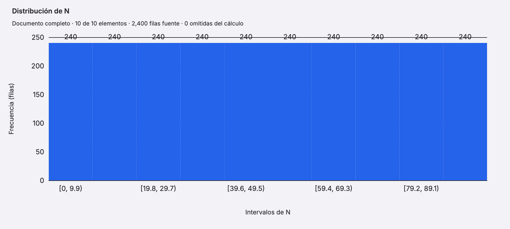

# Gráficos · respetar la espera existente del CSV grande

En [la CI 44782501446](https://github.com/ruzer/freyalab/actions/runs/44782501446/job/136448770201), macOS falló dos veces en `charts.spec.ts:121`. `finishChart()` aplicaba una espera genérica de 15 s antes de llegar a los 90 s que el mismo caso ya tenía escritos. La traza del primer intento mide 15.200 s en esa espera; la del reintento, 15.058 s. Los últimos estados fueron «Ejecutando la consulta» y «Cargando los datos». No alcanzaron la exportación.

La prueba usa un documento grande y siempre dispone del botón manual. Cambian solo dos llamadas: se pulsa ese mismo botón directamente y se mantiene la comprobación de resultado que ya esperaba 90 s. Se conserva el límite general de 120 s, el fixture, los rechazos, las exportaciones SVG/PNG/PDF, los recuentos de 2.400 filas y 2.000 puntos parciales y el hash/mtime del original. No se cambia la app, el motor, IPC, guardado, dependencias, workflow ni reintentos. No se elimina ni añade ninguna identidad de prueba. El diff inverso exacto devuelve el archivo anterior, salvo esas dos llamadas y su comentario.

## Rojo → verde real

Base: `43913e2d846659100d932e9a676d8f6bb00d97c0`. Código de prueba corregido: `06ab3da230db02a38df71d7246843eb5e5053e26`. Plataforma local: macOS Apple silicon, Node 24.22.1. [Números y huellas](charts-espera-grande-2026-11-20/proof.json).

| Fase | Resultado | Playwright / proceso |
|---|---|---|
| Caso anterior, respuesta SQL real retenida 17 s | 1 fallo en la espera de 15 s; 0 reintentos | 18.083 / 18.821 s |
| Dos clics directos, misma retención | 1 aprobado; respuesta retenida 17.001 s; 0 reintentos | 27.301 / 27.782 s |
| Caso original sin instrumentación, `--repeat-each=3` | 3/3 aprobados; 0 reintentos/omisiones | 30.164 / 30.725 s |

La sonda privada copia el caso, delega en el manejador real y retiene únicamente la entrega de la primera respuesta SQL válida durante 17 s; no cambia sus datos. El rojo termina antes de liberarla; el verde recorre las mismas exportaciones y rechazos hasta el hash final. La sonda queda fuera del repositorio; no se incorpora demora al producto ni a la CI. No es una medición de velocidad del motor.

Comandos nativos: `npx playwright test tests/e2e/chart-wait-probe.spec.ts --project=csv --grep 'gráficos de un CSV mayor de 50 MiB' --reporter=list,json` en la copia privada, antes y después; luego `npx playwright test tests/e2e/charts.spec.ts --project=csv --grep 'gráficos de un CSV mayor de 50 MiB' --repeat-each=3 --reporter=list,json`. El build se ejecutó antes de las E2E; entre rojo y verde solo cambia la prueba.

| Cierre local | Resultado | Proceso |
|---|---|---|
| `npm run check` | 0 errores y 0 avisos | 13.623 s |
| `npm test` | 3.096 aprobadas, 2 omisiones existentes | 20.122 s |
| `npm run build` | salida 0 | 3.557 s |

Los tres comandos de cierre se ejecutaron en paralelo. Sus tiempos no miden el rendimiento del producto.

El PNG conserva sus bytes originales y se revisó visualmente: solo datos sintéticos. No hay una nueva matriz de capturas claro/oscuro o es/en-XA, porque no cambia ninguna interfaz de producto.

## Límites

Las trazas contienen acciones de prueba y el contexto de error, no identificadores internos de las consultas ni CPU. El histograma ejecuta la consulta principal y otra para totales; repetir fases no demuestra un reinicio. No se afirma cuánto habría tardado en completar la app en aquel runner. La nueva CI debe calificar este head; el verde local no la reemplaza.

No se ejecutó otra suite integral local ni Windows/Linux nativos para este cambio exclusivo de prueba. El flaky de Undo en CSV Texto queda sin corrección aquí; no se confunde con el hallazgo H13 de LF/CRLF ni con pérdida de datos guardados. No se fusionó, publicó ni instaló nada.
