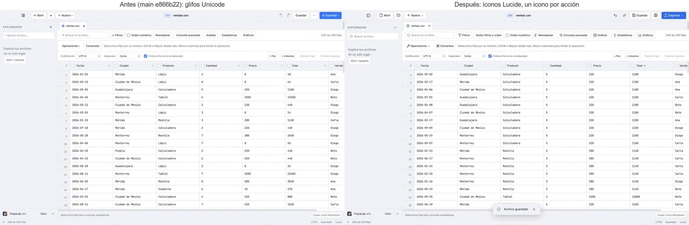
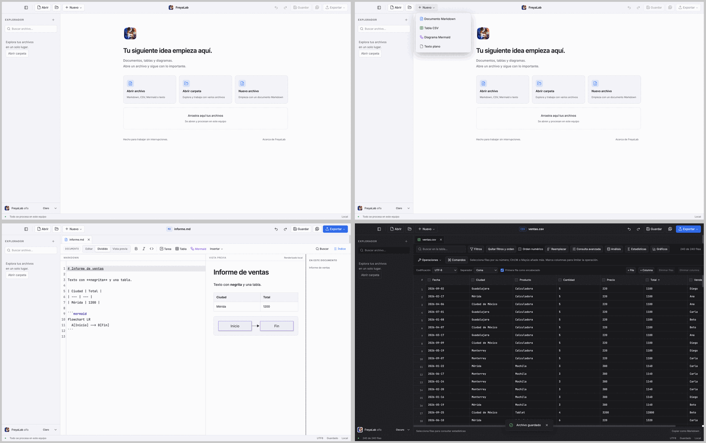

# Sistema de iconos y jerarquía visual de las acciones

Fecha local: 23 de octubre de 2026. Rama: `codex/icon-system`, sobre `main` `e866b22`. Origen: análisis visual de la [auditoría UX/UI](../audit/UX-UI-CONTINUOUS-IMPROVEMENT.md) (PR #39) y comparación con `docs/design/reference.html`. Alcance: iconos, etiquetas, avisos y dos tokens de contraste; no cambia la disposición de los paneles (eso va en el espacio de trabajo flexible).

## Problema

La interfaz usaba 21 caracteres Unicode como iconos (`▥ ▰ ▱ ＋ ↶ ↷ ⋯ ⇧ ⌕ ☷ ✎ ▦ ◇ ▤ ≡ ☑ ⊞ ▾ ▸ ×`). Su aspecto depende de la fuente del sistema, no se leen como acciones (`▰` por «carpeta», `⋯` por «Guardar como»), el nombre accesible de los botones incluía el carácter («▱ Abrir») y no había relación entre tipo de archivo, icono y color. El render aprobado usa iconos vectoriales de la familia Feather (y algunos de Heroicons v1), con trazos de 1,5 a 2 sin criterio común.

## Elección del conjunto

Solo se consultaron licencia y versión en el registro de npm; el encaje de estilo es un juicio visual, no una medición.

| Conjunto | Licencia | Encaje con lo que tenemos | Decisión |
|---|---|---|---|
| **Lucide 1.61.0** | ISC (los derivados de Feather, MIT) | Continuación mantenida de Feather: mismo lenguaje que los iconos del render aprobado (cuadrícula de 24 px, trazo redondeado). Cubre la analítica que necesitamos: `funnel`, `sigma`, `database`, `chart-column`, `chart-line`, `chart-scatter`, `chart-candlestick`, `grid-3x3`, `table`, `workflow`, `command`, `panel-left/right`. Falta un icono de histograma (se usará `chart-column`) | **Elegido** |
| Heroicons 2.2.0 | MIT | Misma familia que parte del render, pero una colección corta; de memoria, sin equivalentes para estadística y datos (no verificado hoy) | Descartado por cobertura |
| Tabler 3.49.0 | MIT | Más de 5 000 iconos, trazo más geométrico que el render | Reserva para iconos que falten |
| Phosphor, Remix, Fluent, Carbon, Material | MIT o Apache-2.0 | Formas más redondeadas, rellenas o corporativas; no coinciden con el tono sobrio del render | Descartados |
| SF Symbols | Licencia de Apple | De memoria, su uso se limita a plataformas Apple: no sirve para Windows ni Linux (no verificado hoy) | Descartado |

Se copian solo los 45 SVG usados (6,4 KB) en `src/renderer/lib/icons.ts`; **no se añade ninguna dependencia**. La licencia (ISC y MIT de Feather) está en `docs/licenses/lucide-ISC-MIT.txt` y `scripts/licenses.mjs` la añade a `THIRD_PARTY_NOTICES.txt` (+50 líneas, ninguna eliminada).

## Cambios

- **`Icon.svelte`** (nuevo): SVG en línea de 24 px, trazo 1,75 y `currentColor`; `aria-hidden` salvo que se pase una etiqueta. Solo inserta cadenas constantes de `icons.ts`, nunca contenido de documentos.
- **Barra superior:** explorador, Abrir, Abrir carpeta, Nuevo, Deshacer, Rehacer, Guardar, Guardar como y Exportar con icono y, donde cabe, etiqueta. Los `title` incluyen el atajo («Guardar · Ctrl/Cmd S»).
- **Tipos de archivo:** `fileKind()` e icono y color únicos (`kind-markdown`, `kind-csv`, `kind-mermaid`, `kind-text`) en el menú Nuevo, pestañas, explorador, resultados de búsqueda y recientes.
- **Barra Markdown:** Negrita, Cursiva y Código con icono; Tarea, Tabla y Mermaid con icono y texto; el menú Insertar muestra un icono por opción (encabezado, lista, cita, enlace, bloque de código).
- **Herramientas CSV:** Filtros, Reemplazar, Consulta avanzada, Análisis, Estadísticas, Gráficos, Operaciones y Comandos con icono y etiqueta; la ordenación muestra una flecha y el lápiz de las cabeceras solo aparece al pasar el ratón o al enfocar.
- **Avisos:** icono de éxito o de advertencia según el tipo; los errores siguen dentro del mismo `role="status"`.
- **Bienvenida:** acciones con icono sobre un cuadro tintado; recuperación e historial con el icono correspondiente; búsqueda del explorador con lupa propia.
- **Contraste (dos tokens):** texto atenuado claro `#777783` → `#6e6e7a` (3,96:1 → 4,51:1 sobre el panel); botón primario `#007aff` → `#0a6cf0` (4,02:1 → 4,76:1 con texto blanco). `Exportar` deshabilitado deja de verse azul.

## Pruebas

- 38 nombres accesibles actualizados en 6 archivos de prueba: antes incluían el glifo («⇧ Exportar ▾»); ahora son los nombres reales («Exportar»). Dos más dejaron de incluir la flecha de ordenación («Código ↑» → «Código»); el estado de orden sigue expuesto con `aria-sort`.
- Las recuperaciones se localizan por su contenedor `.recovery-item` en lugar de por el glifo `↶`.
- `tests/icons.test.ts` (2 unitarias): cada icono es marcado SVG sin scripts ni atributos de evento; `fileKind()` deduce el tipo por extensión y cada tipo tiene un icono que existe.
- `tests/e2e/icons.spec.ts` (2 E2E): en la bienvenida, un CSV y un Markdown ningún control incluye glifos heredados, ningún SVG queda expuesto a lectores de pantalla y ningún botón visible carece de nombre; el aviso de guardado lleva icono y texto, y `Exportar` deshabilitado no se pinta del azul primario.

Resultados locales con **Node v24.22.1** (el de `.nvmrc`), sobre `main` más este cambio: `npm run check` 891 archivos, 0 errores y 0 advertencias; `npm test` 194 aprobadas (21 archivos); `npm run test:e2e` 110 aprobadas (4,3 min); `npm run licenses` correcto. La comprobación visual está en las capturas de este documento.

## Límites

- Solo cambia el aspecto de acciones ya existentes. No se tocan paneles, flujos, exportaciones ni el comportamiento de ordenar o editar.
- Los iconos de los seis tipos de gráfico y de los asistentes SQL no se incluyen: sus controles siguen siendo selectores de texto.
- El icono de «Reemplazar» (`replace`) a 14 px es el menos legible de los nuevos; conviene revisarlo con personas.
- Lector de pantalla no verificado: los iconos son `aria-hidden` y los botones conservan texto o `aria-label`.
- Los scripts de `docs/audit/exploration/` (PR #39) usan los nombres antiguos («⇧ Exportar ▾», «＋ Nuevo ▾») y habrá que actualizarlos al fusionar este PR.
- La CI de cuatro sistemas del commit de este PR es la comprobación de Windows y Linux; la ausencia de glifos elimina la dependencia de la fuente del sistema pero no se probó allí.

## Cómo revertir

Revertir el PR: restituye los glifos, los nombres de prueba y `THIRD_PARTY_NOTICES.txt`. No toca datos, IPC ni dependencias.
