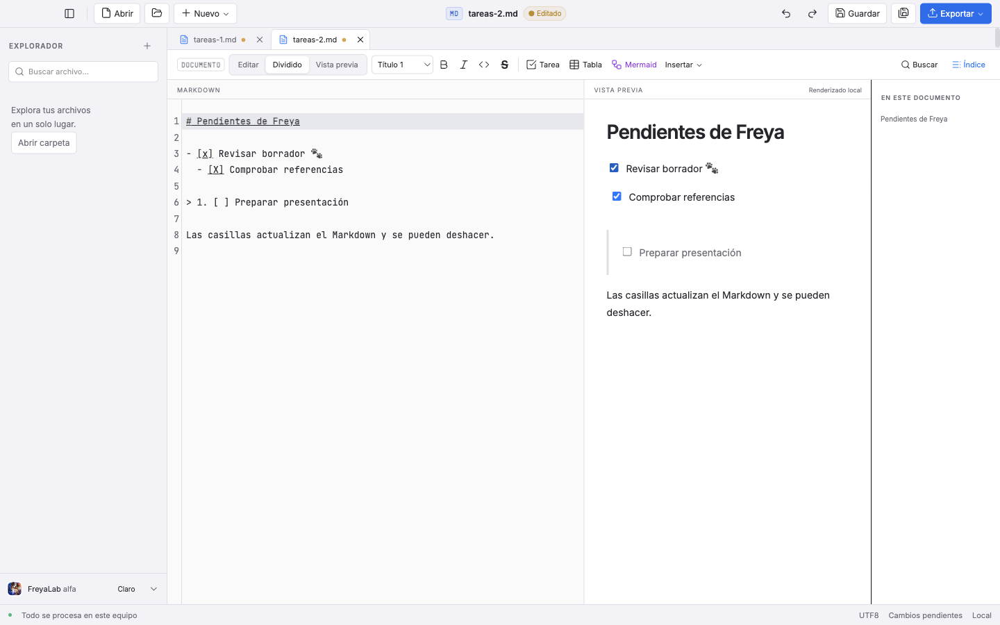
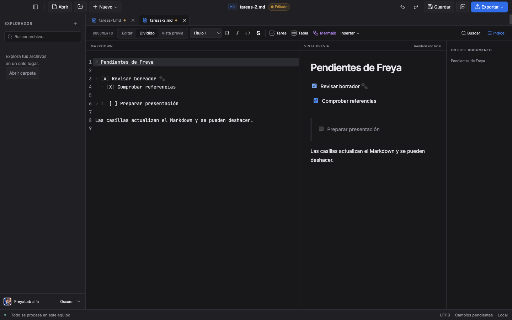

# FL-MD-004 · Casillas interactivas

Fecha: 2026-10-27. Rama: `codex/md-004-casillas`. Base del worktree y base prevista del PR: `codex/md-002-correcciones-render`, en `a93c4b2f598861ef208cae1fff28ba9a8b3930a4`, conforme al lote. El padre corregido corresponde al [PR #68](https://github.com/ruzer/freyalab/pull/68), ya fusionado; main observado es `1df90fdb`. Se conserva la base indicada hasta el cambio explícito a main tras reconciliar el padre.

Las **cuatro comprobaciones locales están completas**: check 0/0, 621 unitarias, 246 E2E en 8,1 min y build final independiente con salida 0. La CI del PR sigue pendiente. El estado final incluye la gramática en el compartimento de UI, configurado solo con el editor montado. Las 615 unitarias y 246 E2E de 8,4 min anteriores se conservan como históricos separados. Los hashes de fuentes, logs y medidas están en [el registro JSON](md-004-casillas-2026-10-27.json). Este cierre local no acredita CI, publicación ni actualización de la app instalada.

## Resultado y arquitectura

Las tareas de la vista previa se pueden marcar con clic, Espacio o Intro. Solo cambia su marcador de tres caracteres; el documento queda con cambios y la acción se deshace en un paso. El texto restante conserva BOM, LF/CRLF, Unicode y sangrías. En solo lectura y exportación, las casillas siguen deshabilitadas.

El render utiliza los nodos GFM existentes. Después del saneado añade únicamente un `data-line` numérico generado a cada tarea localizable. Las referencias `{line,from,expectedLine,marker}` viajan **en memoria**, en orden de las tareas DOM: `from` es un offset UTF-16 del RAW original. No se toma el primer `[ ]` de la línea. Los fragmentos de details recuperan su origen incluso cuando el resumen contiene otro `[ ]` literal o hay dos tareas en la misma línea.

Preview asocia referencias y snapshot con sus propios inputs mediante WeakMap. Una casilla o atributo HTML escrito por el documento no adquiere esa asociación. App mantiene un EditorState y un compartimento de UI por documento: casillas y edición visible comparten un historial CodeMirror, también sin EditorView. No se añade una pila paralela para casillas. El historial de texto de la API de backend y la recuperación existentes permanecen intactos.

La medición pura mostró trabajo de parseo innecesario cuando no existe EditorView. Como ajuste mínimo justificado por esa evidencia, `createMarkdownSession` crea el estado común sin gramática; el lenguaje vive en el compartimento de UI de Editor. Al retirarlo se conserva el mismo estado e historial. Con el editor montado sigue existiendo el coste del parser: no se presenta la retirada del lenguaje en Vista previa como una aceleración universal de la app.

La carrera se resuelve de forma conservadora: **cualquier cambio del snapshot completo invalida el clic**, incluso una edición en notas fuera de la línea de la tarea. Se muestra un aviso y se espera al nuevo render. No se intenta recuperar una posición aproximada de un documento ya cambiado.

Sin dependencias nuevas, nuevos canales IPC o cambios del motor CSV. No se modifica `tests/render.test.ts`: el JSON comprueba igualdad exacta con la base, incluidos los tres casos originales. Los manifiestos permanecen idénticos.

La CI mantiene el ajuste de capacidad de las entregas anteriores: 60 minutos en macOS Intel y 45 en las otras plataformas, sin añadir reintentos o modificar aserciones. Es configuración de hardware; no acredita todavía CI aprobada de esta rama.

## Rojo → verde y problemas encontrados

| Etapa | Resultado real | Log |
|---|---|---|
| Core antes de implementar | Suite fallida al importar el módulo inexistente; **0 casos ejecutados**. Es un rojo de existencia. | `6-core-red.log` |
| Core de cambio y transacción | **45/45**, 108 ms. | `6-core-green.log` |
| Metadatos antes del render nuevo | **22 fallos y 7 guardas aprobadas**, 29 casos, 432 ms. Faltaban tasks/data-line; código y seguridad ya pasaban. | `6-render-red.log` |
| Render y regresiones | **127/127**, cinco archivos, 400 ms; incluye los 29 nuevos, render original, details/context y exportación. | `6-render-green.log` |
| GUI sobre build basal a93 | **1 fallo**, 17,5 s: la casilla seguía disabled. | `6-e2e-red.log`, `6-build-baseline.log` |
| Diagnóstico de recarga con editor montado | **1/1**, 1,9 s; no reprodujo la ruta sin editor. Se conserva separado. | `6-readonly-reload-mounted-diagnostic.log` |
| Recarga sin editor, antes de corregir | **1 fallo real**, 16,6 s: tras pasar de muestra a editable, la UI decía editable y la casilla estaba habilitada, pero el clic no modificaba `[ ]`. | `6-readonly-reload-red.log` |
| Focal nativa posterior a la corrección | **12/12**, 15,5 s; el caso de recarga sin CodeMirror pasa en 1,6 s. | `6-e2e-first.log` |
| Global anterior a separar lenguaje/UI | **246/246**, 8,4 min; check 0/0 y 615 unitarias aprobadas. Es una etapa histórica antes del último cambio de producto. | `6-e2e-before-parser-ui.log`; resultados y hashes previos de check/unit, cuyos logs se sobrescribieron |
| Factoría actual sin gramática en el núcleo | **6 fallos y 45 omitidos** al faltar la exportación; después **51/51**, 126 ms. | `6-session-red.log`, `6-session-green.log` |
| Focal nativa actual, posterior a gramática/UI | **12/12**, 15,3 s. Recarga sin editor aprobada en 1,7 s. | `6-e2e-parser-ui-focal.log` |
| Global y build finales actuales | **246/246**, 8,1 min, sin reintentos; build independiente con **salida 0**. | `6-e2e-final.log`, `6-build-final.log` |

La factoría de sesión se añadió después de esa etapa, con seis pruebas nuevas que fallaron antes de existir la exportación. Esto no se atribuye al rojo inicial de módulo inexistente ni al verde global anterior. Tras el cambio se repitieron las cuatro comprobaciones comunes, terminadas correctamente sobre el mismo código final.

Solo los logs históricos de check y unitarias de 615 casos se sobrescribieron antes de copiarse. El JSON conserva los resultados observados y sus hashes previos, marcados **LOG SOBRESCRITO / no disponible**; no se fabricaron archivos antiguos ni se repitió una ejecución para recrearlos. Los builds anteriores sí se conservan: `6-build-focal.log` mantiene el hash `cc4527d…` registrado y `6-build-focal-final.log` corresponde a la focal posterior al arreglo de readonly (`8b0c142…`). El global histórico de 246 y sus capturas también se conservan íntegros.

El bloqueo al recargar provenía de un facet readOnly fijo en el núcleo compartido de EditorState. Se retiró ese término; permanecen la guarda de permiso del documento y el compartimento de permisos de UI. El primer diagnóstico en Dividido había pasado y **no se presenta como reproducción del fallo**. El rojo posterior se obtuvo en Vista previa sin EditorView y la focal final vuelve a probar ambos permisos.

La sonda pura de revisión había colocado el facet base antes del compartimento ui, mientras App colocaba ui antes del base. Esa sonda no demuestra un fallo en la ruta montada: el diagnóstico nativo en Dividido pasó. La reproducción válida fue exclusivamente la ruta de Vista previa sin UI/Editor, en la que el facet fijo quedaba sin el override del compartimento.

La revisión también detectó que el cleanup del editor leía referencias reactivas al destruir una pestaña. Se capturaron la sesión y el callback de la instancia al montarse. No se obtuvo un rojo nativo independiente de ese cleanup; la focal posterior sí comprueba la ruta final de pestañas y sus historiales. Se distingue la inspección de código de una reproducción aislada.

Tras la primera focal de 12 se ajustó la captura del último caso: conserva la prueba del documento largo y después abre una guía breve para mostrar tres tareas con contexto. Ese ajuste de captura no cambió producto. Después sí cambió la colocación de la gramática y se repitió la global: las imágenes de abajo proceden de esa **ejecución final 246/246**, no de la etapa histórica anterior.

## Criterios C1–C6

| Criterio | Evidencia focal |
|---|---|
| C1 · tres caracteres | Igualdad exacta de RAW antes/después: LF, CRLF y mezcla, BOM, YAML, Unicode, `[X]`, cita y plegable compacto con marcador literal previo. El original en disco sigue intacto hasta guardar. |
| C2 · un historial | Un deshacer por acción; guardar no elimina la historia. Vista previa sin EditorView usa clic, Espacio, Intro, undo/redo y conserva el historial al volver a Dividido y cambiar de pestaña. |
| C3 · GFM | Anidadas, numeradas, citas, `*`, `+` y sangría con tabulación. Código y tablas siguen siendo texto. La metadata cubre además tres niveles de details y notas al pie en orden DOM. |
| C4 · carreras | Edición entre render y clic y dos clics rápidos sobre el mismo snapshot: aviso y ninguna escritura sobre una referencia obsoleta ni sobre la segunda tarea idéntica. |
| C5 · permisos/exportación | Muestra de solo lectura: clic, teclado y eventos sintéticos no escriben. Tras recargar como editable funciona sin EditorView. HTML exportado lleva casillas disabled y sin metadatos internos; PDF con texto esperado y sin anotaciones interactivas. |
| C6 · saneado | Solo las casillas derivadas y asociadas internamente pueden editar. HTML hostil no crea otro control privilegiado ni eventos/script; data-line es numérico y generado después del saneado. |

Las etiquetas accesibles son «Marcar tarea: <texto>». La E2E comprueba foco tras Espacio e Intro, ambos temas y barra de herramientas de como máximo 43 px. Las pruebas de eventos sintéticos de solo lectura son guardas programáticas; no equivalen a interacción física adicional.

## Medición actual de la factoría sin editor

La tercera medición usa directamente `createMarkdownSession(source)` del producto, con UI vacía y sin lenguaje. Un calentamiento descartado y tres muestras por formato, con los mismos fixtures ASCII de 10 485 760 bytes y los mismos SHA que las etapas anteriores. Setup fuera del reloj; transacción y undo medidos por separado.

| Formato | Transacción: mediana / máximo (ms) | Undo: mediana (ms) |
|---|---:|---:|
| LF | 5,825 / 6,605 | 0,062 |
| CRLF | 6,246 / 6,528 | 0,083 |
| Mixto | 5,468 / 5,652 | 0,045 |

Estos son números del **núcleo actual sin editor montado**, no el control antiguo renombrado: la medición invoca la factoría real y su hash coincide con la fuente actual. Verifica el parche RAW de tres caracteres y undo en todas las muestras. Las seis pruebas de factoría comprueban además instalar/quitar UI con Markdown y conservar undo/redo y separación por documento.

No son latencia de la app: no hay EditorView, Electron, DOM, IPC ni render de Markdown en el reloj, y no se midieron RAF o memoria. Cuando el editor está montado, vuelve a instalar la gramática y puede conservar trabajo de parser; **no se afirma que la app completa o el modo Editar respondan en 6 ms**.

## Mediciones puras anteriores: gramática y control

Node 24.22.1, arm64, Apple M2 Max, 32 GiB. Tres fixtures ASCII de **10 485 760 bytes** cada una, filas de texto de 879 caracteres y una tarea al final. Un calentamiento descartado y **tres muestras** por formato. La construcción inicial de EditorState queda fuera del reloj de transacción; undo se mide aparte.

| Formato | Líneas | Transacción con history + Markdown: mediana / máximo (ms) | Undo: mediana (ms) | Control con history sin Markdown: mediana / máximo (ms) |
|---|---:|---:|---:|---:|
| LF | 11 917 | 474,064 / 478,891 | 468,724 | 5,957 / 6,694 |
| CRLF | 11 904 | 479,172 / 480,476 | 470,422 | 6,243 / 6,327 |
| Mixto | 11 910 | 468,717 / 487,174 | 463,154 | 5,674 / 5,756 |

El escenario anterior reproduce los campos centrales de App con history y lenguaje Markdown; el control elimina únicamente esa extensión. La diferencia describía trabajo de actualización de CodeMirror en esta forma de documento; **el control de ~6 ms no sustituye a la medición anterior con gramática de ~470 ms**. Ambos se conservan como históricos, separados de la tercera medición actual de la factoría.

Todas las muestras verificaron SHA-256 del RAW completo, el parche esperado de tres caracteres y la restauración después de un undo; un segundo undo no tenía evento. Los hashes de los fixtures coinciden entre ambos escenarios. El JSON incorpora muestras, calentamientos, setup, entorno y manifiesto original, además del hash del helper medido.

Esto es una medición de **Node y EditorState**, sin Electron, EditorView, DOM, IPC, guardado ni exportación. No se midieron memoria o RAF. No acredita una respuesta visual inferior a 200 ms al pulsar una casilla de un archivo de 10 MiB ni ausencia de pausas en la app. No se convierte una medición pura en una afirmación de rendimiento de escritorio.

No hubo una comparación directa de rendimiento con la app basal: el escenario sin Markdown es un control puro, no la aplicación anterior.

## Comandos y estado de comprobaciones

Entorno nativo: macOS 27.0.1, Electron 44.9.2, Node 24.22.1; equipo descrito arriba. Fixtures locales sintéticos; ningún documento del usuario en pruebas o evidencias.

| Comando | Resultado confirmado |
|---|---|
| `npx vitest run tests/markdown-tasks.test.ts` | 45/45. |
| `npx vitest run tests/markdown-task-render.test.ts tests/render.test.ts tests/remark-details.test.ts tests/remark-details-context.test.ts tests/export.test.ts` | 127/127, cinco archivos, 400 ms. |
| `npm run check`, antes de la focal posterior al arreglo | 0 errores, 0 advertencias. `6-check-focal.log`. |
| `npm run build`, antes de la focal anterior posterior al arreglo readonly | Código de salida 0. `6-build-focal-final.log`. El primer build candidato se conserva aparte en `6-build-focal.log`. |
| `npx playwright test tests/e2e/markdown-tasks.spec.ts` | 12/12, 15,5 s. `6-e2e-first.log`. |
| `npm run check`, etapa anterior con lenguaje en el núcleo | **0 errores, 0 advertencias**; salida 0. Histórico antes del cambio de producto. |
| `npm test`, misma etapa | **615/615**, 34 archivos, 5,10 s; salida 0. Histórico. |
| `npm run test:e2e`, misma etapa | **246/246**, 8,4 min. `6-e2e-before-parser-ui.log`. Histórico. |
| Core actual con la factoría de sesión | **51/51**, 126 ms; seis pruebas nuevas tras rojo propio. |
| Focal Electron actual | **12/12**, 15,3 s. `6-e2e-parser-ui-focal.log`. |
| Build actual anterior a esa focal | **Salida 0**. `6-build-parser-ui-focal.log`; es distinto de los builds anteriores. |
| `npm run check` final actual | **0 errores, 0 advertencias**, salida 0. `6-check-final.log`, copia estable `6-check-parser-ui.log`. |
| `npm test` global final actual | **621/621**, 34 archivos, 5,02 s, salida 0. `6-unit-final.log`, copia estable `6-unit-parser-ui.log`. |
| `npm run test:e2e` global final actual | **246/246**, 8,1 min, sin reintentos; salida 0. `6-e2e-final.log`. |
| `npm run build` final independiente | **Salida 0**. `6-build-final.log`; el bundle renderer coincide con el de la focal actual. |
| CI de macOS Intel/ARM, Windows y Linux | **Pendiente**. |

Scripts de medición externos: `node /private/tmp/freyalab-lote/6-task-benchmark.mjs`, `node /private/tmp/freyalab-lote/6-task-benchmark-history.mjs` y `node /private/tmp/freyalab-lote/6-task-benchmark-current.mjs`. No son comandos de producto ni dependencias permanentes. Los logs terminados y sus hashes están registrados; no se sellan logs abiertos.

## Capturas 1440×900

Capturas finales de la guía breve producidas por la **global actual 246/246**, bajo `6-global-evidence`, copiadas sin retoque. Se conservan también `6-focal-parser-ui` (focal actual), `6-before-parser-ui-evidence` (global histórica de 8,4 min) y `6-focal-evidence` (documento largo), con procedencia y hashes separados.

Claro:

Oscuro:

## Límites pendientes e integración

- Las cuatro comprobaciones locales están completas; solo queda la CI de macOS Intel/ARM, Windows y Linux. No se usa el resultado de otro PR o del estado histórico como prueba del actual.
- No se midió latencia de la aplicación, RAF ni memoria con 10 MiB; el límite de rendimiento puro se conserva explícito.
- Las E2E locales usan Electron y `out`, no un instalador o la app instalada. No se acreditan empaquetado o instalación con estas 12 pruebas focales ni se reutilizan comprobaciones de otros cambios. No se publicó o actualizó la app instalada.
- El PR debe ser en borrador, dirigido a la rama padre indicada por el lote; no se cambia su base, fusiona ni publica desde esta evidencia.
- Integración futura con [PR #72](https://github.com/ruzer/freyalab/pull/72): conservar `markdown({pasteURLAsLink:false})` en el compartimento de UI de Editor, donde ahora reside la gramática. La base a93 todavía contiene `markdown()`; no se importó código de ese PR en esta entrega independiente.
