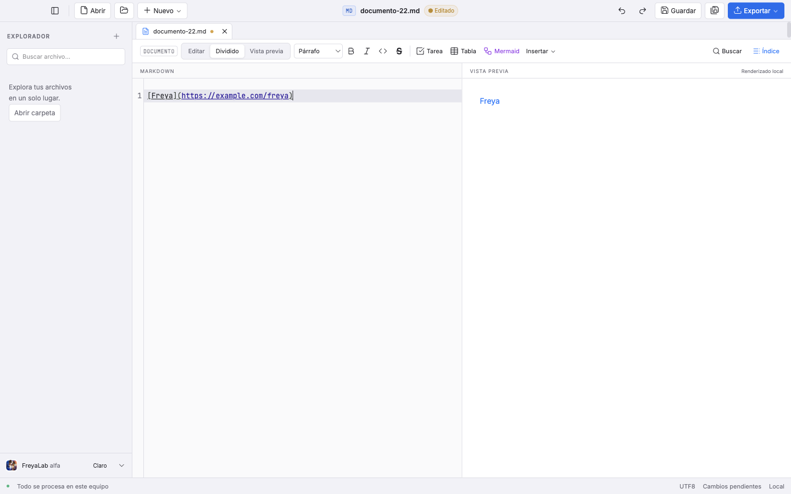
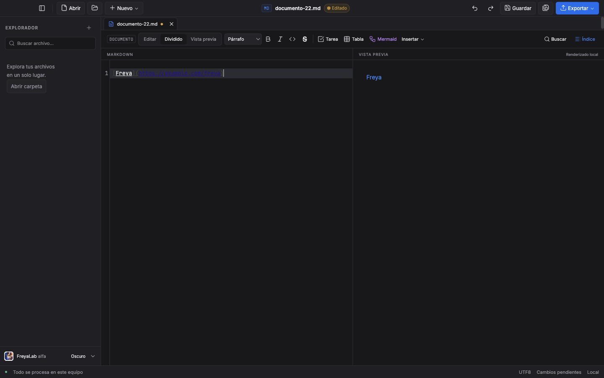

# FL-MD-005 · Pegar una URL sobre texto seleccionado

Fecha: 2026-10-27. Rama: `codex/md-005-pegar-url`. Base: `1df90fdb8c46bab61c28b090113596b00848e5da`.

Esta evidencia corresponde a las fuentes identificadas por SHA-256 en [el registro JSON](md-005-pegar-url-2026-10-27.json), todavía sin commit al capturar las pruebas. Las cuatro comprobaciones locales terminaron correctamente: check, unitarias, E2E global y build final independiente. La CI del PR sigue pendiente. Esto no acredita una fusión, publicación ni actualización de la app instalada.

## Resultado y alcance

Seleccionar texto y pegar una única URL HTTP, HTTPS o mailto crea un enlace Markdown. Una acción de deshacer recupera la fuente y la selección originales. El pegado sin formato mediante Ctrl/⌘+Mayús+V pega la URL literalmente.

La inspección previa confirmó que CodeMirror **ya incluía** `pasteURLAsLink` por defecto. Su validación aceptaba, por ejemplo, una URL con espacios. Se desactivó ese controlador y se integró una adaptación estricta sobre el árbol sintáctico existente: no hay dos controladores de autoconversión ni una librería nueva.

El módulo `markdown-paste.ts` devuelve un cambio sin modificar el estado recibido. `Editor.svelte` lo aplica en una sola transacción `input.paste`, con aislamiento del historial. La detección rechaza código, enlaces, imágenes y HTML, selecciones vacías, múltiples o multilínea, protocolos distintos, espacios y caracteres de control. Si el árbol necesario todavía no está disponible, deja actuar al pegado normal en vez de adivinar el contexto.

Solo cambian cuatro archivos de producto: el módulo nuevo, `Editor.svelte`, preload y el proceso principal. No se modifican App, renderizador, CSV, CSS, guardado o recuperación. `package.json` y `package-lock.json` permanecen idénticos a la base; sus hashes y la comprobación de igualdad están en el JSON.

La configuración de CI conserva el ajuste de capacidad de los trabajos anteriores: 60 minutos para macOS Intel y 45 para las otras tres plataformas, sin añadir reintentos. Es una adaptación al tiempo de ejecución de ese hardware, no una relajación de aserciones ni un resultado de CI de esta rama.

## Pruebas primero y secuencia real

| Etapa | Resultado observado | Evidencia original |
|---|---|---|
| Core antes de implementar | Suite falla al importar el módulo inexistente; cero casos ejecutados. Es un rojo de existencia, no de comportamiento. | `4-core-red.log` |
| GUI sobre la base construida | 1 fallo, 2,6 s: `https://example.com/una ruta` convertía `texto` en `[texto](https://example.com/una ruta)` en vez de un pegado ordinario. | `4-e2e-red.log`, `4-paste-baseline.json` |
| Primera validación del core | 39 aprobados y 1 fallo: la expectativa omitía que el renderizador codifica `[`/`]` del href como `%5B`/`%5D`. Se corrigió la expectativa; no el producto. | `4-core-render-encoding-initial.log` |
| Contextos HTML antes de sus guardas | 3 fallos reales: atributo HTML, comentario y procesamiento admitían una conversión que el controlador anterior evitaba. 40 casos omitidos por la ejecución focal. | `4-html-context-red.log` |
| Core final | **43/43 aprobados**, 247 ms. | `4-core-final.log` |
| Primera focal GUI | **8/11 aprobados**, 24,3 s. Dos expectativas incorrectas y un problema real del atajo sin formato; se describen debajo. | `4-e2e-first.log` |
| Focal GUI final | **11/11 aprobados**, 8,3 s, después de construir los tres procesos con la solución nativa. | `4-e2e-native.log`, `4-build-native.log` |
| E2E global final | **245/245 aprobados**, 8,1 min, sin reintentos. Incluye de nuevo los 11 casos de pegado. | `4-e2e-final.log` |

En el caso con espacios, el resultado final es exactamente la URL pegada como fuente. La vista previa puede convertir el primer token en enlace mediante GFM; no se ha cambiado esa regla del renderizador.

### Qué falló en la primera focal

1. **Historial:** el texto y la selección se restauraban correctamente con un solo deshacer. La expectativa adicional de rehacer y obtener un cursor vacío era incorrecta. Se reprodujeron seis ejecuciones puras: transacción FreyaLab y pegado estándar de CodeMirror, con y sin aislamiento completo, tanto sobre todo el documento como entre un prefijo y un sufijo. En todas, rehacer selecciona el rango insertado. La prueba conserva las aserciones fuertes de deshacer y comprueba esa semántica estándar al rehacer. No se cambió el historial de producto para adaptar la prueba.
2. **Destino del enlace:** el href real `https://example.com/wiki/A_(B)%5BC%5D` conserva el destino solicitado. Se corrigió la expectativa que comparaba corchetes literales con corchetes codificados. La fuente Markdown sí conserva sus escapes explícitos y el texto visible sigue siendo `Freya (demo)`.
3. **Ctrl/⌘+Mayús+V:** en Mac, el teclado virtual enviaba un keydown trusted, pero no se producía ningún evento paste. La bandera del editor no podía resolver un evento inexistente. Este fue un fallo real, corregido después del diagnóstico.

El rehacer usa ⌘+Mayús+Z en Mac y Ctrl+Y en Windows/Linux, siguiendo los atajos instalados de CodeMirror. El problema descubierto en la CI de FL-MD-003 se trató en su propia rama; esta historia reutiliza la corrección de la prueba.

## Pegado sin formato: diagnóstico y solución mínima

Los diagnósticos están conservados, sin sustituir los resultados fallidos:

- `4-history-diagnostic.{mjs,json,log}` y `.md`: las seis ejecuciones de historial descritas arriba.
- `4-shortcut-diagnostic.{mjs,json,log}`: ⌘+Mayús+V y ⌘+Opción+Mayús+V recibían teclas trusted, pero ningún paste; ⌘+V sí pegaba. El menú predeterminado de Electron anuncia «Paste and Match Style» con ⌘+Opción+Mayús+V.
- `4-shortcut-exec-command.{json,log}`: `document.execCommand('paste')`, invocado desde ese keydown trusted, devuelve `false` y no genera paste. **Se descartó; no está en el producto.**
- `4-shortcut-native-hook*.{json,log}`: sonda aislada del evento principal `before-input-event`. Playwright/CDP no lo generó en la ventana correcta, incluso para ⌘+V, que sí produjo el evento DOM paste. Por ello esta sonda **no acredita ni refuta** el comportamiento con teclado físico. **Ese hook no se implementó.** El primer timeout de 30 s también se conserva.

La solución adoptada consume en preload únicamente un keydown **trusted**, sin composición y con Ctrl/Meta+Mayús+V, sin Alt. Emite la señal DOM fija `freya-paste-plain` y envía un mensaje privado sin datos `freya:paste-plain`. El proceso principal valida el emisor con `assertSender` y pide el pegado a `webContents.pasteAndMatchStyle()`. El editor consume la señal una sola vez y deja el contenido al pegado normal de CodeMirror.

No se expone un método de lectura del portapapeles en `window.freya`, no se habilita `navigator.clipboard`, ni se cambian permisos, CSP, saneado o aislamiento. La E2E observa **cero mensajes IPC y ninguna edición** al despachar un KeyboardEvent no trusted; el atajo real del teclado virtual produce **un mensaje** y una sola operación reversible. Esta verificación no equivale a una auditoría completa de seguridad.

## Cobertura P1–P6

| Criterio | Verificación concreta |
|---|---|
| P1 · selección y URL estrictas | HTTP/HTTPS/mailto; rechaza www, xmpp, javascript, data, espacio, tabulación, saltos de línea, controles y URL inválida. Selección vacía, múltiple o multilínea cae al pegado normal. |
| P2 · contexto existente | Código en línea, cercado e indentado; enlace explícito y por referencia; autolink, URL literal, imagen, atributo, comentario y procesamiento HTML. E2E cubre código en línea/cercado, enlace y URL literal. |
| P3 · una transacción | E2E: fuente y selección originales tras un deshacer; rehacer recupera el resultado con el rango insertado seleccionado, como el historial estándar. |
| P4 · escapes | Fuente exacta con paréntesis y corchetes escapados, texto visible intacto y href real equivalente. Core adicional con Unicode, barra invertida y CRLF. |
| P5 · sin red ni ejecución | Portapapeles real con texto plano y HTML hostil: usa la URL plana; cero solicitudes HTTP(S), sin script/imagen insertados y sin ejecución del marcador. |
| P6 · solo lectura | Archivo de 10 MiB + 1 byte abierto como muestra de solo lectura; el modelo cargado y los bytes del archivo permanecen iguales tras pegar. No es una prueba de edición de 10 MiB. |

Las otras comprobaciones focales cubren texto ya en negrita, un título, Ctrl/⌘+Mayús+V y dos temas. La composición IME se comprueba con `CompositionEvent` y `ClipboardEvent` **sintéticos**, con `isTrusted=false`; no se afirma haber probado un IME físico.

## Portapapeles y datos de prueba

Las pruebas nativas materializan todos los tipos de cada `ClipboardItem` y conservan el snapshot únicamente en memoria del proceso principal. Antes de sustituirlo por fixtures, verifican que se pueda reescribir atómicamente. El `finally` restaura el snapshot completo; la limpieza y la restauración terminaron sin excepción en las ejecuciones registradas.

El contenido original del portapapeles **no se imprime, no se guarda en artefactos y no entra al repositorio**. Los JSON contienen solo las cadenas de prueba. No se ha validado manualmente la interpretación de todos los formatos restaurados en cada aplicación externa.

## Comprobaciones ejecutadas

Entorno local: macOS 27.0.1, arm64, Apple M2 Max, 32 GiB, Node 24.22.1 y Electron 44.9.2. Electron se lanza desde `out`; las focales finales utilizaron el build corregido, y el rojo original utilizó el build de la base. No se mezclan esos dos estados.

| Comando | Resultado confirmado al escribir esta versión |
|---|---|
| `npx vitest run tests/markdown-paste.test.ts` | 43/43; 247 ms. |
| `npm run check` final | **0 errores, 0 advertencias**. `4-check-final.log`. La comprobación previa a la focal también pasó en `4-check-native.log`. |
| `npm run build` antes de la focal final | Código de salida 0. `4-build-native.log`. Conserva avisos del build, entre ellos configuración Svelte predeterminada y tamaño de chunks; no se afirma ausencia de avisos. |
| `FREYALAB_PASTE_EVIDENCE_DIR=/private/tmp/freyalab-lote/4-focal-native FREYALAB_PASTE_PHASE=native npx playwright test tests/e2e/markdown-paste.spec.ts` | 11/11; 8,3 s. |
| `npm test` global final | **584/584**, 33 archivos, 5,19 s; código de salida 0. `4-unit-final.log`. |
| `npm run test:e2e` global final | **245/245**, 8,1 min, sin reintentos; código de salida 0. `4-e2e-final.log`. |
| `npm run build` final independiente | **Código de salida 0**. `4-build-final.log`. |
| CI en las cuatro plataformas | **Pendiente**; no se sustituye por pruebas locales. |

Los comandos locales usaron Node 24 en PATH. Los diagnósticos temporales se ejecutaron mediante `node /private/tmp/freyalab-lote/4-history-diagnostic.mjs` y `node /private/tmp/freyalab-lote/4-shortcut-diagnostic.mjs`, con sus variantes `--exec-command` y `--native-hook`. Son herramientas de prueba externas, no CLI del producto.

Los logs originales permanecen bajo `/private/tmp/freyalab-lote/4-*`. El JSON adjunto registra sus rutas, tamaños y SHA-256, además de las fuentes, manifiestos y configuración de CI. Las capturas finales se copiaron sin modificación desde `4-global-evidence`, generadas durante la suite completa. También conserva la ruta y el hash de cada captura focal anterior de `4-focal-native`; los originales no se borraron.

## Capturas

Claro, 1440×900:

Oscuro, 1440×900:

No se añadió ningún control ni franja. Las capturas muestran la edición y la vista previa reales; no constituyen una medición independiente de contraste o rendimiento.

## Lo no verificado y estado de entrega

- Las cuatro comprobaciones locales están completas: check 0/0, 584 unitarias, 245 E2E y build final 0. La focal anterior de 11 casos se conserva como etapa independiente, no como sustituto de la suite global.
- La CI de macOS Intel/ARM, Windows y Linux sigue pendiente. No hay aquí una comprobación de instalación, firma o empaquetado nuevo.
- No se probó un teclado físico ni un IME físico. La limitación del diagnóstico `before-input-event` queda explícita.
- No se añadió un benchmark nuevo de 10 MiB; el caso grande de solo lectura valida integridad de una muestra, no rendimiento ni edición integral.
- Los dominios internacionales se validan con la implementación `URL` del navegador y se inserta la cadena original con escapes Markdown, sin un analizador IDN propio. Es una decisión comprobada en el código; no se añade aquí una prueba E2E específica de IDN.
- No se fusionó, publicó ni actualizó la app instalada. El PR debe permanecer en borrador. La apertura del PR espera el gate de la tarea anterior; esta evidencia no declara ese gate aprobado.
