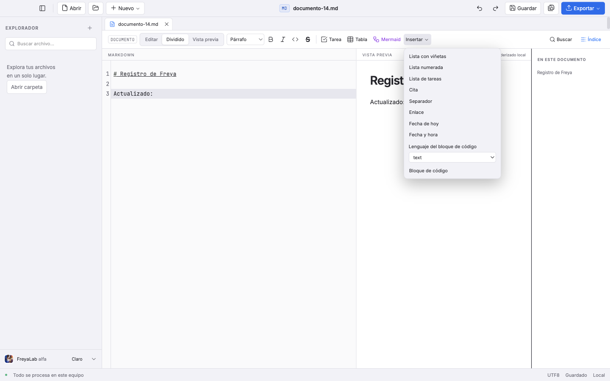
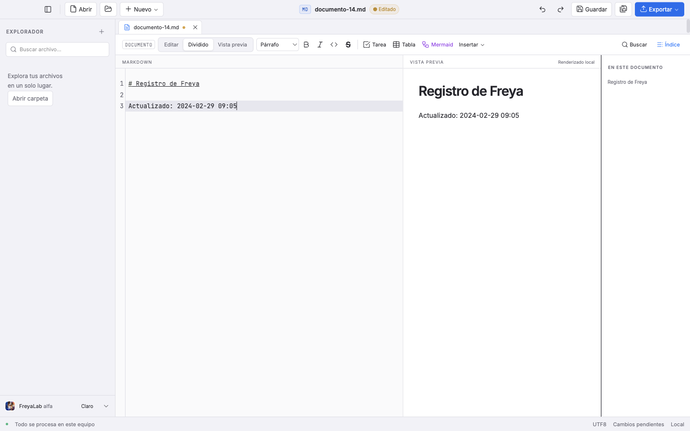
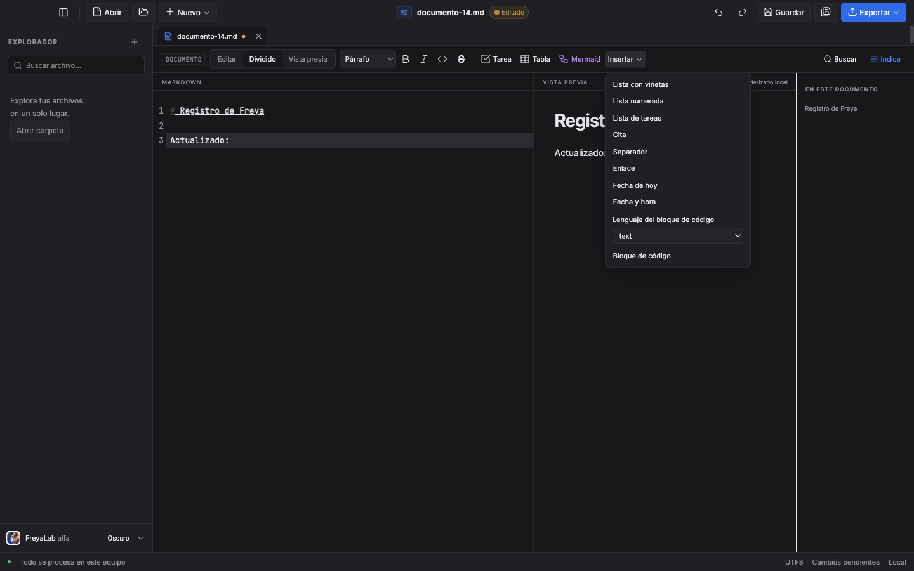
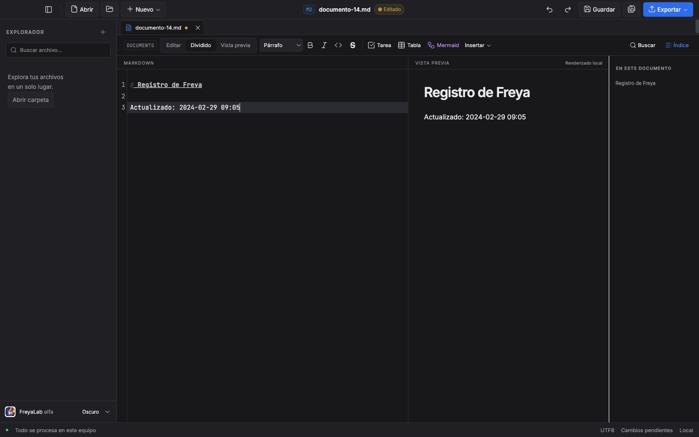

# FL-MD-008 · Insertar fecha y hora

Fecha: 2026-10-27. Rama: `codex/md-008-fecha-hora`. Base: `1df90fdb8c46bab61c28b090113596b00848e5da`.

Mejora incremental de la experiencia Markdown, dentro de la entrega 6 de [PLAN](../PLAN.md). Las fuentes y resultados están identificados por SHA-256 en [el registro JSON](md-008-fecha-hora-2026-10-27.json). Las cuatro comprobaciones locales terminaron correctamente: check, 571 unitarias, 244 E2E y build final independiente. La CI sigue pendiente. Todavía no hay commit candidato al capturar esta versión; no se acredita fusión, publicación ni actualización de la app instalada.

## Resultado

El menú **Insertar** añade «Fecha de hoy» y «Fecha y hora», después de Enlace y antes del selector de lenguaje. Insertan `AAAA-MM-DD` o `AAAA-MM-DD HH:mm`, con la hora local del equipo en formato de 24 horas. Reemplazan la selección completa y dejan el cursor al final. Cada inserción es una acción independiente de deshacer.

Se reutilizan el registro de comandos, la barra y la transacción única existentes. `Editor.svelte` obtiene `new Date()` únicamente al ejecutar estas dos acciones y pasa ese valor al comando puro. La lógica no lee el reloj, no usa UTC para formatear ni modifica el objeto Date recibido. Sin fecha o con Invalid Date, devuelve ningún cambio y conserva la selección.

No hay botones nuevos fuera del menú, atajos nuevos ni opciones de formato. La guarda existente bloquea composición IME, documentos distintos de Markdown y solo lectura. El texto dentro de código o front matter se trata como texto al insertar; no se interpreta ni se reescribe su estructura.

Solo cambian tres archivos de producto: `markdown-commands.ts`, `Editor.svelte` y `MarkdownToolbar.svelte`. Se amplía la prueba unitaria existente y se añade la E2E. App, renderizador, CSV, Mermaid, IPC, guardado y recuperación no cambian. `package.json` y el lockfile son idénticos a la base; la igualdad y sus hashes están registrados.

La CI conserva el ajuste de hardware de las tareas anteriores: 60 minutos para macOS Intel y 45 para las otras plataformas. No añade reintentos ni modifica las aserciones; tampoco acredita que esta rama ya haya pasado la CI. Su configuración tiene un hash separado en el registro.

## Secuencia rojo → verde

| Etapa | Resultado real | Log original |
|---|---|---|
| Core antes del cambio | **29 fallos**, 116 casos omitidos intencionalmente: las acciones date/datetime no existían. | `5-core-red.log` |
| GUI sobre el build de la base | **1 fallo**, 17,4 s: «Fecha de hoy» no existía en Insertar. Se conservan las etiquetas y fuente de partida. | `5-e2e-red.log`, `5-date-baseline.json` |
| Core completo inicial con la implementación | **145/145**, 149 ms: 29 casos nuevos y 116 existentes, antes de añadir el caso explícito de cambio horario. | `5-core-green.log` |
| Core nuevo en tres zonas | **29/29 por proceso**, con los 116 existentes omitidos deliberadamente en cada ejecución. | `5-core-{utc,ny,kiritimati}.log` |
| Primera focal GUI | **9/10**, 7,7 s. La inserción, el texto resultante y los dos pasos de deshacer pasaban; falló una expectativa adicional de selección al rehacer. | `5-e2e-first.log` |
| Focal GUI final | **10/10**, 7,7 s, con las mismas tres fuentes de producto. | `5-e2e-final-focal.log` |
| Cobertura adicional de cambio horario | Añadida después de la implementación inicial: **1 fallo contra la base**, 145 omitidos; después **1 aprobado y 145 omitidos por zona** en UTC, New York y Kiritimati. No cambió el producto. | `5-dst-red-baseline.log`, `5-dst-{utc,ny,kiritimati}.log` |
| Core actual dentro de la suite global | **146 casos**: 30 nuevos y 116 existentes, incluidos en los **571/571** aprobados globales. No se midió una ejecución aislada nueva de esos 146. | `5-unit-after-dst.log` |
| E2E global final | **244/244**, 8,0 min, sin reintentos. | `5-e2e-final.log` |

La primera E2E esperaba que rehacer seleccionase la fecha insertada, copiando la expectativa de un caso que reemplazaba una selección. Aquí la inserción partía de un cursor vacío: el resultado real mantenía el cursor vacío. Se corrigió **solo la prueba** y se añadió escribir `!` tras rehacer, exigiendo `Nota 2024-02-29!`; esto demuestra que el cursor queda al final. Las aserciones de dos inserciones y dos pasos de deshacer siguen intactas. No se cambió el historial ni el producto para hacer pasar esta expectativa.

El rojo adicional de cambio horario se obtuvo posteriormente contra `1df90fdb`, mediante una copia temporal del test que se retiró al terminar. **No se presenta como un trigésimo caso en rojo antes de la primera implementación.** La única ampliación fue un test unitario; las tres fuentes de producto y la E2E son idénticas por hash a las usadas en la focal y en la suite global. Por ello se repitieron check y unitarias tras añadirlo, conservando la E2E global ya terminada sobre el mismo comportamiento.

## Cobertura F1–F8

| Criterio | Verificación |
|---|---|
| F1 · formato local exacto | Fecha y fecha/hora, ceros a la izquierda, 00:00, 23:59, fin/inicio de año y 29 de febrero. La UI utiliza un reloj fijo local y comprueba cadenas literales esperadas. |
| F2 · selección y cursor | Reemplazo de selección multilínea; cursor colapsado tras el resultado. En CRLF se selecciona el último `5` con el teclado para comprobar su posición. |
| F3 · historial y cambios | Dos inserciones necesitan dos undos. Deshacer recupera fuente y selección originales. Dirty, original intacto antes de guardar y archivo exacto después de guardar se verifican en Electron. |
| F4 · lógica pura | Fecha inyectada; no se modifica el Date recibido. Ausencia o Invalid Date no cambian texto ni selección. Casos ejecutados con TZ=UTC, America/New_York y Pacific/Kiritimati, más el caso explícito posterior de cambio horario en cada zona. |
| F5 · IME | CompositionEvent y clic sintéticos ejercitan la guarda; después de terminar la composición se inserta normalmente y se conserva el Unicode. **No es una prueba con IME físico.** |
| F6 · Markdown y permisos | Muestra Markdown de solo lectura: ambos botones deshabilitados, fuente y archivo intactos. TXT y Mermaid no ofrecen las entradas. |
| F7 · nombres y teclado | «Fecha de hoy» y «Fecha y hora», orden de tabulación real del menú, activación con Enter y devolución del foco al editor. Sin atajo nuevo. |
| F8 · conservación | LF y CRLF, Unicode fuera de la selección, código y front matter literales; el resto del texto y los originales en disco permanecen iguales hasta guardar. |

El caso de solo lectura utiliza un archivo sintético de 10 MiB + 1 byte que la app abre como muestra del primer MiB. Valida permisos e integridad de esa muestra; no acredita edición ni rendimiento de un archivo completo de ese tamaño.

## Reloj y zonas horarias

Las pruebas de UI usan `page.clock.setFixedTime(new Date(2024,1,29,9,5))`: solo fija Date. No se instala un reloj que detenga timers, requestAnimationFrame o el debounce de la vista previa. Las capturas esperan que desaparezca el indicador de renderizado.

En procesos unitarios separados se construyen las fechas con componentes locales. UTC, America/New_York y Pacific/Kiritimati aprueban los 29 casos nuevos; sus duraciones son 87, 87 y 88 ms respectivamente. Estos números describen el proceso de pruebas y **no son un benchmark de CPU de la inserción**. No se cambió físicamente la zona del sistema ni se garantiza aquí toda configuración regional o transición horaria posible.

Después se añadió la construcción `new Date(2024,2,10,2,30)` para comprobar el día de cambio horario: serializar a fecha/hora local y volver a interpretarla conserva el instante que devolvió Date. New York normaliza la hora inexistente de las 02:30 de acuerdo con el sistema; FreyaLab utiliza ese valor, sin inventar una corrección propia. Cada una de las tres zonas aprobó ese caso con los otros 145 omitidos; los procesos duraron 123 ms cada uno. Son ejecuciones distintas de las iniciales de 29 casos, y sus contadores se conservan separados.

## Comandos y estado local

Equipo: macOS 27.0.1, arm64, Apple M2 Max, 32 GiB. Node 24.22.1 y Electron 44.9.2. Los datos son fixtures locales sintéticos. El build rojo de la base y el build candidato se conservan como etapas distintas.

| Comando | Resultado confirmado |
|---|---|
| `npx vitest run tests/markdown-commands.test.ts`, antes de ampliar DST | 145/145, 149 ms. La cobertura actual de 146 se verificó dentro de la suite global final. |
| `TZ=UTC npx vitest run tests/markdown-commands.test.ts -t FL-MD-008` | 29 aprobados, 116 omitidos; 87 ms. |
| Mismo comando con `TZ=America/New_York` | 29 aprobados, 116 omitidos; 87 ms. |
| Mismo comando con `TZ=Pacific/Kiritimati` | 29 aprobados, 116 omitidos; 88 ms. |
| Focal posterior `-t 'cambio horario'`, en cada una de esas tres TZ | 1 aprobado, 145 omitidos por proceso; 123 ms cada uno. `5-dst-*.log`. |
| `npm run check`, antes de la focal | 0 errores, 0 advertencias. `5-check-first.log`. |
| `npm run build`, antes de la focal | Código de salida 0. `5-build-focal.log`. Los avisos habituales de configuración Svelte y tamaño de chunks permanecen en el log. |
| `FREYALAB_DATE_EVIDENCE_DIR=/private/tmp/freyalab-lote/5-focal-final FREYALAB_DATE_PHASE=final npx playwright test tests/e2e/markdown-date.spec.ts` | 10/10, 7,7 s. |
| `npm run check` final, tras añadir DST | **0 errores, 0 advertencias**; código de salida 0. `5-check-after-dst.log`. |
| `npm test` global final, tras añadir DST | **571/571**, 32 archivos, 5,02 s; código de salida 0. `5-unit-after-dst.log`. |
| `npm run test:e2e` global final | **244/244**, 8,0 min, sin reintentos; código de salida 0. `5-e2e-final.log`. |
| `npm run build` final independiente | **Código de salida 0**. `5-build-final.log`. |
| CI de cuatro plataformas | **Pendiente**. La focal local no sustituye ese gate. |

La suite global anterior a DST aprobó 570/570, 32 archivos, 5,09 s (`5-unit-final.log`), con check 0/0 (`5-check-final.log`). Se conserva como etapa anterior: el resultado unitario vigente es 571/571. No se deducen totales sumando pruebas ni se reutilizan logs abiertos.

Los logs originales están bajo `/private/tmp/freyalab-lote/5-*`; el JSON incluye rutas, tamaños, hashes, fuentes y manifiestos. Las cuatro capturas siguientes se copiaron sin retocar desde `5-global-evidence`, producidas por la suite global final. Los originales de `5-focal-final` siguen conservados y figuran en el JSON con su procedencia y hash; en este caso son idénticos a los finales.

## Capturas 1440×900

Menú, claro:

Resultado, claro:

Menú, oscuro:

Resultado, oscuro:

La E2E comprueba que la barra no supera 43 px. Las capturas no sustituyen una medición independiente de contraste ni un ensayo de rendimiento.

## Límites y estado de entrega

- Las cuatro comprobaciones locales están completas. La CI de macOS Intel/ARM, Windows y Linux sigue pendiente; no se presenta el verde local como verde remoto.
- No se probó un teclado físico ni un IME físico. Los eventos de composición son sintéticos y así quedan identificados.
- No se alteró el reloj del sistema ni se añadieron consultas de red o configuración de formato. Se usa la hora local que proporciona el equipo, aunque su reloj esté desajustado.
- No se probaron instaladores, publicación ni actualización de la app instalada. El PR debe permanecer en borrador y espera el gate de la tarea anterior antes de abrirse.
