# E1 · Selección visible en la línea activa

Validación local del 5 de noviembre de 2026 en macOS Apple silicon con Node.js 24.22.1. Base de código `22b871fc68f81dcf10291f0281ea3a666cc5b0cc`. Implementación `63a46698009f632fc4809404b9682b9f88f83264`.

## Diseño conservado y alcance

Se copió íntegro [md-editor-diseno-para-codex.md](../stories/md-editor-diseno-para-codex.md) en el primer commit, `e1f2f74`. SHA-256 `ee69042748aaf6efefe6d2bdc7b3ec279703301db91e9b90510cad124ed2a159`.

Se implementa E1. La línea activa usa el color de hover al 35 % sobre transparente, de modo que la capa de selección sigue visible detrás. Los colores se centralizan en `--selection` y `--selection-inactive`, con variantes clara y oscura. El selector enfocado tiene la misma especificidad que el del tema base de CodeMirror para que se utilice el token.

En colores forzados, el componente redefine ambos tokens a `Highlight`, conserva el color del sistema en el rectángulo y utiliza `HighlightText` para el texto seleccionado. La línea activa queda transparente. La vista previa conserva su selección nativa.

El código de edición, transacciones, guardado, formato y los archivos de dependencias permanecen idénticos a la base. E2 y E3 solo figuran en el documento de diseño copiado.

## Rojo y verde

Las pruebas envían doble clic, arrastre y Mayús+flechas reales mediante Playwright. Comprueban que la selección nativa contiene «mundo», que su línea sigue activa y que el recorte cambia respecto al texto sin seleccionar. Se comparan los buffers PNG y el color predominante del recorte usando Canvas, sin bibliotecas adicionales. El cursor se oculta solo durante la captura.

| Comprobación | Base sin arreglo | Con E1 |
| --- | --- | --- |
| Markdown claro, tres formas de seleccionar | La palabra seleccionada conserva el mismo buffer y fondo que sin selección | El recorte y su fondo cambian |
| Markdown oscuro, tres formas de seleccionar | La palabra seleccionada conserva el mismo buffer y fondo que sin selección | El recorte y su fondo cambian |
| Ventana realmente sin foco | El fondo opaco oculta la diferencia | La selección permanece visible con el token gris |
| Colores forzados | Fallan las comprobaciones del estilo de selección | Se usan `Highlight` y `HighlightText`, con contraste medido |
| Mermaid y CSV Texto, claro y oscuro | Se reproduce la selección invisible en el componente compartido | Se ve la selección |
| Vista previa, selección con ratón | Se ve la selección nativa | Se ve la selección nativa |

Un extracto de la salida roja está en [md-editor-e1-rojo-2026-11-05.txt](md-editor-e1-rojo-2026-11-05.txt). La prueba final también se ejecutó contra una compilación limpia de la base, con el mismo archivo de prueba y el mismo Playwright. Dio tres pruebas fallidas. La ejecución enfocada del arreglo dio tres pruebas correctas en 6,9 s.

Los casos se etiquetan `@solo` porque cambian el foco real de las ventanas. Durante esa comprobación se desactiva la simulación de foco de Playwright, se enfoca otra ventana de prueba y se verifica `document.hasFocus() === false` y la ausencia de `cm-focused`. Se aísla el puntero físico y se espera al repintado posterior a cada captura antes de continuar el arrastre. El contenido y el archivo original se comprueban al terminar.

## Recortes

| Tema | Antes sin selección | Antes seleccionado | E1 sin selección | E1 seleccionado |
| --- | --- | --- | --- | --- |
| Claro |  | 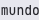 | 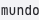 | 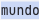 |
| Oscuro |  | 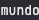 | 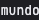 | 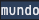 |

| Tema | Sin foco | Colores forzados | Mermaid | CSV Texto | Vista previa |
| --- | --- | --- | --- | --- | --- |
| Claro | 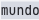 |  | 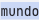 | 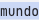 | 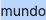 |
| Oscuro | 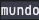 |  | 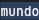 | 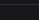 |  |

## Contraste

El fondo se obtiene de los píxeles del recorte, una vez compuesta la línea activa sobre la selección. El texto se mide con el color calculado de `::selection`. La relación se calcula con la luminancia relativa sRGB. Cada caso exige al menos 4,5:1. Los tonos se eligieron con margen sobre 4,5:1 incluso después de componer el fondo de la línea activa. Las tres formas de seleccionar dieron el mismo contraste en cada tema.

| Tema | `--selection` | `--selection-inactive` | Selección activa | Sin foco | Colores forzados |
| --- | --- | --- | --- | --- | --- |
| Claro | `#b7d1ff` | `#cdd3df` | 10,66:1 | 10,90:1 | 11,40:1 |
| Oscuro | `#244a75` | `#404756` | 8,71:1 | 8,85:1 | 9,02:1 |

Mediciones sin redondear en [claro](md-editor-e1-contrast-light.json) y [oscuro](md-editor-e1-contrast-dark.json). Los colores forzados se resuelven desde el sistema en tiempo de ejecución.

## Validación

| Comando | Resultado |
| --- | --- |
| `npm run check` | Cero errores y cero advertencias |
| `FREYALAB_PANDOC_TEST_PATH=/opt/homebrew/bin/pandoc npm test` | 125 archivos correctos, 2.460 pruebas correctas y una omisión del entorno. 17,80 s |
| `FREYALAB_SELECTION_PHASE=after npx playwright test tests/e2e/markdown-selection.spec.ts --workers=1 --output=test-results-e1-after` | Tres pruebas correctas, 6,9 s |
| `FREYALAB_PANDOC_TEST_PATH=/opt/homebrew/bin/pandoc npm run test:e2e -- --reporter=list` | Salida 0, `565 passed` según Playwright, 20,9 minutos. Incluye el fallo esperado preexistente de SEG-S2e |
| `npm run build` | Compilación correcta, también ejecutada al iniciar la suite E2E |

La suite integral ejecutó también el caso de `custom-style` con controles XML que conserva `test.fail` por decisión previa del propietario, SEG-S2e. Su resultado esperado no cierra ese límite de Word. Las pruebas unitarias conservaron una omisión del entorno; Pandoc local informó que no dispone de soporte HTTP.

Para repetir el rojo, ejecutar la CLI de Playwright de esta rama con su `playwright.config.ts`, desde el directorio de una copia limpia y compilada de `22b871f`, y definir `FREYALAB_SELECTION_PHASE=before`. El directorio de trabajo determina el `out/main/index.js` que abre la prueba. Usar una misma instalación de Playwright evita cargar dos instancias del corredor.

## Límites de la evidencia

La comprobación local corresponde a Apple silicon. La emulación de colores forzados no sustituye una prueba manual con el modo de alto contraste de Windows. No se ejecutaron lectores de pantalla físicos, una instalación de paquetes ni mediciones de rendimiento de documentos grandes. La CI de este PR y las plataformas remotas se registran en el PR sobre su head final, sin atribuirles el verde histórico de la base. No se actualizó la app instalada.
