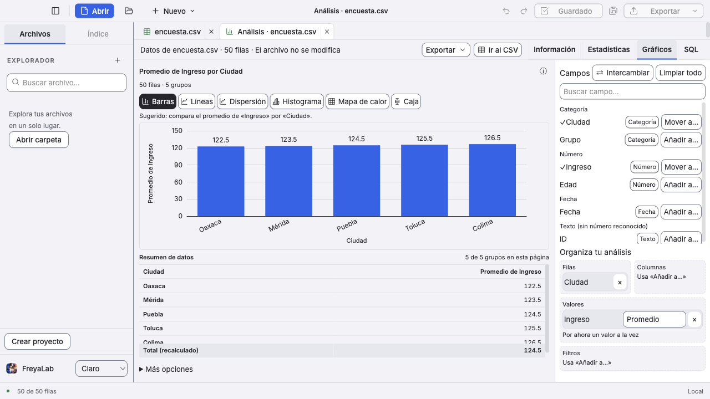
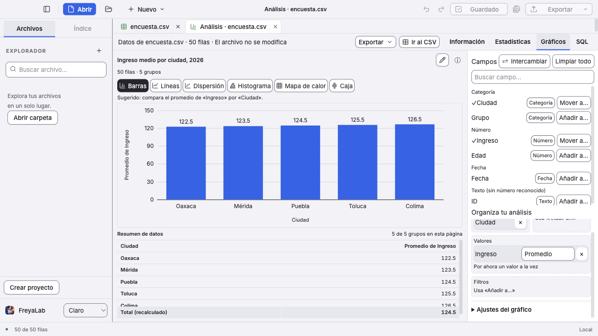

# SIM-2b · Gráficos más claros · Evidencia por fases

Estado documental: 20 de noviembre de 2026. **Cierre local enfocado aprobado: 18/18. Listo para abrir el PR completo en borrador; CI pendiente.** Las capturas posteriores corresponden a `e7598ed64820116e1a348e592778891f879a9e6e`. El cierre sobre `00074b4764f03004246521a9d8de7887a37885e6` incluye la espera de preparación del helper, con producto idéntico según coordinación, y pasó check, unitarias completas, build y el lote enfocado final. La CI calificará el SHA que se publique con estos documentos.

La [historia SIM-2, sección B](../stories/historia-sim2-analisis-graficos-diseno-para-codex.md) y el [alcance con las siete respuestas ADR 0021](../stories/sim-2b-alcance-adr-0021.md) fijan el contrato. B mantiene una sola configuración: Campos/Ajustes del gráfico reúne controles existentes; Detalles del cálculo conserva tabla, SQL, filtros y procedencia. El lápiz edita un título propio con Intro/Escape/vacío, sin recalcular ni cancelar. El título viaja como texto seguro a presets y descripciones de exportación, sin cambiar CSV ni SQL. Cinco etiquetas que caben quedan rectas; treinta nombres largos en Caja giran 25° usando la medida de texto de ECharts.

El propietario aprobó dos condiciones de conservación, después de sus pruebas rojas: mantener una única elección Nombres o códigos/Números para resumir para las medidas agregadas, y mantener la agrupación temporal cuando el perfil contiene fechas válidas —incluido un perfil mixto—, falta el perfil manual o una configuración ya trae agrupación. Se reutilizan controles y handlers; no hay nuevo detector, barrido, conversor, motor, dependencia ni canal IPC. Los casos ordinarios de identificadores/fechas mixtas no se sustituyen por presets para ocultar controles ausentes.

## Resultados conservados

| Fase | Resultado real | Alcance y límite |
| --- | --- | --- |
| Título puro | Rojo: 48 aprobadas/5 fallos de 53; verde: 53/53 | 15 casos nuevos y 38 anteriores; título, esquema estricto, escape, CSV/hash y SQL idéntico. Se conservó un intento 52/53 por exigir `&lt;` frente al escape equivalente `&#x3C;`; solo se corrigió ese oráculo de representación. |
| Rotación pura | Rojo: 4 aprobadas/7 fallos de 11; verde enfocado: 36/36 | Se mide texto/ancho real; no se cambia el ranking para fabricar treinta barras. |
| Seis nuevas E2E de B | Rojo previo a UI: 1 aprobada/5 fallos, 92.539 s de Playwright; verde: 6/6, 41.562 s PW / 41.872 s proceso | Sobre `eb64dd4`, sin omisiones ni reintentos en esos reportes. Cubre título/foco, exportaciones/preset, controles únicos, manual sin perfiles y ambas rotaciones. |
| Dos controles aprobados | Tras corregir setup, rojo real 0/2: 37.103 s PW / 37.454 s proceso | El primer intento buscaba el toggle estrecho antes de que el panel apareciera; no se cuenta como rojo funcional. |
| Seis B + dos controles | Primer lote: 7/8 aprobadas; después 1/1 en 7.056 s PW | Unión de ocho identidades por fases, **no un lote 8/8**. El único rojo intermedio era el oráculo nuevo Texto/Número frente a las etiquetas reales Nombres o códigos/Números para resumir; conserva valores y todos los datos. |
| Consumidores iniciales | 114 aprobadas/5 fallos, 554.308 s PW / 554.667 s proceso | 119 identidades; 0 omitidas y 0 flaky en ese reporte. No es una suite verde. |
| Cuatro correcciones de consumidores | 4/4, 26.151 s PW / 26.445 s proceso | Apariencia de controles anidados; geometría solo de controles visibles con lista no vacía; nueve series como error intencional; Y antes de Month con configuración temporal comprobada. Sin cambiar datos, motor, plazos o retries. |
| TEN/temporal, intento intermedio | 8 aprobadas/2 fallos, 97.295 s PW / 97.587 s proceso | Dos fallos de preparación se conservaron antes del cierre actual; el sondeo de cuatro fixtures no demuestra la causa histórica del resultado AllX. |
| Cierre enfocado actual · `00074b4` | **18/18**, 113.132534 s PW / 113.431 s proceso | Un solo lote: 6B + 2 controles + 9TEN + 1 constructor temporal; 18 intentos aprobados, 0 reintentos/0 flaky/0 omitidas. Se conservan precondiciones de documento/ejes/SQL y todos los oráculos. |
| Checks finales · `00074b4` | Check 0 errores/0 avisos: 9.08 s; build: 1.84 s | Fuente de producto idéntica a la capturada en e759; el siguiente commit documental tendrá su CI propia. |
| Unitarias finales · `00074b4` | 3034 aprobadas/2 omitidas, 170 archivos aprobados + 1 omitido de 171 | Pandoc real 3.12.1; 17.36 s Vitest / 17.712 s proceso. SHA y exit0 registrados en el cierre. |
| Unitarias completas registradas | 3034 aprobadas/2 omitidas, 170 archivos aprobados + 1 omitido de 171; 17.23 s | Pandoc real 3.12.1. El log no contiene SHA: se conserva como fase histórica y no se transfiere al target final. |

Los checks registrados incluyen 0 errores/0 avisos en la fase UI, 294 unitarias enfocadas en 16 archivos, check de `eb64dd4` en 9.706 s y build en 2.005 s. El triage posterior registró check en 8.511 s y el último build conservado en 2.095 s. Estos registros anteriores se conservan como historia; el cierre actual identificado arriba acredita check, unitarias, build y las 18 pruebas enfocadas sobre 00074b4. No acredita una suite E2E integral ni CI.

Los reportes originales permanecen conservados; [proof.json](sim2b-graficos-claros-2026-11-20/proof.json) registra sus SHA-256, estadísticas y los límites de identidad. No se borró el primer rojo, los errores de setup ni los intentos intermedios. La migración de consumidores mantuvo las 799 identidades previas: 736 rápidas y 63 perf/solo, sin pérdida ni duplicados. Los dos controles añadieron dos rápidas: 801 = 738 + 63; esa enumeración no acredita su ejecución integral.

## Comparación visual

[Galería HTML de las 48 capturas](sim2b-graficos-claros-2026-11-20/index.html), sin recursos remotos. Es un índice de PNG originales, no una exportación HTML del producto.

| Matriz | Antes | Después |
| --- | --- | --- |
| Fuente | `4e3289fee36702935c3be9de4eecf420f16225d4` | `e7598ed64820116e1a348e592778891f879a9e6e` |
| Idiomas | es y en-XA | es y en-XA |
| Temas/tamaños | Claro y oscuro; 1440×900 y 1280×720 | Los mismos |
| Estados | Resultado, Ajustes y Detalles | Los mismos |
| PNG | 24 | 24 |

Cada archivo conserva SHA-256, bytes y dimensiones reales en el manifiesto. El mismo CSV sintético de 50 filas conserva SHA-256 `1ca1f0084d88b564e5922040333ba25ed8def9fb590d221bb6ce3ea98344c574`. La comparación mantiene cinco medias 122.5/123.5/124.5/125.5/126.5 y total recalculado 124.5; el título posterior «Ingreso medio por ciudad, 2026» se eligió expresamente. No se presenta como una comparación de títulos idénticos.

| Antes · es/claro/1280×720 | Después · mismo escenario |
| --- | --- |
|  |  |

Las pruebas comprobaron el título en SVG y en el SVG enviado al PNG, preset, JSON/contexto CSV, todas las filas y encabezados CSV, ceros iniciales y su hash. También conservaron el escape HTML/Markdown como dato. Este paquete no inventa ni reconstruye archivos exportados que no quedaron archivados: las salidas independientes de SVG/JSON/CSV no están incluidas; sus aserciones ejecutadas y los reportes son la evidencia disponible. No se acredita apertura en lectores externos.

## Publicación y límites pendientes

- Abrir el PR completo de implementación en borrador contra `main`, conservando el head que se publique. La preparación documental no ejecutó push ni creó el PR.
- Calificar la CI automática del SHA publicado en las plataformas seleccionadas por el plan. El verde local de 00074b4 no se transfiere a CI, a main posterior, Intel, paquete, instalador o lectores externos.
- Conservar la separación: 119 consumidores iniciales terminaron 114/5; cuatro correcciones pasaron aparte; el cierre actual es un lote de 18, no una repetición verde de 119 ni una suite integral.
- La causa histórica de AllX continúa sin demostrarse. El sondeo y las nueve pruebas TEN actuales aprobadas no autorizan atribuirle una causa anterior ni un arreglo de motor.
