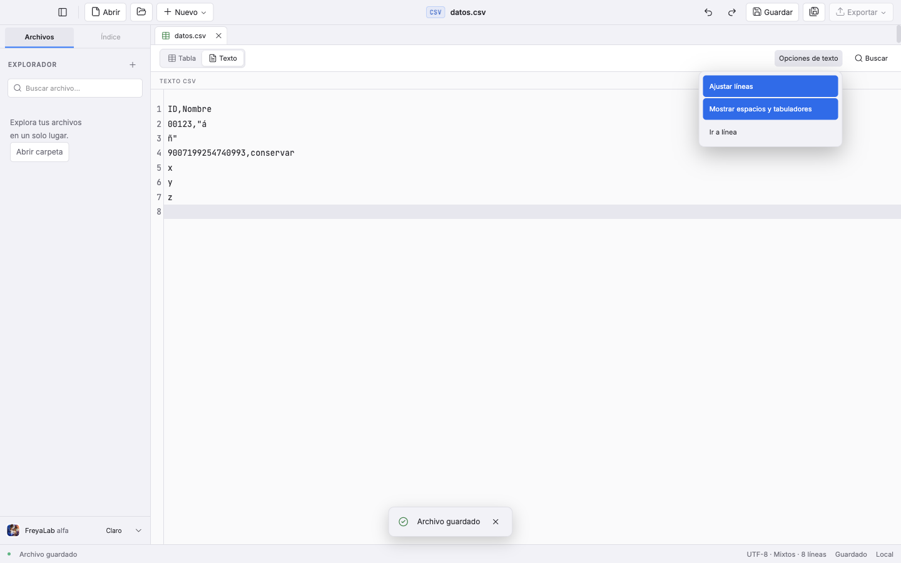
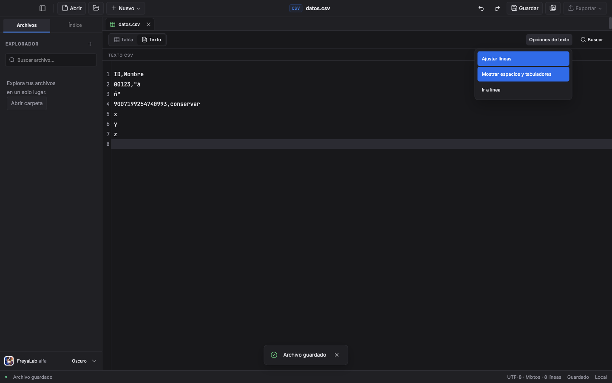

# TXT-01 · CSV como Tabla o Texto · 2026-10-28

Rama `codex/txt-01-csv-texto`, worktree propio `txt-01`, base B1 congelada `c78c9e8` porque `main` seguía en `33a5dfd`. PR89 y sus fuentes de medición no se modifican. Historia leída completa: `docs/stories/7-csv-texto.md`, X1–X23. Node 24; dependencias idénticas clonadas COW, sin instalar. Datos y perfiles sintéticos temporales; raw externo en `/private/tmp/freyalab-lote2/evidence-csv`.

## Dependencia D1 integrada una vez

Tras el bloque A `cedceb5`, el coordinador pidió incorporar localmente D1 `ec53302` antes de seguir B: incluye A0/activos, i18n, protección de literales nuevos y centralización del prefijo de errores IPC. Respaldo `codex/txt-01-pre-d1`; los tres archivos B WIP se copiaron fuera del repositorio con SHA antes/copia/después iguales (`txt-before-d1/manifest.json`). PR89 permanece congelado en `c78c9e8`.

Conflictos en `Documents`, `App` y tipos compartidos, resueltos conservando ambos flujos: `SaveOutcome`, reparación/copia de activos, guardas IME/assetBusy, diagnósticos Mermaid, APIs de idioma y normalización de prefijo en preload; junto con csvView/identidad/guardas Tabla. El historial y código Markdown no se reescriben para TXT. Los contratos nuevos siguen cerrados y limitados a CSV; no se crea API genérica de archivos. Las cadenas nuevas de TXT usan `t()` y catálogos es/en; **pending-files.json es idéntico al de D1**, sin nuevas excepciones ni I18N-03.

Comprobaciones tras resolver: check correcto (Svelte 0 errores/avisos y tipos), 139/139 enfocadas en12 archivos: 71 de i18n/guardas/documentos/TXT y68 adicionales de activos/cambios de imágenes/prefijo IPC/idioma. El primer check durante la preparación encontró únicamente el módulo B modelo ausente; se conserva el intento y el check posterior. Los fuentes y pruebas B WIP no se incluyen en el commit de integración; las comprobaciones nativas previas de A conservan su base anterior y se repetirá su focal por este cambio de integración cuando se coordine la ventana.

## Bloques y evidencia

| Bloque | Rojo real | Estado comprobado |
| --- | --- | --- |
| A · elegir y recordar | Store ausente; 6/6 casos de Documents fallan al pedir Texto; interpretación de Tabla seguía abriéndose en Texto; conmutador realmente ausente en UI | Store 6/6, documentos 9/9, regresiones de apertura/transacciones/etiquetas/imágenes/exportación/SQL: 112 pruebas distintas verdes; check correcto (Svelte 0 errores/avisos, tipos Node). Native: primer intento 2/3; el menú falló por leer un prop después de cerrar. Captura local antes de cerrar → focal 1/1 (1,4 s); conmutador/recuerdo y límite ya verdes. No se presenta como una pasada limpia de tres. |
| B · texto/codificación exactos | CM normalizaba CRLF/mistos; módulos ausentes en recuperación; guardar BOM/UTF-16/1252 fallaba; Enter junto a CR+LF coalescía; estado y controles no existían; búsqueda nativa seguía en inglés | Codec, ledger físico y Documents implementados; check 0 errores/avisos, 131 pruebas enfocadas en 6 archivos. A nativo 3/3 tras integrar D1; B pegado/undo/redo/bytes 1/1 focal. B pegado/undo/redo/bytes y B buscar/regex/reemplazar/undo/Ir a línea pasaron en focales separados; capturas claro/oscuro inspeccionadas. |
| C · cambios pendientes/recuperación | Pendiente | Todavía no implementado. A rechaza cambiar si hay cambios pendientes; no los descarta. |
| D · salida de emergencia | Pendiente | Todavía no implementado. |

A: `csv-view-store` conserva sólo versión, ruta canónica y vista, máximo 500 elecciones; descarta la más antigua, serializa escrituras con `atomicWrite`, tolera preferencias dañadas y conserva el estado anterior si falla escribir. Ruta desaparecida o Texto recordado por encima de 10 MiB equivale a Tabla. Límite probado con 10.485.760 y 10.485.761 bytes.

Un CSV sigue siendo `kind:'csv'`, con `csvView` opcional (ausente = Tabla). El modo Texto posee el camino textual; no mantiene una tabla antigua. Cambiar limpio prepara el destino antes de publicar el mismo ID, cierra el modelo anterior y reinicia la representación. Si falla leer/interpretar/recordar, la representación anterior permanece utilizable. Se comprueban aperturas concurrentes y conservación del original. La revisión de la tabla de vuelta es la de su motor real, sin fingir otra revisión; los resultados de análisis anteriores se olvidan al cambiar modo.

El IPC agrega sólo `csvOpen(path,view)`, `csvView(id,view)` y `csvViewInfo(path)` (tamaño y si admite Texto). Enum cerrado y autorización existente de rutas; el último evita cargar contenido sólo para deshabilitar el menú. Las rutas de Tabla y consumidores de exportación/SQL/Extraer comprueban la representación. No hay API genérica de archivos.

Interfaz A: grupo Tabla/Texto con selección anunciada, menú contextual CSV/TSV por ratón/teclado también en resultados del explorador, Escape y foco de regreso, ayuda y botón Texto deshabilitado por encima del límite. El rojo nativo abrió una tabla real y falló en el grupo ausente (timeout 1 s), antes de cambiar App/Tree. Aún no se declara el modo Texto completo: codecs, fidelidad del editor, toggles, diálogo y aviso de emergencia pertenecen a B–D.

Raw A: `txt-a-store-red.txt`, `txt-a-store-green.txt`, `txt-a-doc-red.txt`, `txt-a-table-guard-red.txt`, `txt-a-doc-green.txt`, `txt-a-focused.txt`, `txt-a-consumers.txt`, `txt-a-concurrency-green.txt`, `txt-a-node.txt`, `txt-a-check.txt`, `txt-a-ui-red.txt` y su trace/snapshot. El primer intento verde de Documents encontró un defecto del adaptador de prueba: `checkpoint` se resuelve en `table-worker`, no existe como método de TableEngine; el adaptador ahora usa `snapshot` real con la misma envoltura del worker. No fue una corrección de producto ni se suavizó una aserción.

El primer verde nativo de A se conserva en `txt-a-ui-green.txt`: dos casos verdes y un fallo del menú al elegir desde resultados TSV. El JS compilado mostraba que `onclose(false)` ponía el estado a null antes de leer el getter reactivo `path`; `txt-a-menu-bug-before.txt` conserva fragmentos y SHA del bundle. Se capturan ruta/callback antes de cerrar; sólo ese caso se repite y pasa **1/1 en 1,4 s** (`txt-a-menu-fixed.txt`). Ambos builds terminaron0 y se confirmó cero Electron al liberar cada ventana.

## Preservación del editor: precondición observada

Sonda pequeña con `EditorState` instalado, sin DOM: `txt-b-cm-precondition.ndjson`. El modo predeterminado cambia CRLF y mixtos al primer `sliceDoc`; un facet LF conserva bytes y edición localizada, pero CR solo queda dentro de una línea CM. Ese atajo no demuestra correspondencia de líneas, selección de emergencia ni undo. No se cambia la sesión Markdown ni se adopta una normalización silenciosa.

## Pendientes

B/C/D completos; mediciones comparables Tabla/Texto a 2/5/9 MiB y línea de 1 MB; capturas finales 1440×900 claro/oscuro; check/unitarias/build/full E2E de cierre, CI4 y paquete. `TableEngine`, dependencias, CI, permisos y aplicación instalada intactos respecto a la base de este bloque. La evidencia de B1 y sus verdes no se transfieren a TXT-01.

## Recuperación del worktree temporal y estado B

Al retomar, `/private/tmp/freyalab-lote2` ya no existía. Git conservaba A `cedceb5` y el merge D1 `789c82c`; ambos índices estaban limpios. El WIP no estaba en commits ni stashes. Se recuperaron cuatro archivos exactos a partir de los eventos FileChange y contenidos de heredoc propios, sin ejecutar comandos antiguos. `txt-restoration-manifest.json` registra SHA antes/recuperado/después en un directorio persistente de esta tarea. Las salidas históricas recuperadas llevan esa etiqueta: no son nuevas ejecuciones ni certifican el estado actual. Se volvió a capturar rojo real con los módulos ausentes antes de restaurarlos.

B mantiene el texto crudo como modelo canónico. CodeMirror presenta LF/CRLF/CR como líneas físicas y guarda un ledger compacto de terminadores por línea; transacciones, pegado y efectos invertidos conservan esos terminadores al deshacer y rehacer. Enter crea una línea nueva sin fusionar accidentalmente un CR previo con un LF; pegar secuencias crudas sí respeta la coalescencia real CR+LF. El cálculo de adyacencias visita las líneas afectadas, no todas las líneas en cada pulsación. El diferencial contrasta 600 ediciones y todos sus pasos undo/redo contra un oráculo de texto crudo. Su primer montaje contaba una operación vacía como paso de historial; se conserva ese fallo y el generador ahora produce ediciones reales.

El codec usa `iconv-lite` ya instalado, la misma detección de prefijo que TableEngine, firma BOM separada e ida/vuelta antes de permitir escritura. Windows-1252 con sustitución U+FFFD abre en solo lectura aunque iconv pueda reemitir 0x9D; caracteres no representables se rechazan con línea física y sin escritura. Documents conserva formato/BOM en la memoria del documento y sigue usando `atomicWrite`/digest. No se cambia el motor tabular.

Comandos enfocados nuevos: `vitest run tests/document-csv-view.test.ts tests/csv-text-codec.test.ts tests/csv-text-model.test.ts tests/i18n.test.ts tests/i18n-audit.test.ts tests/i18n-pending.test.ts`: **131/131, 6 archivos, 2,31 s**. `npm run check`: Svelte **0 errores/0 avisos**, tipos Node correctos. Builds de desarrollo finalizan 0. La suite completa se reserva para la fuente congelada al cerrar B–D.

E2E B: primer intento de invocación no encontró casos por un filtro anclado, guardado aparte como error de invocación. El rojo real falló por estado «Formato del texto CSV» ausente. Primera pasada A+B: **3/4**, B consultaba un botón por rol tras cerrar su menú; se corrigió el montaje para reabrirlo y se conservó la comprobación de foco. El focal B pasó **1/1 en 1,3 s**, comprobando cinco líneas físicas, toggles apagados, pegado mixto, un paso undo/redo y bytes BOM exactos al guardar. No se presenta como un 4/4 limpio. El caso de búsqueda en español tiene rojo real sobre el panel inglés; el verde aún está pendiente.

La primera prueba de búsqueda traducida pasó expresiones regulares, reemplazar todo y undo, pero usó `Alt G` para ir a línea. El keymap instalado realmente define `Mod Alt G`; se corrigen el montaje y la ayuda, sin añadir un atajo propio. Las capturas opt-in iniciales detectaron que el menú nuevo salía unos píxeles del borde derecho; se conserva ese par en raw, se alinea el desplegable a la derecha y se añade una aserción de límites. Las capturas definitivas desactivan únicamente animaciones de screenshot para no fotografiar una transición de tema a medias.

El siguiente focal B confirmó el menú dentro de 1440 px y produjo capturas claras/oscuras sin transición. Buscar/reemplazar/undo volvieron a pasar, pero el localizador de «Ir a línea» omitía el `:` que la propia librería añade a su etiqueta; se conserva ese fallo de montaje. El adaptador instalado no usa `highlightActiveLineGutter`, así que la comprobación de destino verifica el texto de la tercera línea activa (ID largo exacto), no una clase de gutter ausente. No se añade código para acomodar el montaje.

Cierre enfocado B: `txt-b-menu-check-final.txt` confirma **0 errores/0 avisos** y tipos Node; `txt-b-menu-build-final.txt` termina0 con fuente actual. `txt-b-verified.txt` conserva el primer B verde con límites de menú/capturas y el montaje de etiqueta aún fallido; después `txt-b-search-verified.txt` confirma **1/1, 1,2 s** sin reintento para Buscar/regex/reemplazar todo/undo/Ir a línea3. No se atribuye una corrida limpia conjunta a estos focales. Ambas capturas 1440×900 finales se inspeccionaron: menú dentro del borde, texto y controles legibles en claro/oscuro.

