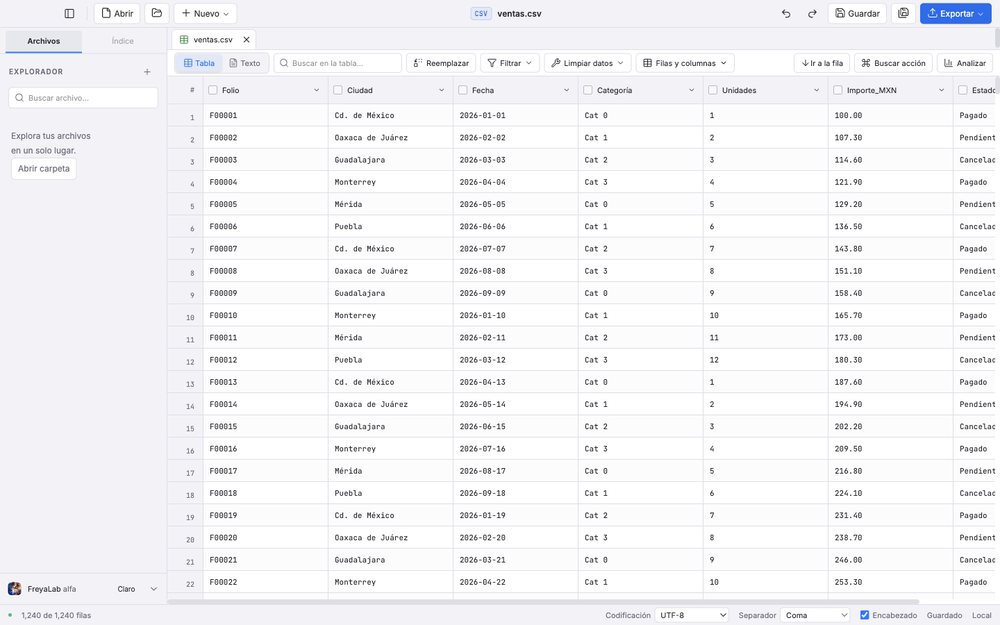
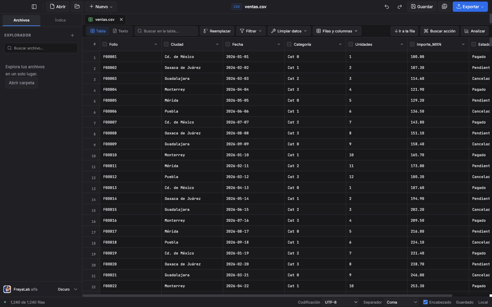
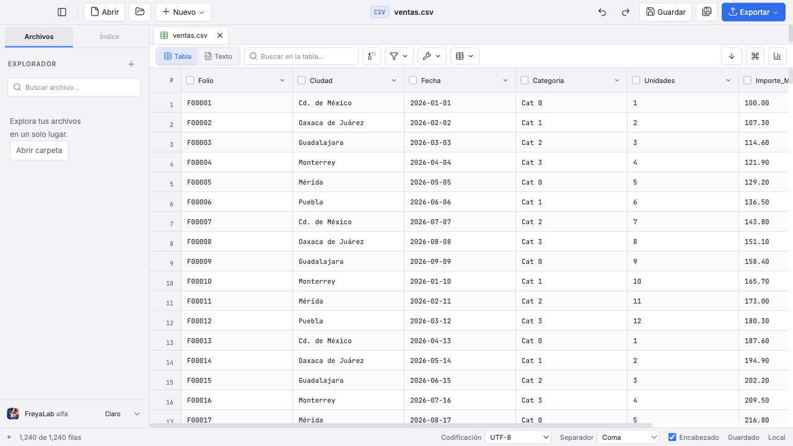
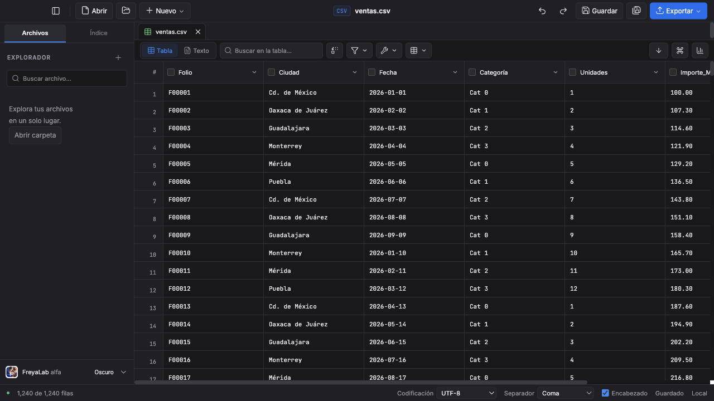

# TXT-01 · Cierre completo de 7d82bda: fallo visual conservado

Fuente/pruebas congeladas en `7d82bdac10553a5abf66833ebb6a5124a5a29f78`. Se ejecutaron las cuatro órdenes completas, una vez:

| Orden | Resultado real | Raw |
|---|---|---|
| `npm run check` | 0 errores, 0 avisos; salida 0 | txt-final-check.txt |
| `npm test` | 1.361/1.361, 69 archivos, 14,65 s; salida 0 | txt-final-test.txt |
| `npm run test:e2e` | 413/414, 11,6 min; salida 1, sin reintentos | txt-final-e2e.txt |
| `npm run build` | salida 0; DQ2Wz-BR | txt-final-build.txt |

La prueba existente `compact-toolbar.spec.ts:33` detectó **gridTop 153 px a 1440×900**, frente al máximo de 110 px. El conmutador nuevo creaba una franja adicional en modo Tabla. No se cambió el límite ni se omitió la prueba. Los 413 casos verdes de este SHA no se presentan como un verde integral sobre la corrección posterior.

Los manifiestos antes/después comprueban que **143 PNG rastreados conservaron SHA-256 y mtime** y **238 archivos de fuentes/pruebas conservaron SHA-256** durante este cierre. Raw: txt-final-png-before/after.json y txt-final-frozen.json. La captura y la traza del único fallo permanecen en test-results/compact-toolbar-una-sola-f-34450--del-borde-superior-o-menos-csv/.

## Corrección enfocada de la altura

Se define un único snippet de controles. Tabla lo recibe en su barra ya existente y Texto lo utiliza en su barra propia. Se reutiliza el modo compacto de la tabla reservando el ancho del conmutador; no se añade CSS ni se cambia el ancho mínimo de la ventana.

`txt-toolbar-focused.txt`: **3/3 en 4,6 s**, sin reintentos: barra compacta con las aserciones anteriores intactas; conmutador con una pestaña y recuerdo; borrador de celda, diálogo y valores reales al cancelar/descartar/guardar. Check 0 errores/avisos y build 0. Las capturas opt-in se inspeccionaron en claro/oscuro a 1440×900 y 1280×720: barra única, fila de controles visible y modo compacto a la anchura menor. Se conservan las aserciones de 110 px y los mínimos de 22/16 filas visibles.

## Medición del código anterior al ajuste visual

La medición de 7d82bda terminó: 21 aperturas, 30,31 s, originales/fuentes/compilado intactos. [Muestras completas](txt-01-medicion-7d82bda.json). Medianas Tabla→Texto: 2 MiB 494,16→118,90 ms y 165,98→55,05 MiB extra; 5 MiB 665,45→153,93 ms y 252,39→92,42 MiB; 9 MiB 874,30→210,40 ms y 329,27→181,41 MiB. La línea de 1.000.000 bytes dio 79,67 ms y 20,34 MiB extra. Mismo equipo/protocolo que 477883c, carga de un minuto 2,42–5,45. Caché de disco caliente, memoria working set estimada, no pico ni garantía universal.

Esta medición queda identificada antes del cambio visual. Se justifica una nueva medición y cierre por un fallo real recién descubierto, después de congelar el ajuste. No se transfieren resultados al siguiente SHA. El cierre global de ventana/sistema con un buffer rechazado >10 MiB sigue sin verificarse; la prueba de seguridad nueva cubre Cerrar pestaña.
